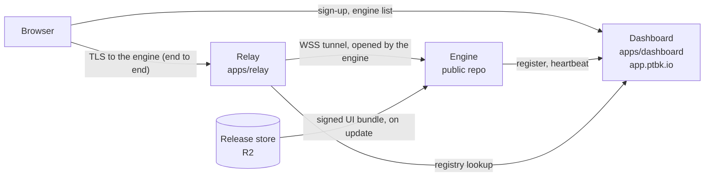
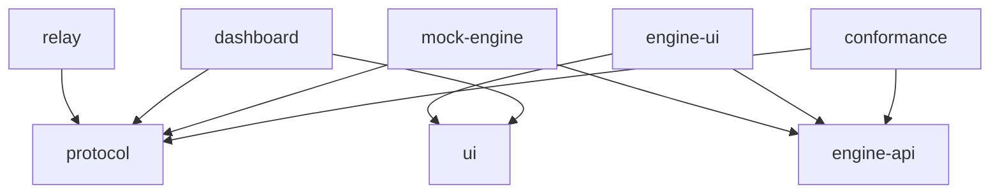

# Architecture

This page maps the [spec](spec/zero-trust-spec.md) onto this repo. The spec explains why; this page says where things live. Module design rules are in [engineering.md](engineering.md).

## The system

- The **engine** runs on the customer's server, holds all data and keys, and serves the full app on `<engineId>.<engine domain>` (or an enterprise custom domain). Its gateway, sign-in, CSP headers and API authorization are open source.
- The **UI** (`apps/engine-ui`) is ours and closed. It is a static bundle that the engine downloads on update, verifies against the release log, and serves from its own origin. We never serve it to browsers ([ADR 0003](adr/0003-ui-as-signed-bundle.md)).
- The **relay** lets browsers reach engines behind NAT. The engine dials out over WSS on 443 and keeps a multiplexed tunnel open. The relay reads the SNI and pipes TLS bytes; it cannot decrypt them. Engines connect to several relays at once, and DNS returns all of them.
- The **dashboard** is the entry point: account, engine list, billing, status. It links to engines and never loads their data.

## Public and private

| Part                                                                           | Repo                            | Why                                                                                                   |
| ------------------------------------------------------------------------------ | ------------------------------- | ----------------------------------------------------------------------------------------------------- |
| Engine: gateway, API, tunnel client, ACME, UI loader, updater, release tooling | `webgptorg/promptbook` (public) | Customers must be able to audit what runs on their server                                             |
| Contracts: `protocol`, `engine-api`, `conformance`                             | here first, then public         | The public engine depends on them; one source of truth ([ADR 0002](adr/0002-public-private-split.md)) |
| Relay                                                                          | here                            | Commercial; it sees only ciphertext, so its code is not part of the trust argument                    |
| Engine UI                                                                      | here                            | Commercial; sandboxed by the open engine and delivered as a signed release                            |
| Dashboard, mock engine, e2e, infra                                             | here                            | Commercial or internal; hold no engine content                                                        |

## Modules

### `apps/relay`

Node 24 on plain VPSs (raw TCP on 443 rules out Workers). One listener on 443, split by SNI: its own hostname terminates TLS and accepts engine tunnels (`/v1/tunnel`); any other SNI is matched against the hostnames of engines connected to this relay (looked up by engine ID at tunnel auth) and piped raw into that engine's tunnel. Unknown or missing SNI is closed.

Owns the server side of the tunnel protocol (spec, Interfaces 3). Caches registry entries for 5 minutes and keeps serving stale ones for at most 24 hours if the dashboard is down. Routes a custom hostname only with a valid claim signed by the engine key.

### `apps/dashboard`

app.ptbk.io. One Cloudflare Worker serving a Vite SPA (TanStack Router, Query and Table, `@ptbk/ui`) and a Hono API ([ADR 0007](adr/0007-frontend-stack.md), [ADR 0008](adr/0008-hono-for-http-apis.md)). D1 via Drizzle with generated, guarded migrations ([ADR 0009](adr/0009-drizzle-and-migrations.md)) for accounts, organizations and the engine registry, a Durable Object per engine for status and offline alarms, Stripe for billing, Cron Triggers for monitoring jobs (CT watch, abuse feeds, public-face check).

Owns engine registration (Interfaces 1), the relay registry lookup (2, internal) and heartbeat ingest (4). Stores accounts, engine IDs, public keys, hostnames and their signed claims, heartbeat metadata and billing state. Nothing else.

### `apps/engine-ui`

The full app for engine owners and members: agents, agent creation and editing, chat, security panel, secrets metadata, audit log. Vite, React, TanStack Router, Query and Table, Tailwind, `@ptbk/ui`, Paraglide (English and Czech). Talks only to the engine API through the `EngineApiClient` interface from `engine-api`. Built to a hashed static bundle with a manifest, signed and logged as part of a release.

### `apps/mock-engine`

Stands in for the real engine until the engine team integrates. Speaks every real contract: registers with the dashboard, dials the relays, serves TLS inside the tunnel, sends signed heartbeats, runs the UI loader and serves the engine API with seeded fake data, scenarios and fault injection. It is also the reference implementation for the engine team.

### `packages/protocol`

Wire contracts between engine, relay and dashboard: registration, registry lookup, tunnel handshake and frame codec, heartbeat, release log and its verification, engine IDs and hostname claims. zod, strict, versioned. Web APIs only.

### `packages/engine-api`

The engine HTTP API that engine-ui consumes and every engine implements. Beyond the core (agents, chats, members, secrets, security, audit), the engine advertises versioned capabilities (`runs@1`, `files@1`, `triggers@1`, `integrations@1`), each a separate contract module, and the UI shows a feature only when its capability is advertised ([ADR 0016](adr/0016-engine-capabilities.md)). Contents: zod schemas, the `EngineApiClient` interface and a `fetch` implementation, and the generated OpenAPI document. Web APIs only.

### `packages/ui`

The private design system shared by engine-ui and the dashboard: tokens, accessible components, forms, `DataTable`, i18n helpers. CSP-safe by construction; imports no app or contract package.

### `packages/conformance`

The test suite any engine must pass: engine API behaviour, tunnel handshake, heartbeat, registration, UI loader checks. Runs against the mock engine in CI now and against the real engine later.

### `e2e` (created in task X-01)

Playwright and Docker Compose: browsers through relays to the mock engine, the network conditions from the spec's spike criteria, UI flows under CSP, the dashboard flow.

### `infra`

Relay hosts, DNS (Cloudflare, DNS-only, so TLS stays end to end) and Cloudflare resources that do not belong to a single app.

## Dependency rules

- `apps/*` may depend on `packages/*`. Apps never import from each other.
- `ui` imports no app and no contract package.
- `protocol` and `engine-api` depend on nothing in this repo and use only Web APIs, so they run in Node, Workers and browsers and can move to the public repo unchanged.
- Cross-app communication goes over the documented interfaces, never shared code paths or a shared database.

## Stack

| Concern         | Choice                                                                                        |
| --------------- | --------------------------------------------------------------------------------------------- |
| Package manager | Bun workspaces ([ADR 0001](adr/0001-bun-workspaces-monorepo.md))                              |
| Runtime         | Node 24 LTS (relay, mock engine), Cloudflare Workers (dashboard), browser (engine-ui)         |
| Language        | TypeScript, strict                                                                            |
| Validation      | zod                                                                                           |
| HTTP APIs       | Hono (dashboard Worker, mock engine); relay uses plain `node:net`/`node:tls` + `ws`           |
| Database        | D1 via Drizzle ORM, generated and guarded migrations                                          |
| UI              | Vite SPAs: React, TanStack Router, Query and Table, Tailwind, Paraglide; shared `packages/ui` |
| Lint and format | ESLint (typescript-eslint, type-checked) and Prettier                                         |
| Tests           | Vitest; Playwright for e2e                                                                    |
| Commits         | Conventional Commits, commitlint, husky                                                       |
