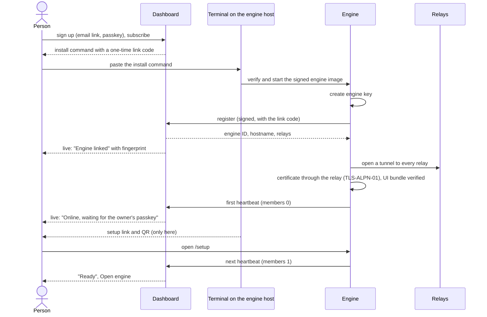

# Onboarding

**Someone who runs, or wants to run, the open Promptbook engine pastes one command, opens one link and creates one passkey. After that, their engine has an address, a certificate, a tunnel, the signed UI and an owner, and we never held a key to any of it.**

This is the product spec for linking an engine to the platform, across every surface the person touches: our dashboard, the engine's terminal and CLI, the engine's open setup and sign-in pages, and the engine UI's first run. It fixes the steps, states, copy, errors and recovery. Visual design follows [ui.md](ui.md); the engine-side requirements behind it are in [installation.md](../engine-integration/installation.md). The spec's [Pairing and identity](../spec/zero-trust-spec.md#pairing-and-identity), [One address for users](../spec/zero-trust-spec.md#one-address-for-users) and [Moving existing deployments](../spec/zero-trust-spec.md#moving-existing-deployments) say why it works this way.

Copy in quotes is the English source text; Czech follows through i18n. Where the copy already exists in the dashboard, this document quotes it and marks changes as gaps.

## Principles

1. **Three actions after sign-up.** Paste a command, open a link, confirm a passkey. Everything else (keys, hostname, certificate, tunnel, UI bundle) happens on its own, and each step reports itself.
2. **Narrate where the person is looking.** The terminal and the dashboard tell the same story in the same order, each from what it can see. Nobody has to switch windows to find out whether something worked.
3. **Every failure has a cause, a meaning and a next step.** An error names what failed, says whether anything is lost, and gives one command or button that fixes it. No stack traces, no "something went wrong".
4. **Zero trust shows as craft, not friction.** The setup link appears only on the engine, because only the engine can make someone its owner. We say that once, warmly, at the moment it matters, and never as a warning wall.
5. **The dashboard says only what it can know.** It sees the link code, the registration, the heartbeat numbers and, through the relays, whether a tunnel is up. It never sees, asks for or shows anything from inside the engine, including the setup link.

## Surfaces

| Surface                                            | Who builds it      | Code                          | Onboarding job                                                                                            |
| -------------------------------------------------- | ------------------ | ----------------------------- | --------------------------------------------------------------------------------------------------------- |
| Dashboard, `app.ptbk.io`                           | Us                 | Private                       | Account, billing gate, link code and install command, live link progress, engine list                     |
| Installer and engine CLI, on the engine's host     | Engine team        | Open                          | Preflight checks, verified install, key, registration, progress, the setup link and QR, recovery commands |
| Engine gateway pages: `/setup`, sign-in, step-up   | Engine team        | Open                          | Owner's first passkey, later sign-ins                                                                     |
| Engine UI first run, `<engineId>.<engine domain>/` | Us (signed bundle) | Private, served by the engine | Welcome, first LLM provider, first agent, invite members                                                  |

The gateway pages are engine code by design: anonymous visitors only ever reach open code ([spec, Architecture](../spec/zero-trust-spec.md#architecture)). We specify their behaviour and copy here. So that the first screen an owner sees matches our UI, we publish a small MIT stylesheet with the design tokens, and the mock engine's `/setup` and sign-in pages are portable, CSP-safe MIT reference pages the engine team may copy ([M-08](../plan/tasks/M-08-mock-engine-onboarding.md)). The engine team owns and reviews whatever it ships.

## What each side can observe

The dashboard's live view is built only from signals it already receives or that relays already hold as routing metadata. None of them is engine content.

| Signal                             | Source today                                                | Dashboard shows                                     | Status                                       |
| ---------------------------------- | ----------------------------------------------------------- | --------------------------------------------------- | -------------------------------------------- |
| Link code issued, expiry           | Dashboard (D-03)                                            | Install command and countdown                       | Built                                        |
| Link code consumed, engine ID      | Registration `POST /v1/engines/register` (D-03)             | "Engine linked", engine ID, fingerprint             | Gap: no live view (D-10)                     |
| Engine running, version, counts    | Signed heartbeat every 60 s (D-05)                          | "Online", version                                   | Built in the list, not live on the link page |
| Owner set up                       | Heartbeat `members` ≥ 1 (0 until the owner's first passkey) | "Owner set up" or "Waiting for the owner's passkey" | Gap (D-10)                                   |
| Reachable through a relay          | Relays report their ready tunnels every 60 s (R-07)         | "Reachable through 2 relays"                        | Built in the list, not live on the link page |
| Certificate issued                 | Public Certificate Transparency logs                        | Not shown in v0                                     | Later                                        |
| Setup link, setup secret, passkeys | Engine only                                                 | Never. The dashboard says where to look instead     | By design                                    |

The engine sees everything about itself and narrates it in the terminal ([installation.md, first-start output](../engine-integration/installation.md#first-start-output)).

## Journey 1: new person, new engine

The spec's v0 flow. Target from landing on `app.ptbk.io` to a signed-in engine: **under 10 minutes** on a VPS with Docker, of which the person actively spends under 3.



### Step 1. Sign up (dashboard, built in D-09)

- `/signup`: "Create your account" → email → "Check your email" → link (15 min, single use) → "Create your passkey". Lands on `/engines`.
- Target: under 2 minutes. The email round trip dominates.
- The empty state already says: "No engines yet" / "Link an engine to this organization to see it here with its status, fingerprint and address. Linking ties it to the organization for routing and billing only; it grants nothing inside the engine." Action: "Link an engine".

### Step 2. Billing gate (dashboard, built in D-07, order to change)

Engines need a paid, verified account ([spec, Abuse on our domains](../spec/zero-trust-spec.md#abuse-on-our-domains), item 4). Decided: a **trial with a card on file** comes before the install command. Today a new account has no plan, and the person finds out only after clicking "Create link code" (toast plus "Your plan does not include engines" / "Subscribe to a plan to link an engine." with "Go to billing").

Target behaviour (gap, [D-10](../plan/tasks/D-10-live-link-progress.md)):

- `/engines/new` checks entitlements on load. Without `engines.create`, the page shows the plan step first: "Choose a plan to link your engine" with the plans inline and "Start your {n}-day trial" (the card is collected by Stripe Checkout; nothing is charged until the trial ends), not an error after a click.
- A trial is offered once per organization. A `trialing` subscription already grants its plan (D-07), so the install command appears as soon as Checkout returns.
- Checkout returns to `/engines/new`, not to `/billing`, with "Thank you, your trial has started." and the link step ready.
- At the engine limit: "Your plan's engine limit is reached" / "Upgrade your plan or remove an engine to link another one." stays as is.

### Step 3. Install command (dashboard, built in D-03, to extend)

Built: "Link an engine", intro copy, "Create link code", then the "Install command" card with "Copy it now: the link code is shown only once.", a copy button and "Expires in m:ss". At zero: "The link code expired" / "Create a new one to link your engine."

Target (gaps, [D-10](../plan/tasks/D-10-live-link-progress.md) and [D-11](../plan/tasks/D-11-install-command-tabs.md)):

- The link code is created on page load once the person is entitled, so the command is there without an extra click. Leaving and coming back creates a new code; old ones simply expire (at most 5 active per organization).
- Tabs for the install paths, the first selected: **Linux server with Docker** (the one-line installer), **Docker Compose** (a `compose.yaml` snippet plus three commands), **Already running Promptbook** (the exact `promptbook-engine connect --link <code>` one-liner for an engine started without a code, and the move from the predecessor, Journey 2). Each tab shows one copyable block with the same link code, so every path is one paste. Docker is the first and only distribution in v0; other forms may get a tab later. Exact commands are in [installation.md](../engine-integration/installation.md#install-paths).
- Under the command, one line: "Run it on the machine that will host your engine. It needs outbound HTTPS (port 443) and nothing inbound." and a link "Requirements and proxies" to the public install guide.
- The intro's "expires after 30 minutes" comes from the configured lifetime, not a hard-coded number.
- Below the card, the live progress panel (step 4) starts in its first state.

### Step 4. Live link progress (dashboard, gap D-10)

The page polls a link-code status endpoint (by a link-code ID returned at issuance, never the code) every 3 seconds while visible and shows a vertical checklist. Each row is text first, with an icon that is never the only signal ([ui.md, Accessibility](ui.md#accessibility)), and the region is an `aria-live="polite"` region announcing only state changes.

| #   | State                 | Copy                                                                                                                                                                                                     | Observed from              |
| --- | --------------------- | -------------------------------------------------------------------------------------------------------------------------------------------------------------------------------------------------------- | -------------------------- |
| 1   | Waiting               | "Waiting for your engine to link. Run the command above; this page updates by itself."                                                                                                                   | Code unused, not expired   |
| 2   | Linked                | "Engine linked." Below: engine ID (short, copy full), the address, and the fingerprint at large size: "Your terminal shows the same fingerprint. Compare them: if they differ, this is not your engine." | Code consumed              |
| 3   | Online                | "Engine online, version {version}."                                                                                                                                                                      | First heartbeat            |
| 4   | Reachable             | "Reachable through {n} relays."                                                                                                                                                                          | Relay tunnel report (R-07) |
| 5   | Waiting for the owner | "Finish setup on the engine: your terminal shows a setup link and a QR code. Only the engine can make you its owner, so we cannot show that link here."                                                  | Heartbeat `members` = 0    |
| 6   | Ready                 | "Your engine is ready." Primary button "Open engine" (`https://<hostname>/`, new tab, no referrer). Secondary: "Back to engines".                                                                        | Heartbeat `members` ≥ 1    |

Rules:

- Rows 3 to 5 may arrive in any order; the list shows them in this order and ticks each when seen.
- After 2 minutes in row 1: add "Nothing yet? The engine reports problems in the terminal. Common causes:" with three links into [Troubleshooting](../engine-integration/installation.md#troubleshooting) (no outbound HTTPS, a proxy, an expired code).
- After 3 minutes in row 2 without row 3: "Linked, but no heartbeat yet. The engine may still be downloading or starting. If the terminal shows an error, it says what to do."
- The countdown stops at row 2; the code is used.
- The page remains valid after a reload by keeping the link-code ID (not the code) in the URL, `/engines/new?link=<id>`, so a person who closes the tab can come back to the progress. The command itself is not shown again.
- If the person leaves, the engine list shows the same states as badges: "Waiting for first heartbeat" (built), "Online", and the new "Owner not set up" (gap D-10).

An optional email "Your engine is online" goes out at the first heartbeat when the person is not on the page (gap D-12), so somebody who walked away during the image download gets the nudge. It contains no setup link, only "Finish setup on the engine's terminal".

### Step 5. The terminal (engine installer, engine team)

The installer and the engine narrate the same steps. The exact output contract, what must and must never be printed, and the failure lines are normative in [installation.md](../engine-integration/installation.md#first-start-output). The happy path reads:

```text
Promptbook engine installer

  ✓ Docker 27.3, linux/amd64
  ✓ Outbound HTTPS works (no proxy)
  ✓ Clock in sync
  ✓ Engine 1.9.0 verified: signed by webgptorg/promptbook, in the public release log
  ✓ Engine started, data in volume promptbook-data
  ✓ Linked to your Promptbook account
        Engine ID     k5dq4t…  (26 characters)
        Address       https://<engineId>.<engine domain>
        Fingerprint   7KQ2-M9XD-4TRA-0VHE-PZ3N   (the dashboard shows the same)
  ✓ Connected to 2 of 2 relays
  ✓ Certificate issued for <engineId>.<engine domain>
  ✓ Engine UI 1.9.0 verified

Your engine is ready. Make yourself its owner in your browser:

  https://<engineId>.<engine domain>/setup#<secret>

  <QR code of the same link>

This link makes whoever opens it the owner. It works once, until 14:32 (30 minutes).
Do not paste it into chats or tickets. A new link: promptbook-engine setup-link
```

- The engine UI comes with the engine: the image carries its own release's UI bundle, so "Engine UI verified" needs no download and no 72-hour wait ([installation.md, The first UI bundle](../engine-integration/installation.md#the-first-ui-bundle)).
- Target: from paste to the setup link in **under 2 minutes** with the image download, **under 30 seconds** once the image is present. The certificate is the slowest step after the download; while it runs, the line reads "… Getting a certificate (usually under 30 s)".
- The setup link is printed only when the address is reachable with a valid certificate and the gateway serves `/setup`. A link that opens onto a certificate error teaches people to click through warnings.
- The QR code is for opening the link on a phone that holds the person's passkeys. It is the same URL; the fragment never leaves the browser.
- The link goes to the interactive terminal only, never to the engine's log stream ([installation.md](../engine-integration/installation.md#the-setup-link)), because container logs get shipped to log services that other people can read.

### Step 6. Owner setup page (engine gateway, engine team)

`https://<engineId>.<engine domain>/setup#<secret>`. The page reads the fragment once, removes it from the address bar (`history.replaceState`), and sends it to the engine only inside the WebAuthn registration request.

| State                             | Heading and copy                                                                                                                                                                       | Action                      |
| --------------------------------- | -------------------------------------------------------------------------------------------------------------------------------------------------------------------------------------- | --------------------------- |
| Valid link, no owner yet          | "Set up your engine" / "You are about to become the owner of this engine. Your passkey stays with you; the engine keeps only its public half." Engine address, engine ID, fingerprint. | "Create passkey"            |
| Passkey prompt open               | "Confirm on your device: fingerprint, face, PIN or security key."                                                                                                                      | (browser prompt)            |
| Passkey cancelled or not allowed  | The same wording as the dashboard's passkey errors ("The passkey prompt was closed or timed out. Try again when you are ready.")                                                       | "Try again"                 |
| Done                              | "You are the owner." / "Sign in from any device with this passkey. To add a device without synced passkeys, use Security in the engine." Short trust-mark seal animation.              | "Open your engine" (to `/`) |
| Link expired                      | "This setup link has expired" / "Setup links work for 30 minutes. On the engine's server, run `promptbook-engine setup-link` for a new one."                                           | none                        |
| Link already used, owner exists   | "This engine already has an owner" / "Sign in with your passkey. If you are the owner and lost every passkey, run `promptbook-engine owner --reset` on the server."                    | "Sign in"                   |
| No fragment or malformed          | "This page needs the setup link from the engine's terminal." Same command hint.                                                                                                        | none                        |
| No passkey support in the browser | "This browser cannot create passkeys." Routes from the spec's table: Windows Hello PIN, a password manager, a phone nearby, a security key.                                            | "Try again"                 |

The page never says which of "expired", "used" or "wrong" applies when that would help someone guessing secrets: wrong and expired secrets get the same "expired" answer; "already has an owner" is public anyway (the sign-in page shows it).

The fingerprint and engine ID let a careful owner check, before creating the passkey, that this is the engine their terminal described.

### Step 7. First run in the engine UI (our bundle)

After setup the gateway signs the owner in and loads the UI. A first-run home replaces the regular owner home until two things exist:

1. "Connect a model provider": add an LLM provider key as a write-only secret ([spec, What our platform can and cannot do](../spec/zero-trust-spec.md#what-our-platform-can-and-cannot-do)). Copy: "Your key is stored on this engine, encrypted. Nobody can read it back, not even you; you can replace it."
2. "Create your first agent": the guided wizard ([ui.md, Key screens](ui.md#key-screens)).

Then optional cards: "Add another device", "Invite a member" (when the engine advertises invites), "Choose how updates install" (update policy, default automatic). The trust mark seals once on the first load with "Private engine: your data stays on your server".

Target: first chat reply within 10 minutes of landing on the dashboard.

## Journey 2: an existing engine operator

The realistic first users already run the predecessor, the open `agents-server` (the `promptbook` repository, `apps/agents-server`, a Next.js app). It reaches them today in four shapes, and none of them has an engine key, a setup secret or passkeys:

| How it runs today                                                                                | Data lives in                                               | First admin                   |
| ------------------------------------------------------------------------------------------------ | ----------------------------------------------------------- | ----------------------------- |
| VPS installer (`install.sh`: git clone, `npm ci`, pm2, nginx, certbot; Ubuntu 24.04, amd64 only) | SQLite and a local S3 under `/opt/promptbook-agents-server` | `admin` with `ADMIN_PASSWORD` |
| Docker image `hejny/promptbook` (stateless, amd64, port 4440, no TLS)                            | An external Supabase                                        | `ADMIN_PASSWORD`              |
| Vercel with Supabase (deploy button)                                                             | Supabase                                                    | `ADMIN_PASSWORD`              |
| `ptbk agents-server start` from npm                                                              | `.promptbook/` in the working directory                     | `ADMIN_PASSWORD`              |

The spec moves them by import into a fresh engine, not by upgrading in place, because the old server code is what this design replaces ([spec, Moving existing deployments](../spec/zero-trust-spec.md#moving-existing-deployments)). Their agents, books and files must survive; their passwords and their nginx must not.

### 2a. Move a predecessor deployment

1. **Dashboard:** Journey 1, steps 1 to 3. The "Already running Promptbook" tab says: "Moving from an existing Promptbook server? Install the new engine next to it, then import your agents. Your old server keeps running until you switch." and links to [installation.md, Moving an existing deployment](../engine-integration/installation.md#moving-an-existing-deployment).
2. **Old server:** the existing admin backup export (Admin → Backup, a ZIP) is the input. Whether `import` reads that ZIP as is, or the old server gets a dedicated export, is the engine team's call; the operator should not need a shell on the old server for a Vercel deployment.
3. **New engine:** installed with the link code as in Journey 1 (same host or a new one; on the same host the installer warns if nginx already holds 443 and explains that the new engine needs no inbound port at all). Then `promptbook-engine import <archive>`. Terminal: counts per kind ("Imported 14 agents, 212 files, 3 users"), never names or content.
4. **Owner:** the setup link as in Journey 1. Imported users see "Register a passkey" at their next sign-in on the new address; password sign-in ends after the grace period (spec proposal: 14 days), or at once in strict mode. The import cannot carry passwords into passkeys, and it must not keep `ADMIN_PASSWORD` as a way in.
5. **Address:** the old domain stays reachable only as an Enterprise custom domain (Journey 4), or as a redirect from the old nginx to the new address. Everyone else gets `<engineId>.<engine domain>`.
6. **Switch off:** stop the old server, its nginx site and certbot timer, and remove inbound firewall rules.

The terminal and the import report say what changed on purpose, so it reads as an upgrade, not a loss: no admin password, no inbound port, no browser shell, no custom JavaScript in zero-trust mode, no error reporting to a third party and no background sync with other servers unless the owner turns them on.

Servers we host today for customers on the shared Vercel deployment are not self-hosted engines. They move by the same import once the customer runs an engine; how we offer that (a guided migration, a deadline, help with a host) is a business decision outside this spec.

### 2b. Link an engine that already runs without the platform

A new engine started in `local` mode (no link code), or in `direct` mode, joins with:

```sh
promptbook-engine connect --link <code>
```

It creates the engine key if none exists, registers, switches to `tunnel` mode, binds to localhost, and prints the same steps as Journey 1. Data stays. Passkeys are bound to the hostname, so passkeys from the old address do not work on the new one: the CLI prints a link that adds a passkey to the existing owner instead of creating a new owner. The dashboard's live progress is the same as in Journey 1, and row 5 ("Waiting for the owner") is skipped because the heartbeat already reports members.

Decided: in v0 this starts from the CLI only, because shell access is the trust level that changing an engine's address needs. The dashboard's "Already running Promptbook" tab shows the exact one-liner with a copy button, so it is still one paste. A "Connect to Promptbook" form in the engine UI comes in v1, designed together with the passkey handover to the new hostname.

### 2c. Engine first (works, not promoted)

Someone may install the engine before having an account: without a link code it starts in `local` mode, listens on 127.0.0.1 only and prints "Not linked. To reach this engine from anywhere, create an account at app.ptbk.io and run `promptbook-engine connect --link <code>`." The owner can use it through `ssh -L` in the meantime. Linking later is Journey 2b. The dashboard and the marketing pages promote account first; the install guide documents this path.

## Journey 3: another engine for an existing account

`/engines` → "Link an engine" → Journey 1 from step 3. The engine switcher's "Add engine" in the engine UI opens the same page ([ui.md, Shell](ui.md#shell)).

## Journey 4: Enterprise custom domain

Agreed individually; no self-service ([D-08](../plan/tasks/D-08-custom-domains.md), runbook in `apps/dashboard/runbooks/custom-domain.md`).

1. The customer picks a subdomain, for example `agents.example.com`. Never an apex (`example.com`): an apex cannot carry a CNAME. The engine refuses an apex with "Use a subdomain such as agents.example.com; an apex domain cannot point here".
2. On the server: `promptbook-engine custom-domain agents.example.com`. It prints the DNS record to create (a CNAME from `agents.example.com` to `<engineId>.<engine domain>`, never to a relay) and the claim to send us: the hostname and its signature in one copyable block.
3. The customer creates the CNAME and sends the block to their Promptbook contact.
4. A platform admin adds it and checks DNS (built, D-08). The engine page shows it under "Custom addresses" (built).
5. The engine notices the relays now route the name, gets its certificate and prints "✓ agents.example.com is live". The owner registers a passkey for the new address from the engine UI (passkeys are bound to the hostname), using an "add this address" link the engine shows.

Gap: there is no customer-facing status between steps 3 and 5. The engine's terminal and Security page are where the customer sees progress.

## Journey 5: members later

Members are added on the engine, never through the dashboard ([spec](../spec/zero-trust-spec.md#pairing-and-identity)). The owner creates an invite link in the engine UI (Members, `POST /invites`, step-up); the invitee opens it on the engine's address and creates their own passkey there. The dashboard learns only the member count from the heartbeat. Dashboard organization members (billing colleagues) are a separate, later feature and grant nothing on engines.

## Failures and edge cases

Each row: what the person sees on each surface, and the way out. Engine-side wording is normative in [installation.md](../engine-integration/installation.md#troubleshooting).

### Link code

| Case                                                                                 | Terminal                                                                                                                                                                                 | Dashboard                                                                                  | Way out                                                |
| ------------------------------------------------------------------------------------ | ---------------------------------------------------------------------------------------------------------------------------------------------------------------------------------------- | ------------------------------------------------------------------------------------------ | ------------------------------------------------------ |
| Expired, used or mistyped (`invalid-link-code`)                                      | "✗ The link code was not accepted. Codes work once and expire after 30 minutes. Create a new one at app.ptbk.io → Link an engine, then run: promptbook-engine connect --link <new code>" | Row 1 stays; at expiry "The link code expired" with "Create a new link code" (built)       | New code; the key and data are kept                    |
| Key belongs to another organization (`engine-exists`)                                | "✗ This engine is already linked to another Promptbook organization. Sign in to that account, or reset this engine to give it a new identity."                                           | Nothing changes; the code stays unused                                                     | Use the right account, or `reset --identity`           |
| Engine revoked or suspended (`engine-suspended`)                                     | "✗ This engine identity was revoked or suspended and cannot be linked again. Give it a new identity: promptbook-engine reset --identity"                                                 | The old row shows "Revoked" or "Suspended" (built)                                         | New identity ([Identity and data](#identity-and-data)) |
| Not entitled or at the limit                                                         | "✗ Your Promptbook plan does not allow another engine. Check Billing at app.ptbk.io."                                                                                                    | Prevented earlier: the plan step (step 2) or "Your plan's engine limit is reached" (built) | Subscribe or upgrade                                   |
| Rate limited                                                                         | "… The platform is busy; retrying in 2 minutes." The engine retries, it does not exit                                                                                                    | "Too many attempts. Wait a minute and try again." when creating codes (built)              | Wait                                                   |
| Dashboard unreachable                                                                | "… Cannot reach app.ptbk.io (timeout). Retrying; check outbound HTTPS and proxy settings if this persists." Retries with backoff while the code is valid                                 | Row 1 after 2 minutes shows the troubleshooting hint                                       | Fix network; the same code works while it is valid     |
| Engine gets someone else's identity back (`engine-id-mismatch`, `hostname-mismatch`) | "✗ The platform answered with an identity that is not this engine's. Not linked. Report this to security@ with the time."                                                                | Nothing                                                                                    | A bug or an attack; never accepted                     |

### Network

| Case                                           | Behaviour                                                                                                                                                                                                                                                                                            |
| ---------------------------------------------- | ---------------------------------------------------------------------------------------------------------------------------------------------------------------------------------------------------------------------------------------------------------------------------------------------------- |
| Behind NAT, no public IP                       | Works without changes: everything is outbound. Nothing to configure; the installer says "Nothing inbound is needed" in its preflight.                                                                                                                                                                |
| Only port 443 outbound                         | Works. Preflight checks HTTPS to the dashboard, every relay and the release store, and names the one that fails.                                                                                                                                                                                     |
| HTTP proxy (`HTTPS_PROXY`)                     | The installer detects proxy variables in the shell and passes them to the engine. Preflight prints "✓ Outbound HTTPS works through proxy http://proxy:3128". A proxy needing credentials goes in the URL; the installer never echoes it.                                                             |
| TLS-inspecting proxy                           | Preflight detects that the relay's certificate is not publicly trusted and stops: "✗ A proxy is inspecting HTTPS. Add its CA certificate with --extra-ca /path/to/ca.pem." The browser still sees the engine's own certificate, end to end; the installer says so in one line, because people worry. |
| Proxy blocks WebSockets                        | Tunnel fails after the upgrade: "✗ The proxy does not allow WebSocket connections to the relays. Ask your network team to allow WebSocket (HTTP upgrade) to the relay hostnames below." with the list.                                                                                               |
| Clock off by more than a minute                | Preflight: "✗ The system clock is {n} s off. Heartbeats and certificates need the right time. Enable NTP (timedatectl set-ntp true)." Later skew shows in the engine's Security page (built in the contract).                                                                                        |
| One relay unreachable                          | "✓ Connected to 1 of 2 relays" with a dim line naming the other and "retrying". Not an error: browsers fall back. The dashboard shows "Reachable through 1 relay".                                                                                                                                   |
| Certificate fails (CA unreachable, rate limit) | "… Certificate not issued yet: {short reason}. Retrying in {time}." The setup link waits. After 10 minutes: a hint to [Troubleshooting](../engine-integration/installation.md#troubleshooting). The dashboard shows Online but not Ready.                                                            |

### Engine offline

- **Never came online after linking:** row 2 stays, then the hint in step 4. The list shows "Waiting for first heartbeat" (built).
- **Went offline later:** the list shows "Offline" after 195 seconds without a heartbeat (built), and one email "Your engine {hostname} is offline" per outage (built). Gap D-12: an "is back online" email closing the incident, and the engine page shows "Last seen {time}. If the server is up, run `promptbook-engine status` on it."
- **Online but not reachable:** heartbeats arrive (they go straight to the dashboard) while no tunnel is up. The list and the engine page show Online with "Not reachable: no relay connection" (R-07); the link to the proxy troubleshooting is D-10's.

### Setup and owner

- **Setup link expired before use:** on the server, `promptbook-engine setup-link` prints a fresh one and invalidates the previous one. It works only while the engine has no owner.
- **Somebody else used the setup link first** (for example, it leaked into a shared log): the dashboard turns "Owner set up" although the person did not do it, and the real owner's setup page says "This engine already has an owner". The way out is `promptbook-engine owner --reset` on the server, which revokes every passkey and session and prints a fresh setup link. The engine's audit log records the first setup with its client IP.
- **Owner lost every passkey:** `promptbook-engine owner --reset` (spec). Terminal: "This removes every passkey and signs out every session. Agents and data stay. Type the first 8 characters of the engine ID to continue." Then the setup link as in step 5. The dashboard plays no part and cannot.
- **Remote access is down and the owner needs in:** `promptbook-engine login --local` prints a one-time link for `http://localhost:4440`, reached through `ssh -L 4440:localhost:4440 <server>` (spec, Operations).

### Identity and data

- **Data directory lost, key gone:** the engine is a new identity. Run the installer with a new link code; it gets a new engine ID and address. In the dashboard, the old engine turns Offline; revoke it so its address cannot be routed again. Bookmarks and passkeys for the old address stop working. The engine's data is gone unless a backup exists (restore needs the backup and its key; passkeys are re-registered through a setup link).
- **Key kept, registration file lost:** a new link code from the same organization re-links the same identity (idempotent, built in D-03); nothing changes for users.
- **Moved to a new server with the data volume:** nothing to do; the identity travels with `PTBK_DATA_DIR`. Two engines must never run from copies of the same volume: the relays accept one tunnel per engine and relay, and the second replaces the first; the engine logs "replaced by another connection with this engine's key" and stops that link. The dashboard sees one engine.
- **Engine key compromised:** dashboard, engine page, "Revoke engine" (built, D-06: step-up, typed confirmation, permanent). Then on the server `promptbook-engine reset --identity`, a new link code, and the owner's setup link. The terminal explains: "A new identity means a new address. Passkeys for the old address will not work here; you will create a new one."

## What we deliberately cannot do

Say these plainly in help and support answers; they are the product.

- We never see the setup link or secret, so we cannot make anyone, including ourselves, owner of an engine, and support cannot "resend the setup link". Only someone with a shell on the server can.
- We cannot reset an owner, add a passkey or a member, or recover an engine's data. `owner --reset` and backups are on the engine.
- We store nothing from inside the engine, not even encrypted: no agent names, no prompts, no files, no member names. The dashboard can show counts and versions, nothing else.
- We cannot show the engine's own status pages in the dashboard, embed it or prefetch it. "Open engine" is a plain link.
- We cannot move an engine between organizations or rename its address: the address is derived from the engine key.

## Time-to-value targets

| Segment                              | Target   | Dominated by                      |
| ------------------------------------ | -------- | --------------------------------- |
| Landing → account with passkey       | < 2 min  | Email link                        |
| Account → install command            | < 1 min  | Checkout (or trial)               |
| Paste → setup link, image not cached | < 2 min  | Image download                    |
| Paste → setup link, image cached     | < 30 s   | Certificate                       |
| Setup link → signed in               | < 1 min  | Passkey prompt                    |
| Landing → first agent reply          | < 10 min | Provider key and the agent wizard |

Measured in X-07 against the local stack with the mock engine, and on staging against the real engine (E-03).

## Gaps and follow-up tasks

What exists today against this spec, as briefs. They run in this order: C-11, then M-08, then D-10, D-11 and D-12; R-07 runs alongside; X-07 closes the flow.

| ID                                                          | Lane        | Scope                                                                                                                                                                                                                                                                                                 |
| ----------------------------------------------------------- | ----------- | ----------------------------------------------------------------------------------------------------------------------------------------------------------------------------------------------------------------------------------------------------------------------------------------------------- |
| [C-11](../plan/tasks/C-11-onboarding-contract-additions.md) | Contracts   | Additive only: `not-entitled` and `rate-limited` in `REGISTRATION_ERROR_CODE`; the engine fingerprint derivation (`ptbk-fingerprint-v1`) moves from `packages/ui` to `@ptbk/protocol`, so the open engine can print and show it                                                                       |
| [M-08](../plan/tasks/M-08-mock-engine-onboarding.md)        | Mock engine | Setup secret, `/setup` with WebAuthn, `connect`, `setup-link`, `owner --reset`, `status`, the first-start output contract, `members` meaning; MIT reference gateway pages and token stylesheet; registration fixes (401 in the fake dashboard, `not-entitled`, `rate-limited`, retry instead of exit) |
| [D-10](../plan/tasks/D-10-live-link-progress.md)            | Dashboard   | Trial with a card (once per organization), entitlement-first plan step, return from Checkout to the link page; live link progress with link-code status, states 1–6, `?link=<id>` resume, TTL copy from config, "Owner not set up" state                                                              |
| [D-11](../plan/tasks/D-11-install-command-tabs.md)          | Dashboard   | Install command tabs (installer, Compose, already running) from configuration                                                                                                                                                                                                                         |
| [D-12](../plan/tasks/D-12-engine-online-emails.md)          | Dashboard   | "Your engine is online" and "back online" emails, offline page hint                                                                                                                                                                                                                                   |
| [R-07](../plan/tasks/R-07-tunnel-presence.md)               | Relay       | Relays report which engines have a ready tunnel; the dashboard shows "Reachable" or "Not reachable"                                                                                                                                                                                                   |
| [X-07](../plan/tasks/X-07-e2e-onboarding.md)                | E2E         | Journey 1 end to end on the compose stack, with the negative paths and the targets measured                                                                                                                                                                                                           |

Engine-side work is listed in [installation.md](../engine-integration/installation.md) and [checklist.md](../engine-integration/checklist.md) (ENG-100 to ENG-110). The configuration names there are the same ones the test harnesses use ([testing-against-the-platform.md](../engine-integration/testing-against-the-platform.md#engine-settings-the-harness-uses)); C-08's launch contract fixes the subset conformance relies on ([identity-and-registration.md](../engine-integration/identity-and-registration.md#launch-contract)).

## Decisions

Taken 2026-10-26. Seb decided 1, 2, 5 and 7, and delegated 3, 4, 6 and 8 with one priority: "secure as well as seamless and very intuitive".

1. **Link flow:** a link code from the dashboard inside the install command; `connect --link <code>` for an engine that already runs. An engine-shown code approved in the dashboard (a device flow) is revisited after v0: it needs a new engine-facing endpoint, and it lets someone talk a person into approving a stranger's engine into their account.
2. **Distribution:** Docker first: a signed multi-architecture image, a verifying installer and a published Compose file. Other forms may come later; the guide stays open to them without specifying them. npm only for local development.
3. **Connecting a running engine:** from the CLI only in v0, shown in the dashboard as an exact one-liner with a copy button. A connect form in the engine UI comes in v1, with the passkey handover to the new hostname designed then.
4. **Account first** is promoted; engine first (local mode, `connect` later) works and is documented, not promoted (Journey 2c).
5. **Billing gate:** a trial with a card on file before the install command (D-10).
6. **No engine contract change** beyond C-11's additive pieces. Progress comes from the registration, the heartbeat (`members` is 0 until the owner's first passkey, normative in installation.md) and the relays' presence reports (R-07).
7. **First UI bundle:** the engine image carries its own release's UI bundle, with the delay counted from the release's trusted log time, and the installer pins only releases already past their delay. Until UI bundles ship inside engine releases, running the installer counts as the owner approving the first bundle by hand. This needs the engine team and the release key holders.
8. **Gateway pages:** we publish a small MIT stylesheet with the design tokens; the mock engine's `/setup` and sign-in pages are portable, CSP-safe MIT reference pages the engine team may copy (M-08). The engine team owns and reviews what it ships.
