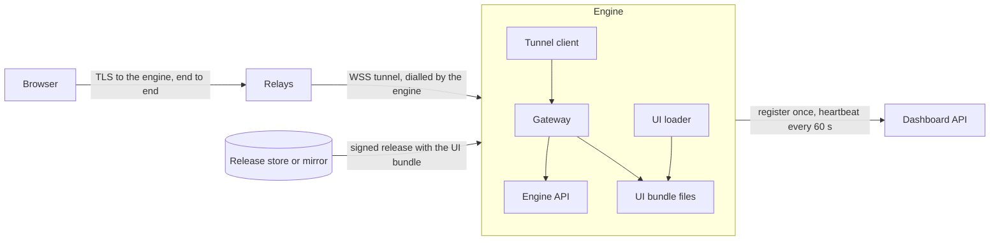

# Engine integration guide

This guide tells the engine team what the open engine must implement to replace the mock engine. For each topic it names what to build, which contract export defines each message, which conformance check proves it, and where the mock engine does the same thing.

The [spec](../spec/zero-trust-spec.md) explains why. This guide is the how, linked to code. When the two disagree, the contract code wins, and the guide says so. The guide never copies a schema: it links to the export, so it cannot drift from the code.

"Must", "must not" and "should" are normative. Everything else is explanation.

## The system, from the engine's side

The engine dials out to every relay in its list and keeps one tunnel open to each. A browser opens TLS to the engine's hostname, the relay reads only the SNI and pipes the encrypted bytes into the tunnel, and the engine ends TLS itself. The engine registers with the dashboard once, sends a signed heartbeat every minute, and downloads, verifies and serves the UI bundle. Nothing in this picture lets us read or change engine content.

## Building the engine with a coding agent

Three files turn this guide into a kit that a coding agent can execute end to end:

- [AGENT_BRIEF.md](AGENT_BRIEF.md): the prompt to paste into the agent. Context, the security rules it must not break, the loop "implement a phase, run the checks, fix until green", and when it is done.
- [implementation-plan.md](implementation-plan.md): the build plan, phase by phase, each with what to read, what to build, the checks that prove it and the commands that run them, mapped onto the engine's codebase.
- [testing-against-the-platform.md](testing-against-the-platform.md): how to test the real engine against our side without our credentials, with a troubleshooting table.

The topic files below stay normative; the kit orders them and points into them. The operator's installation guide, `installation.md`, is forthcoming (task E-05).

## Reading order

| #   | File                                                               | Covers (spec, Interfaces)                                               |
| --- | ------------------------------------------------------------------ | ----------------------------------------------------------------------- |
| 1   | [cryptography.md](cryptography.md)                                 | Encodings and verification rules every signature uses                   |
| 2   | [identity-and-registration.md](identity-and-registration.md)       | Engine key, engine ID, registration (1), configuration (6)              |
| 3   | [tunnel-client.md](tunnel-client.md)                               | Tunnel protocol (3), custom hostnames, ACME through the relay (2)       |
| 4   | [heartbeat.md](heartbeat.md)                                       | Signed heartbeat (4)                                                    |
| 5   | [ui-loader.md](ui-loader.md)                                       | Release log and UI bundle (5)                                           |
| 6   | [engine-api.md](engine-api.md)                                     | The HTTP API the UI uses                                                |
| 7   | [gateway.md](gateway.md)                                           | What the API assumes from the open gateway                              |
| 8   | [conformance.md](conformance.md)                                   | Running the conformance suite against an engine                         |
| 9   | [mock-engine.md](mock-engine.md)                                   | The mock engine as reference implementation                             |
| 10  | [checklist.md](checklist.md)                                       | Every requirement in one table, for your tracker                        |
| 11  | [implementation-plan.md](implementation-plan.md)                   | The build plan, in phases                                               |
| 12  | [testing-against-the-platform.md](testing-against-the-platform.md) | Testing the engine against our stack                                    |
| 13  | [AGENT_BRIEF.md](AGENT_BRIEF.md)                                   | The prompt for a coding agent                                           |
| 14  | [installation.md](installation.md)                                 | Install paths, configuration, first-start output, the setup link (1, 6) |
| 15  | [live-sessions.md](live-sessions.md)                               | Design only: live audio, video and the remote browser tab               |

Interface 2 (the relay's registry lookup) is between the relay and the dashboard. The engine never calls it, but it decides which hostnames the relay routes, so [tunnel-client.md](tunnel-client.md#custom-hostnames) explains what the engine must do for it.

## Contract packages

| Package               | What it defines                                                                                                                     | Version                                                                                                                                                              |
| --------------------- | ----------------------------------------------------------------------------------------------------------------------------------- | -------------------------------------------------------------------------------------------------------------------------------------------------------------------- |
| `@ptbk/protocol`      | Engine ↔ relay and engine ↔ dashboard wire formats: identity, signatures, tunnel, registration, heartbeat, release                  | Each message carries `v: 1`; the tunnel negotiates from `TUNNEL_PROTOCOL_VERSIONS` (`[1]`)                                                                           |
| `@ptbk/engine-api`    | The engine HTTP API the UI consumes, its route table and OpenAPI document                                                           | `ENGINE_API_VERSION` in [constants.ts](../../packages/engine-api/src/constants.ts) (currently `1.11.0`), paths under `/api/v1`                                       |
| `@ptbk/conformance`   | The suite any engine must pass to replace the mock engine                                                                           | Suites `engine-api` (against a URL), and `registration`, `heartbeat`, `tunnel` and `ui-loader` (the harness starts the engine). See [conformance.md](conformance.md) |
| `@ptbk/release-tools` | Node-only release tooling the UI loader uses: the Sigstore provenance verifier, the pinned `trusted_root.json` and the ustar reader | Not versioned yet; see [ui-loader.md](ui-loader.md#reference-implementation)                                                                                         |

All four are MIT and import nothing private; the first three use Web APIs only. They live in this repository, and the engine consumes them from a checkout of it. If they move to a public repository or npm with provenance (task E-02, the engine maintainer's call), the engine depends on the published version instead. Read them here: [protocol](../../packages/protocol/README.md), [engine-api](../../packages/engine-api/README.md), [conformance](../../packages/conformance/README.md) and [release-tools](../../packages/release-tools/README.md), and depend on them by path as [implementation-plan.md](implementation-plan.md#phase-0-setup-and-contracts) shows.

Golden vectors, which an implementation in any language must reproduce:

- [`ed25519-vectors.json`](../../packages/protocol/src/ed25519-vectors.json): accept or reject for 21 Ed25519 edge cases.
- [`signed-message-vectors.json`](../../packages/protocol/src/signed-message-vectors.json): a signed registration request and a signed heartbeat, with their signing inputs.
- [`tunnel/vectors.json`](../../packages/protocol/src/tunnel/vectors.json): a signed handshake and hex frames.
- [`release/vectors.json`](../../packages/protocol/src/release/vectors.json): PAE, key IDs and DSSE envelopes for releases and revocation lists.
- The `signingInput` golden vectors are in [`signing-input.test.ts`](../../packages/protocol/src/signing-input.test.ts).

## Glossary

- **Engine key:** the engine's Ed25519 key pair, created on first start. It signs the tunnel handshake, the registration request, heartbeats and hostname claims, and nothing else.
- **Engine ID:** 26 lowercase base32 characters of SHA-256 over the raw 32-byte engine public key (`deriveEngineId`). Anyone can check that an ID belongs to a key. Because the ID is the key's hash, a key cannot rotate in place.
- **Engine domain:** the separate registrable domain under which every engine gets a hostname. It is configuration, not a constant.
- **Default hostname:** `<engineId>.<engine domain>` (`defaultHostname`). It needs no claim, because it is derived from the key.
- **Custom hostname:** an Enterprise hostname such as `agents.customer.example`, which the customer points at the default hostname with a CNAME and the engine claims with a signature.
- **Hostname claim:** the engine key's signature over a custom hostname and the engine ID (`signHostnameClaim`).
- **Link code:** a one-time code from the dashboard that ties a new engine to an account for routing and billing (`LinkCode`). It grants nothing inside the engine.
- **Relay:** a server that passes browser TLS bytes to the engine through the tunnel without decrypting them. An engine keeps a tunnel to every relay in its list.
- **Relay ID:** the relay's own hostname (`RelayId`), signed into the tunnel handshake so a signature only works for the relay the engine dialled.
- **Gateway:** the small, open engine process in front of the engine API. It ends the browser's TLS, owns sign-in, sessions, step-up, CSRF checks and security headers, and lets anonymous visitors reach only the sign-in, setup and public-agent pages.
- **UI bundle:** our signed, static app UI. It is an artifact (`"kind": "ui"`) of a release; the engine downloads it, verifies it and serves it from its own origin.
- **Release log:** Sigstore Rekor plus the release store. A release is a DSSE envelope signed by the release key and by the release workflow's keyless Sigstore identity.
- **Conformance check ID:** a stable dotted name such as `engine-api.secrets.never-returned`. Renaming one is a breaking change for anyone tracking results.

## How contract changes are proposed

1. Open a pull request against the contract package (here until E-02, then in the public repository). Describe the change and the reason; link a conformance check that proves it.
2. Change by addition. A new optional field is sent only when the peer advertised the feature that introduced it. A breaking change is a new version next to the old one (`/api/v2` beside `/api/v1`, `runs@2` beside `runs@1`, `ptbk-tunnel-v2` beside `ptbk-tunnel-v1`, tunnel protocol 2 beside 1). Nobody ever edits `v1` after the formats freeze.
3. A new signature purpose gets a new signing context; a changed signing input gets a new context version.
4. The wire formats freeze when the contracts are published (E-02), after review by the engine team and an independent cryptography reviewer. Until then, a change is cheap, so raise doubts now.

## Status of the reference implementation

The mock engine implements the engine side of every contract, one task at a time. On `main` today: identity, tunnel client, TLS inside the tunnel, ACME TLS-ALPN-01 through the relay, the engine API with a gateway stand-in, registration and heartbeat, the UI loader with the security headers, the capabilities, and onboarding with the setup link and passkeys. Every mock engine task has merged. The gaps are custom hostname claims, which the mock does not sign ([tunnel-client.md](tunnel-client.md#reference-implementation)), and the operator commands it leaves out, such as `login --local` and `reset --identity` ([installation.md](installation.md#open-points), point 5).

| Task | What the mock engine adds                                                                                                                                                                                         | Status |
| ---- | ----------------------------------------------------------------------------------------------------------------------------------------------------------------------------------------------------------------- | ------ |
| M-01 | Identity, tunnel client, proxy, reconnect                                                                                                                                                                         | merged |
| M-02 | TLS and HTTP inside the tunnel, dev CA                                                                                                                                                                            | merged |
| M-03 | ACME TLS-ALPN-01 through the relay                                                                                                                                                                                | merged |
| M-04 | Engine API, gateway stand-in, faults                                                                                                                                                                              | merged |
| M-05 | UI loader and security headers                                                                                                                                                                                    | merged |
| M-06 | Registration and heartbeat client                                                                                                                                                                                 | merged |
| M-07 | Capabilities (runs, files, triggers, integrations)                                                                                                                                                                | merged |
| M-08 | Onboarding: setup secret, `/setup` with passkeys, `connect`, `status`, `setup-link`, `owner --reset`, registration retry; MIT gateway pages in [`packages/gateway-pages`](../../packages/gateway-pages/README.md) | merged |

## Open points

These are not decided yet. Do not build against a guess: ask, or wait for the decision.

**Decided, so build against them:** relays look engines up by engine ID at tunnel auth, never by hostname; registration proves possession of the engine key (`ptbk-register-v1`); the release signing identity is pinned exactly (issuer, repository, repository ID, workflow path, tag, commit, GitHub-hosted runner, `push` trigger).

**Contract points**

1. **Tunnel (C-02).**
   - `TUNNEL_FEATURES` is empty in v1, so no optional behaviour exists yet. The first feature defines how its additive fields and ignorable frames look.
   - `INITIAL_WINDOW_BYTES` and `MAX_FRAME_PAYLOAD_BYTES` are first guesses; the relay load test (R-05) may change them before the freeze.
   - Whether `OPEN` should also carry the SNI hostname was left out on purpose. The engine reads it from the ClientHello. Say so if you need it.
   - Half-close is not defined: `CLOSE` closes a stream fully, and TLS `close_notify` covers orderly shutdown.
   - The spec's Interface 3 still describes the shorter handshake; the contract code (`reject`, close codes, signed negotiation) is authoritative.
2. **Engine API (C-04, C-07).**
   - The base path `/api/v1`.
   - Run control (`/agents/{agentId}/status`, `start`, `stop`) is `draft`: what start and stop mean for coding agents is not specified.
   - `permanentId` is assumed stable across renames; `profile` is assumed derived from the book and read-only; the file upload format.
   - The permission list, and which routes besides the update policy, API token creation and passkey removal need step-up.
   - The four capability models follow the predecessor and need your review. `GET /activity` uses `agents.read`; an `activity.read` permission is the alternative.
   - Draft test runs (`test-chat@1`, API 1.11.0): the contract fixes that a test stores nothing and is audited once per conversation. Whether it may call the agent's tools and integrations (which can act on the world), and its rate limit, are yours to decide.
   - The mock engine's policy guesses (M-04), to align with you before the freeze:
     - Role to permission table, in [policy.ts](../../apps/mock-engine/src/domain/authorization/policy.ts). C-04 fixes only that the owner holds every permission; the mock gives `admin` everything except `settings.manage`. Role mapping is engine policy.
     - Ownership: without `members.manage`, a member may change (write, delete or run) only agents they created.
     - CSRF: every request other than `GET`, `HEAD` and `OPTIONS` needs a same-origin `Origin` and a `Sec-Fetch-Site` of `same-origin` or `none`. Non-browser clients, such as the conformance runner, must then send both headers.
     - Sign-in counts as a fresh step-up for 5 minutes.
     - Other members' chats: the contract lets a member holding `chats.read` read a chat another member started, read-only ([engine-api.md](engine-api.md#chats)); the mock gives `chats.read` to every role. Whether members may read each other's chats at all is engine policy.
   - Members, invites and sessions (found while building the UI for them, #154 and #163). The UI offers every role and leaves the decision to you, because it never decides by role name:
     - **Owner protection, security-relevant:** nothing in the contract stops a `members.manage` holder from removing the owner or the last owner, or from granting Owner, and no problem code exists to refuse it. The mock and the in-memory engine allow all three. Proposed: refuse them with a dedicated problem code.
     - Which roles a member may assign, and what each role holds, are not exposed, so the UI cannot hide roles the engine will refuse.
     - Invites carry no recipient or label and have no maximum lifetime. How `Member.status: 'invited'` relates to the `Invite` object is not specified.
     - Sessions carry only IP and user agent, and nothing says when `lastSeenAt` must be updated.
     - The member and invite routes are `draft`; the UI hides management when `GET /invites` answers 404.
   - Decided for the next additive engine API version, not in the contract yet: `build: "conformance"` in `GET /engine`, so the conformance runner can tell a conformance build apart. Today only the startup log says so ([ui-loader.md](ui-loader.md#open-points-decided-2026-10-26)).
   - The gateway's sign-in rules added with X-07 (#125, #127), in [gateway.md](gateway.md): a MUST that the redirect to sign-in keeps the requested path in `next` ([anonymous access](gateway.md#anonymous-access), `engine-api.gateway.sign-in-keeps-next`, ENG-94), and a SHOULD that the sign-in page detects an existing session through same-origin `GET /api/v1/me` and goes on to a validated `next` ([sessions](gateway.md#sessions)).
3. **Release log (C-06).**
   - The revocation threshold is not in the spec. `DEFAULT_REVOCATION_RULE` is the proposal: the release key or any one maintainer key (stopping a release is the safe direction).
   - Who signs the revocation list, and how often it is re-signed. A list is valid for at most 30 days (`REVOCATION_MAX_VALIDITY_MS`).
   - A second revocation channel (Rekor search by payload hash).
   - An optional torsion-free check of the engine key at registration, beyond the small-order check.
   - No revocation list is published yet. Because `verifyRelease` refuses every release without a fresh list, an engine cannot install its first UI bundle until one is.
   - Where the engine fetches releases: proposed as the [release mirror layout v1](ui-loader.md#release-mirror-layout-v1) (2026-10-26), which the conformance suite serves; it is open for your review until the E-02 freeze. Find the UI artifact by `kind: 'ui'` in the release entry, not by name.
   - Which release carries the UI. The spec makes the UI bundle an artifact of the engine's own release, so one `WorkflowIdentity` covers both. Until the engine's release tooling carries it, UI releases are published as their own entries, tagged `ui-v<version>` and signed by our UI release workflow, which is a different identity. Which identity, or identities, the engine pins for the UI is open.
4. **Registration and heartbeat (C-03).**
   - The dashboard's registration endpoint (D-03) answers the statuses listed in [identity-and-registration.md](identity-and-registration.md#errors-and-re-registration); the contract fixes only the codes (`REGISTRATION_ERROR_CODE`) and the statuses of `engine-exists` (409), `engine-suspended` (403), `not-entitled` (403) and `rate-limited` (429). The heartbeat endpoint (D-05) answers the statuses and codes listed in [heartbeat.md](heartbeat.md#failure-handling); they are not contract constants yet.
   - To confirm in the engine-team review: the registration failure rules the conformance suite now checks (the output names the problem `code`; final codes are never retried; otherwise at least 5 s before the first retry, with backoff; nothing stored from a refused registration), in [identity-and-registration.md](identity-and-registration.md#errors-and-re-registration).
   - Whether the heartbeat carries an organisation ID. It does not today.
   - How a hostname claim reaches the dashboard. Custom domains are set up by hand (D-08): the engine produces the claim, and an administrator enters it. No engine-facing endpoint exists for it.

**Engine design points**

5. **Conformance sessions (C-05).** Decided 2026-10-26: a `conformance-session` command that only the conformance build has, refused in production builds and never an HTTP endpoint ([launch contract](identity-and-registration.md#conformance-sessions)). Open: how the build-time gate looks in the engine's build.
6. **ACME client.** The production ACME client is your choice. `acme-client@5.4.0`, which the mock engine's Pebble spike uses (M-03), has been unmaintained since 2024; it sits behind one port, `CertificateIssuer`, so any client fits.
7. **Audit checkpoints.** The payload, cadence and publication of engine-signed audit checkpoints (`ptbk-audit-checkpoint-v1`, not yet in `SIGNING_CONTEXT`). C-04 adds a `checkpoint` field to `GET /audit/verify` in a later change. See [engine-api.md](engine-api.md#audit).
8. **Who builds the engine side, and when.** An open decision for the engine team. This guide's review gate depends on it.

**Live sessions** (design only, [live-sessions.md](live-sessions.md))

13. **Live audio, video and the browser tab.** Reserved, not buildable yet: the capability names, the two `draft` open routes and the channel path. Open for you: the audio formats the voice harness takes, the channel's message format, the browser tab's origin allowlist (identity provider redirects included) and whether one tab of a shared browser can be screencast and driven without disturbing other engines. Do not advertise these capabilities; `engine-api.live.reserved` fails if you do.

**Integration points** (raised while writing the [implementation kit](#building-the-engine-with-a-coding-agent))

9. **Consuming the contracts.** Decided: the engine consumes them from a checkout of this repository, by path ([implementation-plan.md](implementation-plan.md#phase-0-setup-and-contracts)). That is the supported way. Publishing them (E-02) and making the engine's work public are the engine maintainer's call; E-02 records our recommendations for it (package versions with a built `dist`, and moving `@ptbk/release-tools` too).
10. **Engine settings.** Decided: the spec's Interface 6 now lists the mock engine's `PTBK_*` names (engine domain, dashboard URL, link code, relay override, release store, ACME directory), aligned with the [launch contract](identity-and-registration.md#launch-contract) ([testing-against-the-platform.md](testing-against-the-platform.md#engine-settings-the-harness-uses)).
11. **Test releases for a real engine.** Decided: a [conformance build](ui-loader.md#testing-the-loader-conformance-build), enabled by a compile-time constant that release builds turn off, may read `PTBK_CONFORMANCE_TRUST_FILE`, and production builds refuse to start when it is set; the same build ships the `conformance-session` command. The loader's remaining decisions are in [its open points](ui-loader.md#open-points-decided-2026-10-26). Re-signing the local stacks' UI releases so that build installs them is in E-03's scope; until then the stacks prove everything but the UI ([testing-against-the-platform.md](testing-against-the-platform.md#b-the-local-dev-stack)).
12. **The reference implementation stays private.** ADR 0002 keeps the mock engine and the e2e stack in this repository. The guide links to them because the engine team reads this repository.

**Review.** This guide waits for review by the engine team contact, or by a maintainer until one is named. Questions from that review are answered in the guide or added here.
