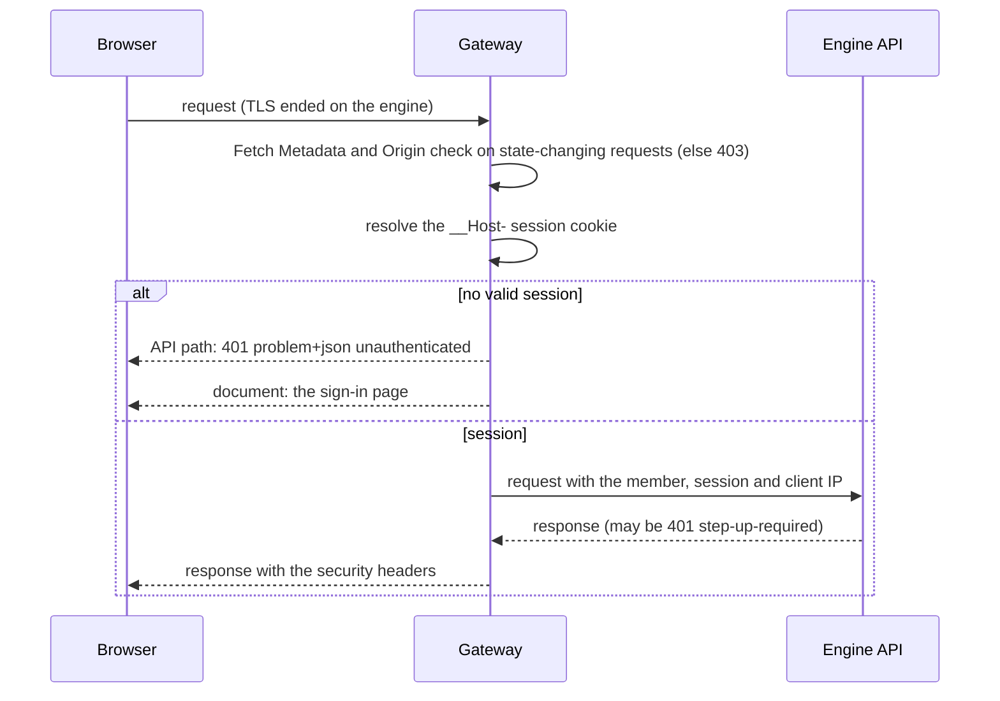

# Gateway

The engine API assumes an open gateway in front of it. The gateway ends the browser's TLS, owns sign-in and sessions, rejects cross-site requests and sends the security headers, so the app server never sees an unauthenticated request. It is engine code, open source and small enough to audit; the API contract only states what it relies on.

Spec: [Security hardening](../spec/zero-trust-spec.md#security-hardening) 1, 5 and 8, [Engine security baseline](../spec/zero-trust-spec.md#engine-security-baseline) (Sessions, Browser headers), [Pairing and identity](../spec/zero-trust-spec.md#pairing-and-identity). ADR: [0003](../adr/0003-ui-as-signed-bundle.md).

## Request flow

## What the engine must do

### Sessions

- Sign-in is passkeys only (WebAuthn on the engine's own hostname). There is no password fallback.
- Keep sessions on the engine with 128-bit random IDs, a new ID on every sign-in, idle and absolute timeouts, and revocation of one or all sessions. A revoked session, or the session of a removed member, fails within one request.
- Send the session as a `__Host-` cookie with `Secure`, `HttpOnly`, `SameSite=Strict` and `Path=/`. The cookie is the only credential the UI uses: the UI's client sends `credentials: 'same-origin'` and never reads the cookie. Its name is the gateway's choice; the OpenAPI document shows `__Host-ptbk-session` for illustration.
- Should give a session's engine API ID (`GET /sessions`, `GET /me/sessions`) a value separate from the cookie, so members who list sessions never see a credential.
- Keep the gateway pages at `SIGN_IN_PATH` (`/auth/sign-in`), `SIGN_OUT_PATH` (`/auth/sign-out`) and `STEP_UP_PATH` (`/auth/step-up`), and the setup page at `/setup`. The UI links to these constants; `ENGINE_RESERVED_PATHS` must never be served from the UI bundle.

### Anonymous access

- Anonymous visitors reach only the sign-in page, the WebAuthn endpoints, the setup-secret page and agents the owner marked public (with rate limits). Everything else needs a session. An anonymous scan of an engine reaches nothing else.
- An anonymous engine API call answers 401 `application/problem+json` with code `unauthenticated` and no resource data. An anonymous document request gets the sign-in page (or a redirect to it).
- Webhooks for integrations pass only on allowlisted paths with their own signature check.

### Cross-site protection

- Reject cross-site requests with Fetch Metadata before any other code runs: a state-changing request (anything but `GET`, `HEAD`, `OPTIONS`) answers 403 unless `Sec-Fetch-Site` is `same-origin` or `none` and `Origin` is the engine's own origin.
- No CORS: the API is same-origin only.
- Whether this applies to every route, public ones and non-browser clients included, is an [open point](README.md#open-points): the mock engine applies it literally, so the conformance runner must send `Origin` and `Sec-Fetch-Site` too.

### Step-up

- For routes flagged `stepUp`, require a fresh passkey assertion. Without one, answer 401 problem+json with code `step-up-required`; the UI sends the member to `STEP_UP_PATH` with a return address and retries ([engine-api.md](engine-api.md#step-up)).
- Changing the update policy always needs step-up and is audited.
- How long a sign-in counts as a fresh assertion is engine policy; the mock engine uses 5 minutes ([open points](README.md#open-points)).

### Security headers

- Send `ENGINE_UI_CSP` from `@ptbk/engine-api`, byte for byte, as the `Content-Security-Policy` of the UI and the gateway's own pages: `default-src 'self'`, `script-src 'self'`, no `unsafe-inline` or `unsafe-eval`, no external origins, `frame-ancestors 'none'`, `require-trusted-types-for 'script'` and the single Trusted Types policy `ptbk-html`. The UI bundle is built and tested against exactly this string; never use a local copy or the manifest's `csp`.
- Also send `Strict-Transport-Security`, `Cross-Origin-Opener-Policy: same-origin`, `Referrer-Policy: no-referrer` and `X-Content-Type-Options: nosniff` on every response. Serve file downloads as attachments with `nosniff`.
- The gateway pages themselves have no inline script or style.
- Agent output never becomes executable: the UI sanitises markdown and shows external images as links, and the CSP backs that up.

### Audit and rate limits

- Audit sign-in, sign-out, step-up, passkey and session events (`auth.*`, `passkey.*`, `session.*` in `AUDIT_ACTIONS`) with the member, the client IP from the tunnel's `OPEN` frame and the user agent.
- Rate-limit anonymous endpoints per client IP.

## Contract exports

| Need                 | Export                                                                                        | Source                                                             |
| -------------------- | --------------------------------------------------------------------------------------------- | ------------------------------------------------------------------ |
| Gateway paths        | `SIGN_IN_PATH`, `SIGN_OUT_PATH`, `STEP_UP_PATH`, `ENGINE_RESERVED_PATHS`                      | [constants.ts](../../packages/engine-api/src/constants.ts)         |
| Content policy       | `ENGINE_UI_CSP`                                                                               | [constants.ts](../../packages/engine-api/src/constants.ts)         |
| Problem codes        | `unauthenticated`, `step-up-required`, `forbidden` in `PROBLEM_CODES`                         | [problem-codes.ts](../../packages/engine-api/src/problem-codes.ts) |
| Session cookie (doc) | the `sessionCookie` security scheme in [openapi.json](../../packages/engine-api/openapi.json) | [openapi.ts](../../packages/engine-api/src/openapi.ts)             |

## Conformance

C-05 v1 checks that every route answers 401 problem+json without credentials and leaks no resource data, and that a state-changing request with `Sec-Fetch-Site: cross-site` answers 403. The gateway check can be skipped for an engine API run without its gateway. Session acquisition for the suite is an open point ([conformance.md](conformance.md#sessions-on-a-real-engine)).

## Reference implementation

- **Headers on every in-tunnel response: merged (M-02), partly.** [http-app.ts](../../apps/mock-engine/src/adapters/http/http-app.ts) sends `ENGINE_UI_CSP`, `Cache-Control: no-store` and `X-Content-Type-Options: nosniff` on every response. The full header set is pending M-05.
- **Sessions, sign-in, CSRF and step-up: Reference implementation: pending M-04** (a gateway stand-in with a dev-only login, in progress). It is a stand-in for tests, not a port of the real gateway: the real gateway uses passkeys.
