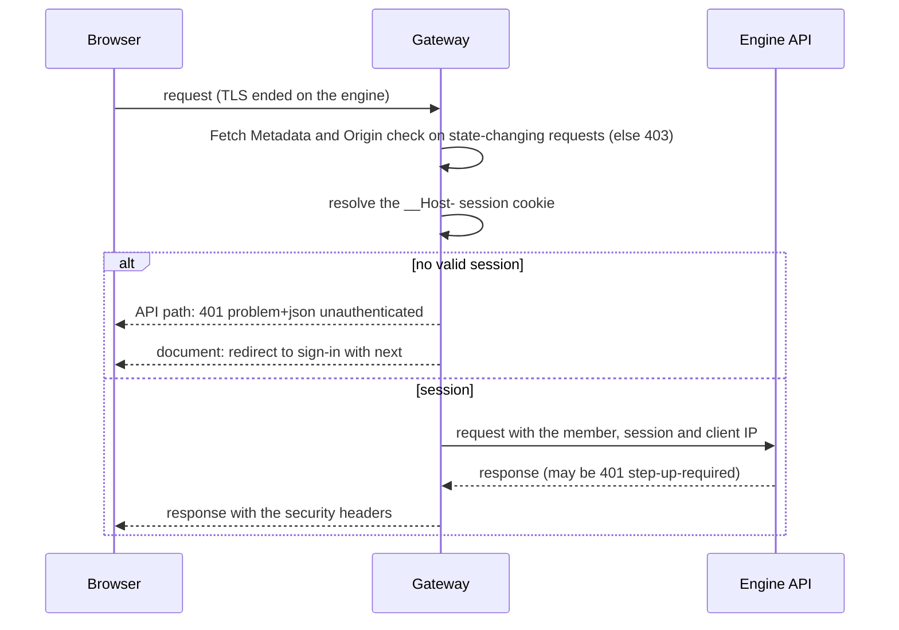

# Gateway

The engine API assumes an open gateway in front of it. The gateway ends the browser's TLS, owns sign-in and sessions, rejects cross-site requests and sends the security headers, so the app server never sees an unauthenticated request. It is engine code, open source and small enough to audit; the API contract only states what it relies on.

Spec: [Security hardening](../spec/zero-trust-spec.md#security-hardening) 1, 5 and 8, [Engine security baseline](../spec/zero-trust-spec.md#engine-security-baseline) (Sessions, Browser headers), [Pairing and identity](../spec/zero-trust-spec.md#pairing-and-identity). ADR: [0003](../adr/0003-ui-as-signed-bundle.md).

## Request flow

## What the engine must do

### Sessions

- Sign-in is passkeys only (WebAuthn on the engine's own hostname). There is no password fallback.
- Keep sessions on the engine with 128-bit random IDs, a new ID on every sign-in, idle and absolute timeouts, and revocation of one or all sessions. A revoked session, or the session of a removed member, fails within one request.
- Send the session as a `__Host-` cookie with `Secure`, `HttpOnly`, `SameSite=Strict` and `Path=/`. The cookie is the only credential the UI uses: the UI's client sends `credentials: 'same-origin'` and never reads the cookie. Its name is the gateway's choice; the OpenAPI document shows `__Host-ptbk-session` for illustration.
- Should let the sign-in page resume an existing session: before offering the passkey, it asks `GET /api/v1/me` from the same origin and, on 200, goes on with `location.replace` to `next` if `isSafeNextPath` accepts it, else `/`. The reason: the dashboard's "Open engine" and any other link from another site arrive without the `SameSite=Strict` cookie, so the gateway sends a signed-in member to sign in; the page's own request carries the cookie. The cookie stays `Strict`, and the check is a side-effect-free `GET`. The reference sign-in page does this (X-07). Since a link from another site then opens the engine signed in, the UI must never change state on load from URL or path parameters: every write waits for the member's own click or submit.
- Should not leave someone without a passkey for this engine on this device at an empty passkey prompt. The reference sign-in page opens the prompt only on a click, and under the button and after a cancelled, failed or unrecognised passkey it names the ways forward: the phone option in the browser's prompt, a synced passkey or the device that has it, and opening the engine from the Promptbook dashboard, which starts the join. There is no way yet to add a device from a signed-in one ([spec, Devices](../spec/zero-trust-spec.md#pairing-and-identity)).
- Should give a session's engine API ID (`GET /sessions`, `GET /me/sessions`) a value separate from the cookie, so members who list sessions never see a credential.
- Keep the gateway pages at `SIGN_IN_PATH` (`/auth/sign-in`), `SIGN_OUT_PATH` (`/auth/sign-out`) and `STEP_UP_PATH` (`/auth/step-up`), and the setup page at `/setup`. The UI links to these constants; `ENGINE_RESERVED_PATHS` must never be served from the UI bundle.

### Anonymous access

- Anonymous visitors reach only the sign-in page, the WebAuthn endpoints, the setup-secret page and agents the owner marked public (with rate limits). Everything else needs a session. An anonymous scan of an engine reaches nothing else.
- An anonymous engine API call answers 401 `application/problem+json` with code `unauthenticated` and no resource data.
- An anonymous document request (a top-level `GET` outside the engine API) gets a redirect to `SIGN_IN_PATH` that carries the requested path and query, as received and URL-encoded, in `next`, so the sign-in page returns there; `/agents/abc?tab=chat` goes to `/auth/sign-in?next=%2Fagents%2Fabc%3Ftab%3Dchat`. Only a value `isSafeNextPath` accepts goes into `next`: never another origin, `ENGINE_RESERVED_PATHS` or `/` itself, which go to `SIGN_IN_PATH` without `next`. The fragment never reaches the server, so it is lost. Never log the path: it can hold IDs. API calls keep their 401. Checked by `engine-api.gateway.sign-in-keeps-next`.
- Webhooks for integrations pass only on allowlisted paths with their own signature check.

### Access requests

- Serve the join page at `/auth/join`. The dashboard sends a person there with an access ticket in the fragment, so it never reaches the server's logs or a `Referer`; the page posts it to the gateway.
- Accept the ticket only if its signature verifies against the dashboard member key pinned at registration, it names this engine, it has not expired, and its `ticketId` was never used. Then register a passkey on the engine's hostname and store a pending request ([engine-api.md](engine-api.md#access-requests)). Refuse past `MAX_PENDING_ACCESS_REQUESTS` with a plain "too many pending requests" page.
- Show the 6-digit code the approver will ask for, generated by the engine with a CSPRNG, and sign the person in once the request is approved: the status answer that reports `approved` sets the session cookie, and the page goes on to `next` without another prompt. A ticket for a `dashboardUserId` that is already an active member just sends them to sign in.
- The page's JSON endpoints are contract, so the conformance suite can drive them without a browser: `JOIN_OPTIONS_PATH`, `JOIN_VERIFY_PATH` and `JOIN_STATUS_PATH` in `@ptbk/engine-api`, with the bodies and answers documented there and `JOIN_PROBLEM`'s codes. Spend a `ticketId` only once its passkey verified, so a cancelled prompt can try again. You MUST keep spent `ticketId`s durably until the ticket expires (its `expiresAt`, plus the 120 s skew if your clock can step back): write the ID to storage before storing the request, and read the IDs back at start, so a restart cannot let a ticket make a second request (`member-access.ticket.spent-across-restart`). The reference page asks for status at most every 3 s and retries a network failure, 429 or 5xx quietly, so status may answer at once or hold its answer a few seconds (under the page's 15 s timeout) while the request waits.
- The reference page is `join.html` in `@ptbk/gateway-pages`; the mock engine serves it.
- Rate-limit the join endpoints like sign-in. Anonymous visitors without a valid ticket reach nothing more than the page itself.

### Cross-site protection

- Reject cross-site requests with Fetch Metadata before any other code runs: a state-changing request (anything but `GET`, `HEAD`, `OPTIONS`) answers 403 unless `Sec-Fetch-Site` is `same-origin` or `none` and `Origin` is the engine's own origin.
- No CORS: the API is same-origin only.
- Whether this applies to every route, public ones and non-browser clients included, is an [open point](README.md#open-points): the mock engine applies it literally, so the conformance runner must send `Origin` and `Sec-Fetch-Site` too.

### Step-up

- For routes flagged `stepUp`, require a fresh passkey assertion. Without one, answer 401 problem+json with code `step-up-required` ([engine-api.md](engine-api.md#step-up)). The UI then opens `STEP_UP_PATH?mode=popup&nonce=…&returnTo=…` in a small window and, once that page answers, sends the same request again; secrets the member typed stay in the UI's memory for that. Only if the browser blocks the window does the UI navigate to `STEP_UP_PATH?returnTo=…` and come back.
- Serve the step-up page for both. Accept `mode=popup` and a `nonce` of 16 to 64 base64url characters in its query (a strict parser must not refuse them). In popup mode the reference page (`step-up.html` and `gateway.js` in `@ptbk/gateway-pages`) starts the prompt at once and, after verify succeeds, posts `{ type: 'step-up-confirmed', nonce }` on the same-origin `BroadcastChannel('ptbk-step-up')` and to `window.opener`, then closes; it never navigates. Nothing changes on the server: verify answers as before.
- Changing the update policy always needs step-up and is audited.
- How long a sign-in counts as a fresh assertion is engine policy; the mock engine uses 5 minutes ([open points](README.md#open-points)).

### Security headers

- Send `ENGINE_UI_CSP` from `@ptbk/engine-api`, byte for byte, as the `Content-Security-Policy` of the UI and the gateway's own pages: `default-src 'self'`, `script-src 'self'`, no `unsafe-inline` or `unsafe-eval`, no external origins, `frame-ancestors 'none'`, `require-trusted-types-for 'script'` and the single Trusted Types policy `ptbk-html`. The UI bundle is built and tested against exactly this string; never use a local copy or the manifest's `csp`.
- Also send, on every response (UI files, API, gateway pages, errors): `Strict-Transport-Security: max-age=31536000`, `Cross-Origin-Opener-Policy: same-origin`, `Cross-Origin-Resource-Policy: same-origin`, `Referrer-Policy: no-referrer`, `X-Content-Type-Options: nosniff`, `X-Frame-Options: DENY` and `Permissions-Policy: camera=(), microphone=(), geolocation=(), payment=(), usb=()`. Serve file downloads as attachments with `nosniff`. Whether to add `Cross-Origin-Embedder-Policy: require-corp` is open until the UI is tested with it.
- `Permissions-Policy` allows the microphone only for the engine's own origin, and only while it can be used: while `GET /engine` advertises `voice-input@1` ([voice.md](voice.md)), or later `live-audio@1` ([live-sessions.md](live-sessions.md)), send `microphone=(self)` instead of `microphone=()`, on every response as above; everything else in the header stays. Never `microphone=*` or another origin. Checked by `engine-api.voice.permissions-policy`. `ENGINE_UI_CSP` does not change for voice.
- The gateway pages themselves have no inline script or style.
- Agent output never becomes executable: the UI sanitises markdown and shows external images as links, and the CSP backs that up.

### Audit and rate limits

- Audit sign-in, sign-out, step-up, passkey and session events (`auth.*`, `passkey.*`, `session.*` in `AUDIT_ACTIONS`) with the member, the client IP from the tunnel's `OPEN` frame and the user agent.
- Rate-limit anonymous endpoints per client IP.

## Contract exports

| Need                 | Export                                                                                        | Source                                                             |
| -------------------- | --------------------------------------------------------------------------------------------- | ------------------------------------------------------------------ |
| Gateway paths        | `SIGN_IN_PATH`, `SIGN_OUT_PATH`, `STEP_UP_PATH`, `ENGINE_RESERVED_PATHS`                      | [constants.ts](../../packages/engine-api/src/constants.ts)         |
| Content policy       | `ENGINE_UI_CSP`                                                                               | [constants.ts](../../packages/engine-api/src/constants.ts)         |
| Problem codes        | `unauthenticated`, `step-up-required`, `forbidden` in `PROBLEM_CODES`                         | [problem-codes.ts](../../packages/engine-api/src/problem-codes.ts) |
| Session cookie (doc) | the `sessionCookie` security scheme in [openapi.json](../../packages/engine-api/openapi.json) | [openapi.ts](../../packages/engine-api/src/openapi.ts)             |

## Conformance

C-05 v1 checks that every route answers 401 problem+json without credentials and leaks no resource data, and that a state-changing request with `Sec-Fetch-Site: cross-site` answers 403. The gateway check can be skipped for an engine API run without its gateway. Session acquisition for the suite is an open point ([conformance.md](conformance.md#sessions-on-a-real-engine)).

## Reference implementation

- **Headers on every in-tunnel response: merged (M-05).** [security-headers.ts](../../apps/mock-engine/src/domain/http/security-headers.ts) is the set above; [http-app.ts](../../apps/mock-engine/src/adapters/http/http-app.ts) applies it after every handler, error and refused WebSocket upgrade, so no route or bundle can change it, and adds `Cache-Control: no-store` unless a route chose its own caching (the UI's files).
- **Sessions, CSRF and anonymous answers: merged (M-04).** [gateway-middleware.ts](../../apps/mock-engine/src/adapters/http/gateway-middleware.ts) and [sessions.ts](../../apps/mock-engine/src/domain/gateway/sessions.ts): the `__Host-ptbk_session` cookie, separate 128-bit token and session ID, idle and absolute timeouts, Fetch Metadata and `Origin` checks, 401 for anonymous API calls and other state-changing requests, and a redirect to sign-in for documents that keeps the requested path as `next`.
- **Passkeys: merged (M-08).** `/setup` registers the owner's first passkey with the setup secret; `SIGN_IN_PATH` signs in usernameless (discoverable credentials, user verification required); `STEP_UP_PATH` asks the session's own passkeys for a fresh assertion. The relying party is the hostname the browser reached. Each ceremony's challenge is single use, five minutes, and bound to its purpose (and, for step-up, to the session). Passkey revocations through the API apply at once. Sign-in, step-up and registration are audited with the client IP. The pages are the MIT reference pages from [`packages/gateway-pages`](../../packages/gateway-pages/README.md): [passkey-routes.ts](../../apps/mock-engine/src/adapters/http/passkey-routes.ts), [passkey-gateway.ts](../../apps/mock-engine/src/domain/gateway/passkey-gateway.ts), [simplewebauthn-ceremonies.ts](../../apps/mock-engine/src/adapters/simplewebauthn-ceremonies.ts). A Chromium test with a virtual authenticator covers setup and sign-in under `ENGINE_UI_CSP` ([onboarding.spec.ts](../../apps/mock-engine/test/browser/onboarding.spec.ts)).
- **Dev login: a stand-in for tests.** With `MOCK_DEV_LOGIN=enabled`, `SIGN_IN_PATH` and `STEP_UP_PATH` stay the dev member picker and step-up form ([dev-login.ts](../../apps/mock-engine/src/adapters/http/dev-login.ts)); the passkey endpoints and `/setup` remain. It must never ship.
