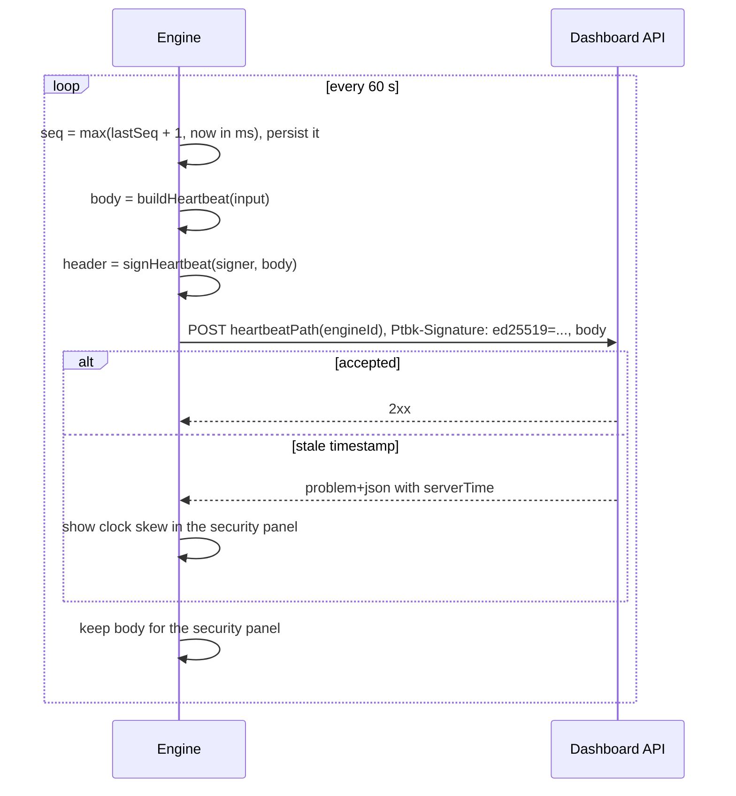

# Heartbeat

Every minute the engine tells the dashboard it is alive, with a small signed payload of numbers only. The heartbeat is the public promise of what we learn about an engine: no names, no free text, no content.

Spec: [Interfaces (draft)](../spec/zero-trust-spec.md#interfaces-draft) 4, [What our platform can and cannot do](../spec/zero-trust-spec.md#what-our-platform-can-and-cannot-do), [Transparency and verifiability](../spec/zero-trust-spec.md#transparency-and-verifiability) (security panel). The spec's Interface 4 still shows an older signing input; the contract code below is authoritative.

## Exchange

## What the engine must do

- Send a heartbeat every 60 seconds (the first one should go out as soon as the tunnels start): `POST` to `heartbeatPath(engineId)` (`/v1/engines/{engineId}/heartbeat`) on the dashboard API, directly over HTTPS (not through the relay), honouring `HTTPS_PROXY` and `NO_PROXY`. A failed send is logged with its status code and not retried before the next tick; missed beats are not backfilled.
- Build the body with `buildHeartbeat(input)`. It validates against the strict `Heartbeat` schema and returns the exact bytes to send. Never re-serialise the body after signing: the signature covers these bytes.
- Sign with `signHeartbeat(signer, body)`. It signs `signingInput('ptbk-heartbeat-v1', sha256(body))` with the **raw 32-byte** SHA-256 digest, not its hex or base64url text, and returns the header value `ed25519=<base64url signature>` for `HEARTBEAT_SIGNATURE_HEADER` (`Ptbk-Signature`). A heartbeat signature therefore cannot be reused for any other message.
- Keep the body within `HEARTBEAT_MAX_BODY_BYTES` (4 KiB).
- Make `seq` strictly increasing across restarts. Send `max(lastSeq + 1, Date.now())` and persist it durably (write a temporary file, `fsync`, rename) **before** sending, so a crash never reuses a value; gaps are fine. An engine that loses its state but keeps its key is then not locked out.
- Set `ts` to the current UTC time (RFC 3339 with `Z`). The dashboard refuses a heartbeat more than `HEARTBEAT_MAX_SKEW_MS` (2 minutes) away from its own clock.
- Send only what the schema allows: `version` (SemVer), `uptimeS`, `diskPct` and `ramPct` rounded to tens, `cpuLoad` (`CpuLoad`: `low`, `medium`, `high`), `update` (`UpdateState`: `none`, `available`, `pending`, `installing`), and the counts `agents` and `members` (0 to `MAX_HEARTBEAT_COUNT`).
- Round percentages with `buildHeartbeat`'s rule: to the nearest ten, halves up (`Math.round(value / 10) * 10`). A value outside 0–100 is a bug and throws.
- Show the last heartbeat body **verbatim** in the security panel: `GET /security` returns it as `lastHeartbeat.body`, the exact bytes sent, as text, with `sentAt` ([engine-api.md](engine-api.md)). The owner can see everything we learn.

## Failure handling

The dashboard checks, in this order, with `verifyHeartbeat`: body size, signature header, the signature over the raw bytes, the strict schema, that the path's engine ID equals the body's, that `seq` is greater than the last one, and the clock. Each failure maps to a problem+json answer:

| Outcome (`HeartbeatVerification`)                                          | What the engine should do                                                                                                                                                             |
| -------------------------------------------------------------------------- | ------------------------------------------------------------------------------------------------------------------------------------------------------------------------------------- |
| `bad-signature-header`, `bad-signature`, `invalid-body`, `engine-mismatch` | A bug in the engine: log it, keep going, fix the code                                                                                                                                 |
| `replayed-seq`                                                             | Its `seq` store went backwards: move `seq` forward with `max(lastSeq + 1, Date.now())`                                                                                                |
| `stale-ts`                                                                 | Read `serverTime` from the problem body, show the skew (local time minus `serverTime`, negative when the engine is behind) in the security panel, and tell the owner to fix the clock |

`ProblemDetails` in `@ptbk/protocol` carries the optional `serverTime` field for exactly this case. The dashboard endpoint is not built yet, so the HTTP status and the problem `code` for each outcome are not contract constants yet (see the [open points](README.md#open-points)). Read the problem with `TolerantProblemDetails` and act on `serverTime` when it is present.

## Contract exports

| Need                    | Export                                                                                                                                                | Source                                                   |
| ----------------------- | ----------------------------------------------------------------------------------------------------------------------------------------------------- | -------------------------------------------------------- |
| Payload                 | `Heartbeat`, `HeartbeatInput`, `CpuLoad`, `UpdateState`, `buildHeartbeat`, `MAX_HEARTBEAT_COUNT`, `HEARTBEAT_MAX_BODY_BYTES`, `HEARTBEAT_MAX_SKEW_MS` | [heartbeat.ts](../../packages/protocol/src/heartbeat.ts) |
| Signature and path      | `signHeartbeat`, `HEARTBEAT_SIGNATURE_HEADER`, `parseSignatureHeader`, `heartbeatPath`                                                                | [heartbeat.ts](../../packages/protocol/src/heartbeat.ts) |
| What the dashboard runs | `verifyHeartbeat`, `HeartbeatVerification`                                                                                                            | [heartbeat.ts](../../packages/protocol/src/heartbeat.ts) |
| Errors                  | `ProblemDetails`, `TolerantProblemDetails`                                                                                                            | [problem.ts](../../packages/protocol/src/problem.ts)     |

Golden vector: the `heartbeat` case in [`signed-message-vectors.json`](../../packages/protocol/src/signed-message-vectors.json) (exact body, its SHA-256, the signing input and the signature header, with the RFC 8032 test key).

## Conformance

No heartbeat suite exists yet. C-05 v1 checks only that the security panel's `lastHeartbeat.body` parses with the protocol `Heartbeat` schema (security panel checks in [conformance.md](conformance.md)).

## Reference implementation

Reference implementation: merged (M-06).

- [build-heartbeat.ts](../../apps/mock-engine/src/domain/heartbeat/build-heartbeat.ts): `buildHeartbeat` and `signHeartbeat` over the same bytes, `ts` from the clock in UTC seconds.
- [heartbeat-loop.ts](../../apps/mock-engine/src/domain/heartbeat/heartbeat-loop.ts): first beat when the tunnels start, then one per interval; failures logged with the status code only, no retry, no backfill; the body kept verbatim for `GET /security`; the clock skew from a `stale-timestamp` answer.
- [fs-seq-store.ts](../../apps/mock-engine/src/adapters/fs-seq-store.ts): `max(lastSeq + 1, now)`, persisted with a temporary file, `fsync`, rename and a directory `fsync` before the beat is built.
- [os-system-stats.ts](../../apps/mock-engine/src/adapters/os-system-stats.ts): disk of the data directory, memory, and the 1-minute load per core as `low` (below 0.5), `medium` (below 1) or `high`.
