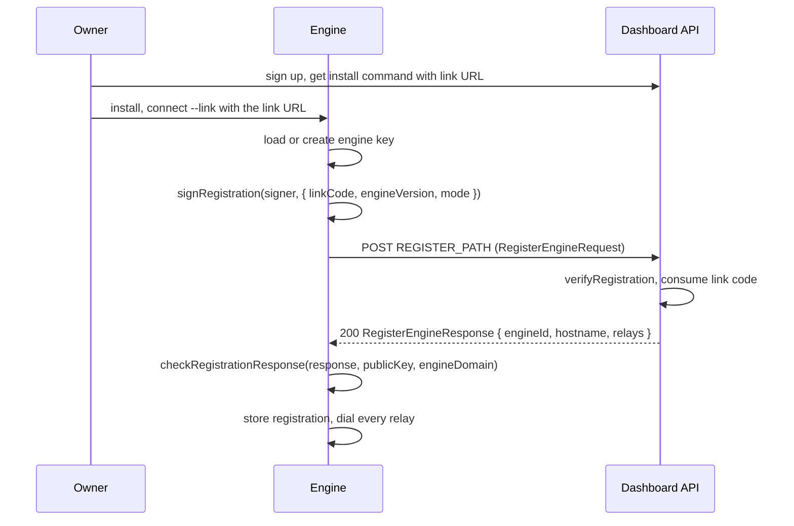

# Identity and registration

The engine's identity is one Ed25519 key. Its hash is the engine ID, the engine ID gives the default hostname, and registration ties that identity to a customer's account for routing and billing. Registration grants nothing inside the engine: who may use the engine is decided by the engine alone, through passkeys on its own hostname.

Spec: [Pairing and identity](../spec/zero-trust-spec.md#pairing-and-identity), [Interfaces (draft)](../spec/zero-trust-spec.md#interfaces-draft) 1 and 6. ADRs: [0014](../adr/0014-cryptography.md).

## Engine key handling

The engine must:

1. Keep its state in `PTBK_DATA_DIR`, created with mode 0700.
2. On first start, generate an Ed25519 key pair with a CSPRNG and create the key file with `O_CREAT | O_EXCL` and mode 0600. If the file already exists (a concurrent first start won), load that one instead of overwriting it.
3. `fsync` the key file and then the directory before the key is first used, so a crash can never leave an engine that registered a key it no longer has.
4. Refuse to start if `PTBK_DATA_DIR` or the key file is not owned by the engine's UID, is group- or world-accessible, or is a symbolic link. Name the path and the mode in the error, never the key.
5. Load the key non-extractable at runtime. The key may be extractable only for the one export that writes it to disk.
6. Use the engine key only through `signingInput` contexts (`ptbk-tunnel-v1`, `ptbk-register-v1`, `ptbk-heartbeat-v1`, `ptbk-hostname-v1`). Never use it for TLS, an ACME account key or anything else.
7. Never log the key, a signature, the link code or the setup secret.

The spec also asks that only the tunnel and TLS process can read the engine key and the TLS key ([Engine security baseline](../spec/zero-trust-spec.md#engine-security-baseline), "Process separation").

## Engine ID and hostname

- `deriveEngineId(publicKey)`: SHA-256 over the raw 32-byte public key (not its base64url text), lowercase base32, first 26 characters (130 bits). The result matches `EngineId` (`^[a-z2-7]{26}$`).
- `defaultHostname(engineId, engineDomain)`: `<engineId>.<engine domain>`. The engine domain is configuration that the registration response confirms.
- `engineIdFromDefaultHostname(hostname, engineDomain)` tells a default hostname (`default`), a hostname outside the engine domain (`custom`) and anything else inside the engine domain (`invalid`) apart.
- The engine should show its engine ID and default hostname at setup, so the owner can compare them with the dashboard.

## Engine fingerprint

The dashboard and the engine UI show each engine's fingerprint: a 20-character code and a 5×5 pattern derived from the engine ID, which people compare across screens like Signal safety numbers. Onboarding asks the owner to compare the code in the engine's terminal and on its setup page with the dashboard's ([installation.md](installation.md#first-start-output)), so the engine derives it with the same function:

- `deriveEngineFingerprint(engineId)` returns `{ code, formatted, patternBits, cells }`. `formatted` is the code in five groups of four (`XXXX-XXXX-XXXX-XXXX-XXXX`), the form to print and show. `cells` is the pattern, 5 rows of 5 booleans, for a page that draws it.
- Derivation `FINGERPRINT_DERIVATION` (`ptbk-fingerprint-v1`): SHA-256 over the UTF-8 prefix `ptbk-fingerprint-v1` immediately followed by the engine ID, with no separator and no normalisation. The code is the digest's first 100 bits in Crockford base32 (`0123456789ABCDEFGHJKMNPQRSTVWXYZ`); the next 15 bits fill columns 0 to 2 of the grid row by row, mirrored into columns 4 and 3.
- `fingerprint-vectors.json` (`@ptbk/protocol/fingerprint-vectors.json`) pins it; an implementation in another language must reproduce every vector. A changed derivation would be `ptbk-fingerprint-v2` next to v1, never an edit.
- It is a recognition aid. The security property stays the engine ID in the hostname, which the browser checks.

## Registration



The engine must:

- Send `POST` to `REGISTER_PATH` (`/v1/engines/register`) on the dashboard API over HTTPS, honouring `HTTPS_PROXY` and `NO_PROXY`. The dashboard's base URL is engine configuration.
- Build the request with `signRegistration`. It signs `signingInput('ptbk-register-v1', v, linkCode, enginePublicKey, engineVersion, mode)` with `v` as its decimal string (`"1"`) and the public key as its raw 32 bytes. This proves possession of the key, so a stolen link code cannot register someone else's key, and `mode` cannot be changed in transit.
- Send `mode` `tunnel` or `direct` (`RegistrationMode`). An engine in `local` mode never registers.
- Keep the request within `REGISTER_REQUEST_MAX_BYTES`.
- Read the response tolerantly with `TolerantRegisterEngineResponse` (unknown fields are stripped; known ones are checked), refuse a body over `REGISTER_RESPONSE_MAX_BYTES`, then run `checkRegistrationResponse`. On `engine-id-mismatch` or `hostname-mismatch`, the engine must refuse the registration: the dashboard handed it someone else's identity.
- Store the registration (engine ID, hostname, relay list) in `PTBK_DATA_DIR` and use `relays` (1 to `MAX_RELAYS`) as its relay list.
- Never write the link code to disk or a log, and drop it from memory after the request.
- Pin `memberKey` from the response with the registration (since teams, [ADR 0018](../adr/0018-teams-and-member-access.md)). It is the only key that may sign access tickets and member revocations for this engine. `null` means a dashboard without teams: refuse every ticket and revocation, and keep heartbeat v1.
- Keep `ownerSetupCommitment`, when it is not `null`, as a second setup slot for `OWNER_HANDOFF_LIFETIME_MS` (30 minutes) from registration, never in the stored registration ([ADR 0023](../adr/0023-owner-setup-handoff.md), [installation.md](installation.md#the-setup-link)). It is `base64url(SHA-256(S))` over the text of the pairing tab's secret `S`, so compare it with the digest you already keep of your own setup secret. Ignore it when the engine has an owner or runs with the handoff off.

### Link URL

The dashboard hands out each link code inside a link URL, `https://<dashboard host>/link#<code>` (`formatLinkUrl`), for example `https://app.ptbk.io/link#<26 characters>`. The code is in the fragment, so a browser that opens the URL never sends it and no access log records it; the dashboard's `/link` page only tells the visitor to run the command on the engine's machine. The URL carries the dashboard's origin, so an engine linked with it needs no `PTBK_DASHBOARD_URL` (decided 2026-11-06).

`connect --link <value>` (the engine's command; its name is the engine's) must:

- Accept a link URL or a bare code (`parseLinkArgument`). A link URL is `https:` only, with no user name or password, no query, the path exactly `/link` and a valid `LinkCode` as its fragment (`parseLinkUrl`). Refuse anything else with a message that names the rule, never the value.
- Take the dashboard origin from a link URL. If `PTBK_DASHBOARD_URL` is also set and names another origin, refuse with a message that names both origins; never guess.
- Print the dashboard origin before it sends anything, so a link pasted from somewhere shows where it goes. The origin is not a secret.
- Store the dashboard origin with the registration, and on later starts use it when `PTBK_DASHBOARD_URL` is unset. A `PTBK_DASHBOARD_URL` that names another origin than the stored one still stops startup.
- Without `PTBK_ENGINE_DOMAIN`, take the engine domain from the answer's hostname once `checkRegistrationResponse`'s engine-ID check passes, and pin it with the registration, as today.
- Never print, log or store the code or the full URL.

A bare code goes to `PTBK_DASHBOARD_URL`, else to the dashboard of a stored registration.

### Errors and re-registration

Errors are RFC 9457 problem+json (`ProblemDetails`, read with `TolerantProblemDetails`) with a `code` from `REGISTRATION_ERROR_CODE`:

| `code`              | Status | Meaning                                                                    | What the engine does                                            |
| ------------------- | ------ | -------------------------------------------------------------------------- | --------------------------------------------------------------- |
| `invalid-link-code` | 401    | The code is unknown, expired or used. One code for all three, on purpose.  | Ask the owner for a new link code                               |
| `bad-signature`     | 401    | The signature does not verify                                              | A bug: report it, do not retry                                  |
| `engine-exists`     | 409    | The key's engine ID belongs to another organisation; the code stays unused | Tell the owner; do not retry                                    |
| `engine-suspended`  | 403    | The engine is suspended or revoked by its owner                            | Tell the owner; do not retry                                    |
| `engine-limit`      | 403    | The account has no room for another engine                                 | Tell the owner                                                  |
| `not-entitled`      | 403    | The account's plan does not include engines; the code stays unused         | Tell the owner, like `engine-limit`                             |
| `rate-limited`      | 429    | Too many attempts from this address (100 per hour)                         | Retry later with backoff while the link code can still be valid |

The dashboard (D-03) also answers 400 `invalid-request` (the body fails the strict schema) and 413 `too-large` (over `REGISTER_REQUEST_MAX_BYTES`), which are bugs on the engine's side. Codes are only ever added to `REGISTRATION_ERROR_CODE`: handle a code you do not know like a 5xx.

Whatever the answer, the engine must (to confirm in the engine-team review, [open points](README.md#open-points)):

- name the problem `code` in its output (log or console), so its operator can tell what to do;
- never retry in a loop: no retry at all after `invalid-link-code`, `bad-signature`, `engine-exists`, `engine-suspended`, `engine-limit` or `not-entitled`. After `rate-limited`, a 5xx or no answer, wait at least 5 s before the first retry and back off exponentially. Exiting instead is allowed;
- store nothing from a refused registration, so a later start with a working dashboard registers normally.

Registering a key that is already registered:

- **Same organisation as the link code, engine active:** idempotent. The dashboard answers 200 with the existing engine's `RegisterEngineResponse`, consumes the link code, and updates the engine's `engineVersion` and `mode` from the signed request.
- **Another organisation:** 409 `engine-exists`; the link code stays unused. Registration never moves an engine between organisations.
- **Suspended or owner-revoked:** 403 `engine-suspended`.

### Compromise recovery

There is no in-place key rotation: the engine ID is the key's hash, so a new key is a new engine. After a key compromise or loss:

1. The owner revokes the engine in the dashboard (a step-up action). The engine is suspended, so relays cut its tunnels at their next registry refresh (within 5 minutes, or 24 hours during a dashboard outage).
2. The engine is reset with a new key, which gives it a new engine ID and default hostname.
3. It registers again with a new link code.

## Configuration

Spec Interface 6 defines the engine's environment:

| Variable                                    | The engine must                                                                                                                                      |
| ------------------------------------------- | ---------------------------------------------------------------------------------------------------------------------------------------------------- |
| `PTBK_MODE`                                 | Accept `tunnel`, `direct` or `local`                                                                                                                 |
| `PTBK_UPDATE_POLICY`, `PTBK_PINNED_VERSION` | Accept `auto` (default), `manual` or `pinned` with a version. The policy can also be changed in the UI with step-up ([engine-api.md](engine-api.md)) |
| `PTBK_CUSTOM_DOMAIN`                        | Accept an optional custom hostname, never an apex domain in v0 ([tunnel-client.md](tunnel-client.md#custom-hostnames))                               |
| `HTTPS_PROXY`, `NO_PROXY`                   | Use them for the tunnel, registration, heartbeat and updates                                                                                         |
| `PTBK_DATA_DIR`                             | Keep keys, certificates, database and audit log there, mode 0700                                                                                     |

The spec names no variables for the link code or the dashboard URL. The launch contract below fixes them, so the conformance harness can start any engine the same way. `mock-engine register --link <link URL or code>` registers and exits.

### Launch contract

The conformance harness (`ptbk-conformance --engine-cmd`, [conformance.md](conformance.md#an-engine-the-harness-starts)) starts the engine itself and plays the dashboard, the relays and the release store on loopback. The engine must honour these variables. Each one is safe in production as well, so an engine needs no test mode to pass:

| Variable              | The engine must                                                                                                                                                                     | Why it is safe in production                                                                                           |
| --------------------- | ----------------------------------------------------------------------------------------------------------------------------------------------------------------------------------- | ---------------------------------------------------------------------------------------------------------------------- |
| `PTBK_DATA_DIR`       | Keep its state there. When the directory does not exist, create it with mode 0700                                                                                                   | Spec Interface 6                                                                                                       |
| `PTBK_MODE`           | Run in that mode; the harness sets `tunnel`                                                                                                                                         | Spec Interface 6                                                                                                       |
| `PTBK_ENGINE_DOMAIN`  | Use it as the engine domain: its default hostname, and the domain `checkRegistrationResponse` checks against. Without it, the production engine domain                              | The dashboard's answer is checked against it, so a wrong value only makes registration fail                            |
| `PTBK_DASHBOARD_URL`  | Register and send heartbeats to this `https://` origin. Without it, the origin stored with the registration, else the production dashboard                                          | Operator configuration. Registration grants nothing inside the engine                                                  |
| `PTBK_LINK_CODE`      | Register with it once, when the engine holds no registration. Never write it to disk or a log                                                                                       | One-time, and useless once consumed                                                                                    |
| `PTBK_RELAYS`         | When set (comma-separated `wss://<relay hostname>[:port]` URLs), dial exactly these relays instead of the relays from the registration                                              | An operator-trusted override: the engine still verifies each relay's TLS certificate, and a relay never sees plaintext |
| `NODE_EXTRA_CA_CERTS` | Trust this PEM CA in addition to the default roots, for the dashboard, the relays and the release store. Node does this for every TLS connection unless the code replaces the roots | It adds a root and never replaces the defaults, as for a TLS-inspecting proxy ([tunnel-client.md](tunnel-client.md))   |

The harness sends `PTBK_LINK_CODE` as a bare code. The mock engine also accepts a link URL there, whose origin must equal `PTBK_DASHBOARD_URL` when that is set; an engine need not.

The UI loader adds `PTBK_UI_RELEASE_URL`, `PTBK_UPDATE_POLICY`, `PTBK_PINNED_VERSION` and `PTBK_UI_TRUST_POLICY_FILE` ([ui-loader.md](ui-loader.md#where-the-trust-policy-comes-from)). For the checks that a production build refuses what a test build accepts, the harness also starts your production build, with `--engine-production-cmd` and the same variables ([conformance.md](conformance.md#an-engine-the-harness-starts)).

The harness removes `HTTPS_PROXY`, `NO_PROXY` and any other `PTBK_*` variable from the engine's environment. Engine-specific settings, such as a shorter development heartbeat interval, belong in the engine command, not in this list. The engine must also:

- exit within 10 s of SIGTERM;
- exit with a non-zero status when it refuses to start (an unsafe data directory or key file, invalid configuration);
- write its logs to stdout or stderr. The harness reads them to check what the engine tells its operator, and to check that no secret is logged.

#### Conformance sessions

The engine API checks need sessions: the owner, and members holding exactly the permissions a check chooses. A passkey-only engine cannot hand them out over HTTP, and it must not. Instead, its **conformance build** ships a command (decided 2026-10-26, ENG-99):

```sh
<engine> conformance-session --subject owner
<engine> conformance-session --subject member --permissions agents.read,chats.read
```

- It runs next to the running engine with the same environment (`PTBK_DATA_DIR` and the rest), so it reaches the engine's own session store. `member` creates a new member each time, holding exactly the listed permissions (none when the list is empty).
- It prints one JSON value on stdout and exits 0: `{"cookie":"<name>=<value>"}`, `{"bearer":"<token>"}`, or `null` when that subject cannot be had. The checks that need it then skip.
- It exists only in the conformance build, behind the same build-time gate as `PTBK_CONFORMANCE_TRUST_FILE` ([ui-loader.md](ui-loader.md)). A production build refuses to run it. It is never an HTTP endpoint.

The harness runs it with `ptbk-conformance --engine-session-cmd "<engine> conformance-session"`, so no hand-written target module is needed. Its checks reach the engine API through the fake relay, so they also need the CA the engine's own certificates chain to. The conformance build therefore also must, decided 2026-10-26:

- serve its API certificate from a development CA it creates in `PTBK_DATA_DIR`, with the CA certificate in a file there, as the mock engine does at `<PTBK_DATA_DIR>/dev-ca/ca-cert.pem`. A production build never does this;
- document that file's path, which the harness takes as `--engine-ca-file "{dataDir}/<path>"` (`{dataDir}` stands for the engine's data directory).

Without `--engine-ca-file` the harness checks the engine's certificate only for its name and dates. The mock engine implements the same command over its dev-only control listener (`MOCK_CONTROL=enabled`).

## Contract exports

| Need                | Export                                                                                                                                                                                                                     | Source                                                                                                 |
| ------------------- | -------------------------------------------------------------------------------------------------------------------------------------------------------------------------------------------------------------------------- | ------------------------------------------------------------------------------------------------------ |
| Keys and signing    | `generateEd25519KeyPair`, `importEd25519PrivateKey`, `createWebCryptoSigner`, `Signer`                                                                                                                                     | [ed25519.ts](../../packages/protocol/src/ed25519.ts)                                                   |
| Engine ID, hostname | `deriveEngineId`, `defaultHostname`, `engineIdFromDefaultHostname`, `EngineId`, `Hostname`, `EngineVersion`                                                                                                                | [engine-id.ts](../../packages/protocol/src/engine-id.ts), [ids.ts](../../packages/protocol/src/ids.ts) |
| Link code           | `LinkCode`, `LINK_CODE_BYTES`                                                                                                                                                                                              | [link-code.ts](../../packages/protocol/src/link-code.ts)                                               |
| Link URL            | `LINK_PATH`, `formatLinkUrl`, `parseLinkUrl`, `parseLinkArgument`, `LinkUrlProblem`                                                                                                                                        | [link-url.ts](../../packages/protocol/src/link-url.ts)                                                 |
| Registration        | `REGISTER_PATH`, `RegisterEngineRequest`, `RegistrationMode`, `signRegistration`, `TolerantRegisterEngineResponse`, `checkRegistrationResponse`, `MAX_RELAYS`, `REGISTER_REQUEST_MAX_BYTES`, `REGISTER_RESPONSE_MAX_BYTES` | [registration.ts](../../packages/protocol/src/registration.ts)                                         |
| Errors              | `ProblemDetails`, `TolerantProblemDetails`, `REGISTRATION_ERROR_CODE`                                                                                                                                                      | [problem.ts](../../packages/protocol/src/problem.ts)                                                   |

Golden vector: the `registration` case in [`signed-message-vectors.json`](../../packages/protocol/src/signed-message-vectors.json) (request, link code and signing input, with the RFC 8032 test key and its engine ID).

## Conformance

The `registration` suite (C-08) starts the engine with the [launch contract](#launch-contract) and acts as the dashboard. Each check starts a fresh engine with an empty `PTBK_DATA_DIR`. The local dev stack shows a registration against the real dashboard ([testing-against-the-platform.md](testing-against-the-platform.md)).

| Check                                          | What it proves                                                                                                                                                        |
| ---------------------------------------------- | --------------------------------------------------------------------------------------------------------------------------------------------------------------------- |
| `registration.request.signature-verifies`      | The request is within `REGISTER_REQUEST_MAX_BYTES`, a strict `RegisterEngineRequest` with the given link code and `mode: tunnel`, and `verifyRegistration` accepts it |
| `registration.identity.engine-id-derived`      | The engine then heartbeats as `deriveEngineId(enginePublicKey)`, in the path and the body                                                                             |
| `registration.identity.stable-across-restarts` | After a restart: no new key registered, the same engine ID, an accepted heartbeat                                                                                     |
| `registration.link-code.used-once`             | Restarted with the same environment, the engine uses its stored registration; the link code is sent once                                                              |
| `registration.secrets.never-logged`            | Neither the link code nor the engine key appears in the output (raw, hex, base64, base64url); the link code is in no file under `PTBK_DATA_DIR`                       |
| `registration.response.unknown-fields-ignored` | An answer with fields a later version added is accepted                                                                                                               |
| `registration.response.invalid-refused`        | An engine ID the key does not derive, a hostname outside the engine domain, or an answer over `REGISTER_RESPONSE_MAX_BYTES`: no heartbeat, nothing stored             |
| `registration.errors.<code>`                   | For `invalid-link-code`, `engine-exists`, `engine-suspended`, `not-entitled`, `rate-limited` and `unavailable` (503): the rules above                                 |
| `registration.data-dir.private`                | The engine creates `PTBK_DATA_DIR` as a 0700 directory owned by its user                                                                                              |
| `registration.key-file.private`                | The file holding the key (PKCS#8 PEM or DER, a JWK, or a raw 32-byte seed) is a regular file owned by the engine user, mode 0600                                      |
| `registration.key-file.loose-modes-refused`    | With the directory at 0755, the key file at 0640, or the key a symbolic link, the engine exits non-zero, contacts nobody and names the path                           |

## Reference implementation

- **Key handling: merged (M-01).** [fs-identity-store.ts](../../apps/mock-engine/src/adapters/fs-identity-store.ts) and [private-files.ts](../../apps/mock-engine/src/adapters/private-files.ts): `PTBK_DATA_DIR` at 0700, `engine-key.pem` as PKCS#8 PEM created with `O_EXCL` and 0600, owner, mode and symlink checks, extractable only for the first write and non-extractable at runtime ([engine-identity.ts](../../apps/mock-engine/src/domain/identity/engine-identity.ts)). Since M-06 the key file and then the directory are `fsync`ed before the key is first used (step 3 above).
- **Registration: merged (M-06).** [register.ts](../../apps/mock-engine/src/domain/registration/register.ts) signs with `signRegistration`, checks the answer with `checkRegistrationResponse` and maps the problem codes; [fetch-dashboard-api.ts](../../apps/mock-engine/src/adapters/fetch-dashboard-api.ts) reads answers with `TolerantRegisterEngineResponse` and `TolerantProblemDetails` within the size caps; [https-fetch.ts](../../apps/mock-engine/src/adapters/https-fetch.ts) honours `HTTPS_PROXY` and `NO_PROXY`; [fs-registration-store.ts](../../apps/mock-engine/src/adapters/fs-registration-store.ts) keeps `registration.json` (0600, written durably, strict on load). An engine that already holds a registration makes no network call, and on every start the stored registration is checked again against the key and the engine domain. The link code is taken once from the configuration and never stored or logged ([establish-registration.ts](../../apps/mock-engine/src/app/establish-registration.ts)).
