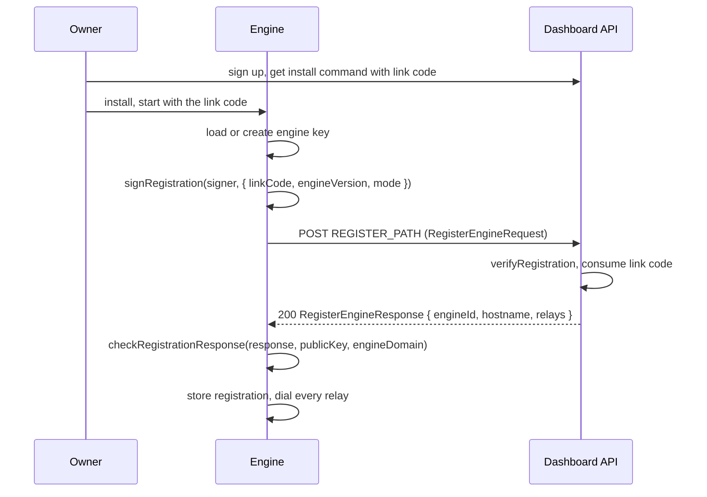

# Identity and registration

The engine's identity is one Ed25519 key. Its hash is the engine ID, the engine ID gives the default hostname, and registration ties that identity to a customer's account for routing and billing. Registration grants nothing inside the engine: who may use the engine is decided by the engine alone, through passkeys on its own hostname.

Spec: [Pairing and identity](../spec/zero-trust-spec.md#pairing-and-identity), [Interfaces (draft)](../spec/zero-trust-spec.md#interfaces-draft) 1 and 6. ADRs: [0014](../adr/0014-cryptography.md).

## Engine key handling

The engine must:

1. Keep its state in `PTBK_DATA_DIR`, created with mode 0700.
2. On first start, generate an Ed25519 key pair with a CSPRNG and create the key file with `O_CREAT | O_EXCL` and mode 0600. If the file already exists (a concurrent first start won), load that one instead of overwriting it.
3. `fsync` the key file and then the directory before the key is first used, so a crash can never leave an engine that registered a key it no longer has.
4. Refuse to start if `PTBK_DATA_DIR` or the key file is not owned by the engine's UID, is group- or world-accessible, or is a symbolic link. Name the path and the mode in the error, never the key.
5. Load the key non-extractable at runtime. The key may be extractable only for the one export that writes it to disk.
6. Use the engine key only through `signingInput` contexts (`ptbk-tunnel-v1`, `ptbk-register-v1`, `ptbk-heartbeat-v1`, `ptbk-hostname-v1`). Never use it for TLS, an ACME account key or anything else.
7. Never log the key, a signature, the link code or the setup secret.

The spec also asks that only the tunnel and TLS process can read the engine key and the TLS key ([Engine security baseline](../spec/zero-trust-spec.md#engine-security-baseline), "Process separation").

## Engine ID and hostname

- `deriveEngineId(publicKey)`: SHA-256 over the raw 32-byte public key (not its base64url text), lowercase base32, first 26 characters (130 bits). The result matches `EngineId` (`^[a-z2-7]{26}$`).
- `defaultHostname(engineId, engineDomain)`: `<engineId>.<engine domain>`. The engine domain is configuration that the registration response confirms.
- `engineIdFromDefaultHostname(hostname, engineDomain)` tells a default hostname (`default`), a hostname outside the engine domain (`custom`) and anything else inside the engine domain (`invalid`) apart.
- The engine should show its engine ID and default hostname at setup, so the owner can compare them with the dashboard.

## Registration

The engine must:

- Send `POST` to `REGISTER_PATH` (`/v1/engines/register`) on the dashboard API over HTTPS, honouring `HTTPS_PROXY` and `NO_PROXY`. The dashboard's base URL is engine configuration.
- Build the request with `signRegistration`. It signs `signingInput('ptbk-register-v1', v, linkCode, enginePublicKey, engineVersion, mode)` with `v` as its decimal string (`"1"`) and the public key as its raw 32 bytes. This proves possession of the key, so a stolen link code cannot register someone else's key, and `mode` cannot be changed in transit.
- Send `mode` `tunnel` or `direct` (`RegistrationMode`). An engine in `local` mode never registers.
- Keep the request within `REGISTER_REQUEST_MAX_BYTES`.
- Read the response tolerantly with `TolerantRegisterEngineResponse` (unknown fields are stripped; known ones are checked), refuse a body over `REGISTER_RESPONSE_MAX_BYTES`, then run `checkRegistrationResponse`. On `engine-id-mismatch` or `hostname-mismatch`, the engine must refuse the registration: the dashboard handed it someone else's identity.
- Store the registration (engine ID, hostname, relay list) in `PTBK_DATA_DIR` and use `relays` (1 to `MAX_RELAYS`) as its relay list.
- Never write the link code to disk or a log, and drop it from memory after the request.

### Errors and re-registration

Errors are RFC 9457 problem+json (`ProblemDetails`, read with `TolerantProblemDetails`) with a `code` from `REGISTRATION_ERROR_CODE`:

| `code`              | Status | Meaning                                                                    | What the engine does              |
| ------------------- | ------ | -------------------------------------------------------------------------- | --------------------------------- |
| `invalid-link-code` | 4xx    | The code is unknown, expired or used. One code for all three, on purpose.  | Ask the owner for a new link code |
| `bad-signature`     | 4xx    | The signature does not verify                                              | A bug: report it, do not retry    |
| `engine-exists`     | 409    | The key's engine ID belongs to another organisation; the code stays unused | Tell the owner; do not retry      |
| `engine-suspended`  | 403    | The engine is suspended or revoked by its owner                            | Tell the owner; do not retry      |
| `engine-limit`      | 4xx    | The account has no room for another engine                                 | Tell the owner                    |

Only the statuses of `engine-exists` and `engine-suspended` are fixed in the contract today; the dashboard endpoint is not built yet (see the [open points](README.md#open-points)).

Registering a key that is already registered:

- **Same organisation as the link code, engine active:** idempotent. The dashboard answers 200 with the existing engine's `RegisterEngineResponse`, consumes the link code, and updates the engine's `engineVersion` and `mode` from the signed request.
- **Another organisation:** 409 `engine-exists`; the link code stays unused. Registration never moves an engine between organisations.
- **Suspended or owner-revoked:** 403 `engine-suspended`.

### Compromise recovery

There is no in-place key rotation: the engine ID is the key's hash, so a new key is a new engine. After a key compromise or loss:

1. The owner revokes the engine in the dashboard (a step-up action). The engine is suspended, so relays cut its tunnels at their next registry refresh (within 5 minutes, or 24 hours during a dashboard outage).
2. The engine is reset with a new key, which gives it a new engine ID and default hostname.
3. It registers again with a new link code.

## Configuration

Spec Interface 6 defines the engine's environment:

| Variable                                    | The engine must                                                                                                                                      |
| ------------------------------------------- | ---------------------------------------------------------------------------------------------------------------------------------------------------- |
| `PTBK_MODE`                                 | Accept `tunnel`, `direct` or `local`                                                                                                                 |
| `PTBK_UPDATE_POLICY`, `PTBK_PINNED_VERSION` | Accept `auto` (default), `manual` or `pinned` with a version. The policy can also be changed in the UI with step-up ([engine-api.md](engine-api.md)) |
| `PTBK_CUSTOM_DOMAIN`                        | Accept an optional custom hostname, never an apex domain in v0 ([tunnel-client.md](tunnel-client.md#custom-hostnames))                               |
| `HTTPS_PROXY`, `NO_PROXY`                   | Use them for the tunnel, registration, heartbeat and updates                                                                                         |
| `PTBK_DATA_DIR`                             | Keep keys, certificates, database and audit log there, mode 0700                                                                                     |

The spec names no variables for the link code or the dashboard URL; that is the engine's choice. The mock engine uses `PTBK_LINK_CODE` and `PTBK_DASHBOARD_URL`, and `mock-engine register --link <code>` registers and exits.

## Contract exports

| Need                | Export                                                                                                                                                                                                                     | Source                                                                                                 |
| ------------------- | -------------------------------------------------------------------------------------------------------------------------------------------------------------------------------------------------------------------------- | ------------------------------------------------------------------------------------------------------ |
| Keys and signing    | `generateEd25519KeyPair`, `importEd25519PrivateKey`, `createWebCryptoSigner`, `Signer`                                                                                                                                     | [ed25519.ts](../../packages/protocol/src/ed25519.ts)                                                   |
| Engine ID, hostname | `deriveEngineId`, `defaultHostname`, `engineIdFromDefaultHostname`, `EngineId`, `Hostname`, `EngineVersion`                                                                                                                | [engine-id.ts](../../packages/protocol/src/engine-id.ts), [ids.ts](../../packages/protocol/src/ids.ts) |
| Link code           | `LinkCode`, `LINK_CODE_BYTES`                                                                                                                                                                                              | [link-code.ts](../../packages/protocol/src/link-code.ts)                                               |
| Registration        | `REGISTER_PATH`, `RegisterEngineRequest`, `RegistrationMode`, `signRegistration`, `TolerantRegisterEngineResponse`, `checkRegistrationResponse`, `MAX_RELAYS`, `REGISTER_REQUEST_MAX_BYTES`, `REGISTER_RESPONSE_MAX_BYTES` | [registration.ts](../../packages/protocol/src/registration.ts)                                         |
| Errors              | `ProblemDetails`, `TolerantProblemDetails`, `REGISTRATION_ERROR_CODE`                                                                                                                                                      | [problem.ts](../../packages/protocol/src/problem.ts)                                                   |

Golden vector: the `registration` case in [`signed-message-vectors.json`](../../packages/protocol/src/signed-message-vectors.json) (request, link code and signing input, with the RFC 8032 test key and its engine ID).

## Conformance

No registration suite exists yet. C-05 registers its suites as acting relay or dashboard later; until then the checklist rows for this page have no check ID. The registration golden vector and `checkRegistrationResponse` are the reference.

## Reference implementation

- **Key handling: merged (M-01).** [fs-identity-store.ts](../../apps/mock-engine/src/adapters/fs-identity-store.ts) and [private-files.ts](../../apps/mock-engine/src/adapters/private-files.ts): `PTBK_DATA_DIR` at 0700, `engine-key.pem` as PKCS#8 PEM created with `O_EXCL` and 0600, owner, mode and symlink checks, extractable only for the first write and non-extractable at runtime ([engine-identity.ts](../../apps/mock-engine/src/domain/identity/engine-identity.ts)). Since M-06 the key file and then the directory are `fsync`ed before the key is first used (step 3 above).
- **Registration: merged (M-06).** [register.ts](../../apps/mock-engine/src/domain/registration/register.ts) signs with `signRegistration`, checks the answer with `checkRegistrationResponse` and maps the problem codes; [fetch-dashboard-api.ts](../../apps/mock-engine/src/adapters/fetch-dashboard-api.ts) reads answers with `TolerantRegisterEngineResponse` and `TolerantProblemDetails` within the size caps; [https-fetch.ts](../../apps/mock-engine/src/adapters/https-fetch.ts) honours `HTTPS_PROXY` and `NO_PROXY`; [fs-registration-store.ts](../../apps/mock-engine/src/adapters/fs-registration-store.ts) keeps `registration.json` (0600, written durably, strict on load). An engine that already holds a registration makes no network call, and on every start the stored registration is checked again against the key and the engine domain. The link code is taken once from the configuration and never stored or logged ([establish-registration.ts](../../apps/mock-engine/src/app/establish-registration.ts)).
