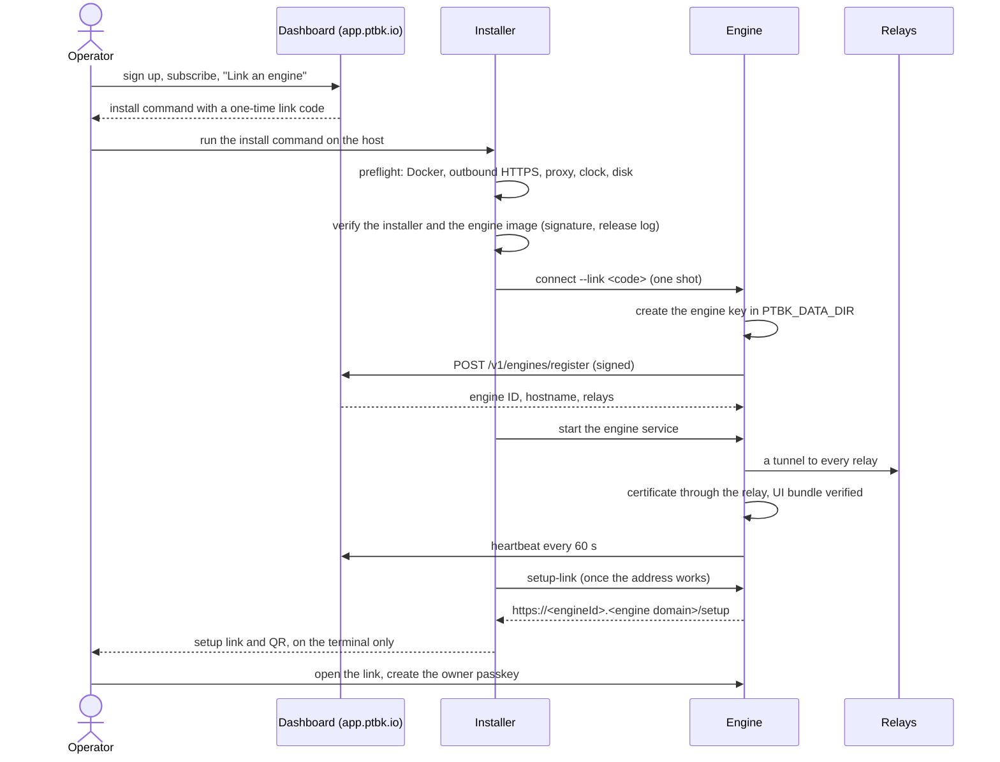

# Installing and linking an engine

How an operator installs the open engine and links it to a Promptbook account, and what the engine must do so that this works from one command: install, key, registration, hostname, certificate, tunnel, signed UI and the owner's first passkey.

Two readers: **operators**, who follow the install paths and the troubleshooting table, and the **engine team**, who build what the normative sections require. "Must", "must not" and "should" are normative and mark what the platform depends on. Everything else (command names, file layout, flag names, exact wording) is a proposal the engine team may change, as long as the behaviour stays.

Spec: [Pairing and identity](../spec/zero-trust-spec.md#pairing-and-identity), [Moving existing deployments](../spec/zero-trust-spec.md#moving-existing-deployments), [Interfaces (draft)](../spec/zero-trust-spec.md#interfaces-draft) 1 and 6, [Operations](../spec/zero-trust-spec.md#operations), [Build plan](../spec/zero-trust-spec.md#build-plan) (Distribution). Related: [identity-and-registration.md](identity-and-registration.md), [tunnel-client.md](tunnel-client.md), [ui-loader.md](ui-loader.md), [gateway.md](gateway.md).

This guide writes the engine's command line as `promptbook-engine`. The spec writes `engine`; the real name is the engine team's choice.

## The flow



The link code ties the engine to the account for routing and billing only. It grants nothing inside the engine. Only someone who can read the engine host's terminal gets the setup link, so only they can become the owner; the platform never sees it.

## Requirements

- **Host:** Linux on x86-64 or arm64 with Docker Engine and the Compose plugin. A VPS, a company server, a home PC or a NAS. The engine should publish multi-architecture images: home servers and NAS boxes are often arm64. macOS and Windows hosts are for development only.
- **Resources:** the engine team sets the minimum and the installer checks it. Agents running coding CLIs and a headless browser need memory; state the number in the installer's preflight, not only in docs.
- **Network:** outbound HTTPS (TCP 443) only. Nothing inbound, no public IP, no open port. See [Networking](#networking).
- **Clock:** synchronised (NTP). Heartbeats are refused more than 2 minutes off, and certificates need the right time.
- **Storage:** one persistent volume for `PTBK_DATA_DIR`. Losing it loses the engine's identity and data ([Data directory](#data-directory)).
- **Account:** a Promptbook account whose plan includes engines. The dashboard shows the install command only when it does.

## Install paths

Docker comes first: a signed multi-architecture image, a verifying installer and a published Compose file. The engine must offer the first path. The second is the same thing written out, for people who manage their own Compose files. The third links an engine that already runs. Other distribution forms may come later and will be added here; until then, direct mode and bare Node or npm installs are for local development only and are not offered in onboarding.

### 1. The installer (recommended)

The dashboard shows a command shaped like this, with the link code and the installer's hash filled in:

```sh
curl -fsSLo promptbook-install.sh <installer URL> \
  && echo "<sha256 of this installer>  promptbook-install.sh" | sha256sum -c - \
  && sudo sh promptbook-install.sh --link <link code>
```

Never `curl … | sh`: the script is checked against the hash in the command before it runs. The installer must:

1. **Preflight**, each line with ✓ or ✗ and the fix: architecture, Docker and Compose present and recent enough, free disk and memory, outbound HTTPS to the dashboard API, the relays and the release store (naming whichever fails), proxy settings in use, a TLS-inspecting proxy (detected when the relays' certificate does not chain to a public root), clock offset. It must stop on a failure that would make a later step fail, rather than continue and fail obscurely.
2. **Verify before running anything:** the engine image by digest, its signature against the exact release workflow identity, and its entry in the public release log, as for any engine release ([ui-loader.md](ui-loader.md) describes the same checks for the UI). An image that fails a check is not started. The image reference is always a digest, never a moving tag such as `latest`.
3. Create the data volume, write the Compose file (for example `/opt/promptbook-engine/compose.yaml`), and pass the operator's proxy settings and any extra CA into it.
4. Run `promptbook-engine connect --link <code>` once in a one-off container. The link code must not end up in the Compose file, the container's environment (`docker inspect` shows it forever) or a log.
5. Start the engine and its updater, and follow the engine's progress (the [first-start output](#first-start-output)) until it is ready or fails.
6. When the address works, run `promptbook-engine setup-link` and print the setup link and its QR code ([The setup link](#the-setup-link)).
7. Be idempotent: run again on a host that already has an engine, it checks, repairs what it can and says "This host already runs engine `<short ID>`", without creating a second identity.

Flags (proposal): `--link <code>`, `--data-dir <path>` (a host directory instead of a named volume), `--extra-ca <file>`, `--proxy <url>`, `--version <x.y.z>`, `--non-interactive` (no prompts; prints the setup link as the last line and exits non-zero on any ✗), `--json` (one JSON object per step, for automation).

### 2. Docker Compose

The same engine, configured by hand. An example of what the installer writes:

```yaml
services:
  engine:
    image: <engine image>@sha256:<digest>
    restart: unless-stopped
    read_only: true
    user: '10001:10001'
    cap_drop: [ALL]
    security_opt: ['no-new-privileges:true']
    tmpfs: ['/tmp']
    volumes: ['engine-data:/data']
    environment:
      PTBK_MODE: tunnel
      PTBK_DATA_DIR: /data
      # HTTPS_PROXY: http://proxy.example:3128
      # NODE_EXTRA_CA_CERTS: /data/extra-ca.pem
  # updater: the separate component allowed to replace the engine container (spec, Security hardening 9)
volumes:
  engine-data:
```

Then:

```sh
docker compose run --rm engine promptbook-engine connect --link <link code>
docker compose up -d
docker compose exec engine promptbook-engine setup-link
```

The hardening lines are the spec's (Security hardening 9): non-root, read-only root filesystem, all capabilities dropped, no new privileges, no Docker socket in the engine container. Only the updater may restart containers.

### 3. Link an engine that already runs

An engine started in `local` mode, or one installed before the account existed, joins with:

```sh
promptbook-engine connect --link <link code>
```

It must create the engine key if there is none, register, switch to `tunnel` mode, bind its app server to localhost and print the same progress as a fresh install. Data, agents and members stay. Passkeys are bound to the hostname, so passkeys made for a previous address do not work on the new one: when an owner already exists, `connect` must print a link that adds a passkey to that owner (same rules as the setup link) instead of a link that creates a new owner.

In v0, connecting is a command on the host only, not a form in the engine UI: shell access is the trust level that changing the engine's address needs. The dashboard shows this exact command with the link code filled in.

**Installing before you have an account** works too: without a link code the engine starts in `local` mode, listens on 127.0.0.1 only, and should print that it is not linked and how to link it ("create an account at app.ptbk.io and run `promptbook-engine connect --link <code>`"). Until then the owner reaches it through `ssh -L`.

## Configuration

Interface 6 of the spec defines `PTBK_MODE`, `PTBK_UPDATE_POLICY`, `PTBK_PINNED_VERSION`, `PTBK_CUSTOM_DOMAIN`, `HTTPS_PROXY`, `NO_PROXY` and `PTBK_DATA_DIR`. The other names below match the mock engine ([mock-engine.md](mock-engine.md)); the engine should use them too, so tools that start an engine (the installer, the conformance runner, the local stack) can start any engine the same way. The conformance harness's launch contract fixes the subset it relies on ([identity-and-registration.md](identity-and-registration.md#launch-contract)), and the test harnesses' view of the same names is in [testing-against-the-platform.md](testing-against-the-platform.md#engine-settings-the-harness-uses).

| Variable                                     | Default                        | The engine must                                                                                                                                                                                                  |
| -------------------------------------------- | ------------------------------ | ---------------------------------------------------------------------------------------------------------------------------------------------------------------------------------------------------------------- |
| `PTBK_MODE`                                  | `tunnel`                       | Accept `tunnel`, `direct` or `local`. `local` never registers and listens on 127.0.0.1 only                                                                                                                      |
| `PTBK_DATA_DIR`                              | none, required                 | Keep keys, certificates, database, audit log and state there; refuse to start if it is not 0700 and owned by the engine's UID ([identity-and-registration.md](identity-and-registration.md#engine-key-handling)) |
| `PTBK_DASHBOARD_URL`                         | `https://app.ptbk.io`          | Use this origin for registration and heartbeats. An `https://` origin only, no path or credentials. Changing it on a registered engine must refuse to start, not re-register silently                            |
| `PTBK_ENGINE_DOMAIN`                         | the production engine domain   | Derive the default hostname with it and check the registration response against it (`checkRegistrationResponse`). Set only for development and staging                                                           |
| `PTBK_LINK_CODE`                             | none                           | Use it once at first start when the engine is not registered, then drop it from memory. Never store or log it. `connect --link` is the preferred way; this variable is for automation                            |
| `PTBK_RELAYS`                                | from the registration          | When set, dial exactly these relays instead of the registration\'s ([launch contract](identity-and-registration.md#launch-contract)). For development and tests; a production install leaves it unset            |
| `PTBK_UPDATE_POLICY`, `PTBK_PINNED_VERSION`  | `auto`                         | Accept `auto`, `manual`, or `pinned` with a version. The owner can change it in the UI with step-up                                                                                                              |
| `PTBK_UI_RELEASE_URL`                        | the public release store       | Fetch releases and the revocation list from there, or from a mirror for enterprise and offline installs                                                                                                          |
| `PTBK_CUSTOM_DOMAIN`                         | none                           | Accept one subdomain; refuse an apex domain ([tunnel-client.md](tunnel-client.md#custom-hostnames))                                                                                                              |
| `PTBK_ACME_DIRECTORY_URL`, `PTBK_ACME_EMAIL` | Let's Encrypt production, none | Use this ACME directory for certificates; the email is optional and stays on the engine and at the CA                                                                                                            |
| `HTTPS_PROXY`, `NO_PROXY` (and lower case)   | none                           | Use them for registration, heartbeats, tunnels, ACME, release downloads and model providers                                                                                                                      |
| `NODE_EXTRA_CA_CERTS`                        | none                           | Trust an inspecting proxy's CA in addition to the public roots, for outbound connections only. Never disable certificate verification instead                                                                    |

The engine must reject `NODE_TLS_REJECT_UNAUTHORIZED=0` at startup with an error that points to `NODE_EXTRA_CA_CERTS`. A configuration error names the variable and the problem, never the value.

Model provider keys should be entered in the engine UI, where they are write-only secrets encrypted at rest. If the engine also accepts them from the environment for unattended installs, it should move them into its secret store at first start and tell the operator to remove them from the environment.

## Data directory

`PTBK_DATA_DIR` holds everything that makes the engine this engine: the engine key, the registration, the ACME account key and certificates, the database, files, the audit log, the heartbeat sequence and the UI loader's state. The mock engine's layout is a reference ([identity-and-registration.md](identity-and-registration.md#reference-implementation)).

- Mount it as a volume or a host directory that survives container replacement. Inside the container it must be 0700 and owned by the engine's UID; files that hold keys are 0600.
- **Moving hosts:** move the volume. The identity travels with it; nothing changes for users or the dashboard.
- **Never run two engines from copies of one volume.** Both would hold the same key. Each relay keeps one tunnel per engine, so the two would replace each other's tunnels in a loop; the engine must log that it was replaced and stop dialling that relay ([tunnel-client.md](tunnel-client.md#reject-reasons-and-close-codes)).
- **Lost the key:** the engine is a new identity with a new engine ID and address. Link it with a new link code, and revoke the old engine in the dashboard. Passkeys and bookmarks for the old address stop working.
- **Lost only the registration:** a new link code from the same organisation re-links the same identity ([identity-and-registration.md](identity-and-registration.md#errors-and-re-registration)).
- **Backups** are an engine feature: database, files and keys, encrypted with a backup key the owner keeps, to storage the owner chooses. The platform never holds the backup or its key. A restore onto a new machine needs both; passkeys are registered again through a setup link.

## Networking

Everything the engine does is outbound on TCP 443.

| Destination                                       | Why                                                         |
| ------------------------------------------------- | ----------------------------------------------------------- |
| The dashboard API (`PTBK_DASHBOARD_URL`)          | Registration once, a heartbeat every 60 s                   |
| Every relay in the registration's list            | Tunnels (WebSocket over HTTPS)                              |
| The release store or mirror                       | Engine and UI releases, revocation list                     |
| The release log (Sigstore Rekor)                  | Inclusion proofs for releases                               |
| The ACME CA (Let's Encrypt by default)            | Certificates; validation comes in through the relay         |
| Certificate Transparency log monitors             | The hourly check for certificates that are not the engine's |
| Model providers and services the owner configures | Agents' work                                                |

- The engine must contact nothing else by default: no error reporting or tracing endpoint, no analytics, no phone-home, no federation or default-agent sync, unless the owner turns it on. The Security page lists every destination (spec, Security hardening 4).
- **Proxies:** set `HTTPS_PROXY` (an `http://` proxy URL; credentials in it are never printed). The proxy must allow `CONNECT` to port 443 and WebSocket upgrades to the relays.
- **TLS-inspecting proxies:** add the proxy's CA with `NODE_EXTRA_CA_CERTS` (installer: `--extra-ca`). The proxy then sees the tunnel's WebSocket frames, and inside them only the browsers' TLS records, which it cannot decrypt: browsers still see the engine's own certificate, end to end.
- **Firewalls:** allow outbound 443 to the destinations above. No inbound rule is needed, and none should be added.
- **Relays down:** agents keep running. `promptbook-engine login --local` gives the owner a one-time local link through `ssh -L` (spec, Operations).

## First-start output

The platform's onboarding depends on what the engine says, so this part is normative. The engine writes two kinds of output:

- **The log stream** (stdout of the engine service, for example `docker logs`): structured, one event per line. It is collected by log services that other people can read, so it must never carry a secret.
- **The operator's terminal**: human progress from the installer, `connect`, `status` and `setup-link`, written only when stdout is an interactive terminal, or when the operator asks with a flag.

### Must report

In this order, as each step completes or fails, in the log stream and on the terminal:

| Step         | On success                                                                                       | On failure                                                                                     |
| ------------ | ------------------------------------------------------------------------------------------------ | ---------------------------------------------------------------------------------------------- |
| Identity     | Engine ID, default hostname, fingerprint code (the same code the dashboard shows)                | Path and mode of a data directory or key file it refuses                                       |
| Registration | "Linked to your Promptbook account", or "already linked"                                         | The problem code mapped to a sentence and a next step (table below)                            |
| Relays       | Each relay's state; "Connected to n of m relays"                                                 | Per relay: dial failure kind (network, TLS, proxy, upgrade refused), reject reason, retry time |
| Certificate  | Issued or loaded, hostnames, expiry                                                              | The stage that failed and the retry time; keeps serving a valid certificate it has             |
| UI bundle    | Version verified and serving                                                                     | The `verifyRelease` failure kind; keeps the previous bundle                                    |
| Owner        | "No owner yet. Run `promptbook-engine setup-link` on this host to get the setup link." (no link) | none                                                                                           |
| Ready        | "Ready: https://<hostname>/"                                                                     | none                                                                                           |

The fingerprint is `deriveEngineFingerprint(engineId).formatted` from `@ptbk/protocol`, five groups of four characters, the same code the dashboard and the engine UI show ([identity-and-registration.md](identity-and-registration.md#engine-fingerprint)).

Registration problems, by `code` ([identity-and-registration.md](identity-and-registration.md#errors-and-re-registration)):

| `code`                                                     | Terminal says                                                                                                                                                              | Then                                               |
| ---------------------------------------------------------- | -------------------------------------------------------------------------------------------------------------------------------------------------------------------------- | -------------------------------------------------- |
| `invalid-link-code`                                        | "The link code was not accepted. Codes work once and expire after 30 days. Create a new one at app.ptbk.io, then run `promptbook-engine connect --link <new code>`."       | Exit, no retry                                     |
| `engine-exists`                                            | "This engine is already linked to another Promptbook organisation. Sign in to that account, or give this engine a new identity with `promptbook-engine reset --identity`." | Exit                                               |
| `engine-suspended`                                         | "This engine identity was revoked or suspended and cannot be linked again. Give it a new identity with `promptbook-engine reset --identity`."                              | Exit                                               |
| `engine-limit`, `not-entitled`                             | "Your Promptbook plan does not allow another engine. Check Billing at app.ptbk.io."                                                                                        | Exit                                               |
| `rate-limited`, timeout, 5xx, network                      | "Cannot reach the Promptbook platform (<kind>). Retrying in <time>."                                                                                                       | Retry with backoff for up to 30 minutes, then exit |
| `bad-signature`, `engine-id-mismatch`, `hostname-mismatch` | "The platform's answer did not match this engine. Not linked. This is a bug or an attack; report it with the time."                                                        | Exit                                               |

One-shot commands (`connect`, `setup-link`, `status`) should use distinct exit codes per class, so scripts can react: 0 success, 2 usage, 3 link code refused, 4 identity refused (`engine-exists`, `engine-suspended`), 5 plan, 6 platform unreachable, 7 answer refused. With `--json` they print one JSON object with `outcome`, `engineId` and `hostname` (or `reason`), as `mock-engine connect --json` does ([connect-command.ts](../../apps/mock-engine/src/app/connect-command.ts), [registration-messages.ts](../../apps/mock-engine/src/app/registration-messages.ts) for the sentences, [register-with-retry.ts](../../apps/mock-engine/src/domain/registration/register-with-retry.ts) for the retry).

### Must never print

In the log stream, on the terminal or in error messages:

- The engine key, the ACME account key, the TLS key, or any other private key.
- Signatures, the link code, session tokens, cookies, API tokens, invite links, recovery or backup keys.
- Model provider keys or any other stored secret, proxy credentials.
- Content: agent names, books, prompts, messages, file names, member names or emails.
- The setup secret, anywhere but the terminal of `setup-link` and the installer (next section).

The heartbeat body should not be logged either; the Security page shows it.

### What the dashboard reads

The dashboard's onboarding view shows progress from the registration and the heartbeat only, so their timing and one count matter:

- The engine should send its first heartbeat right after registration and the first tunnel, without waiting for the certificate or the UI bundle, so the dashboard can show "online" while the rest finishes.
- `members` must count members who can sign in (at least one registered passkey). It is 0 until the owner's first passkey exists, which is how the dashboard says "waiting for the owner's passkey" without learning anything else. After `owner --reset` it is 0 again until the new passkey.

Reference implementation (M-08): the mock engine narrates these steps in [startup-progress.ts](../../apps/mock-engine/src/app/startup-progress.ts) (log events always, human lines only when stdout is a terminal), sends its first beat when the first tunnel is ready ([start-mock-engine.ts](../../apps/mock-engine/src/app/start-mock-engine.ts)) and counts `members` in [owner.ts](../../apps/mock-engine/src/domain/onboarding/owner.ts). `status` and `connect` reach the running engine over a 0600 Unix socket, `/tmp/ptbk-<hash of the data directory's real path>/op.sock` in a 0700 directory both sides check is the engine user's own ([operator-socket.ts](../../apps/mock-engine/src/adapters/operator-socket.ts)); the socket also stops a second engine from starting on the same data directory. It lives outside `PTBK_DATA_DIR` because a Unix socket path holds at most 103 bytes, which a data directory under macOS's temporary directory exceeds. An engine that cannot open it refuses to start and exits non-zero, as the launch contract requires.

## The setup link

The owner's first passkey is registered with a one-time setup secret (spec, Pairing and identity). The engine must:

1. Create the secret only while the engine has no owner: 128 bits from a CSPRNG, base64url without padding, valid once and for 30 minutes, stored only as a hash.
2. Put it in the URL fragment: `https://<hostname>/setup#<secret>`. The fragment never leaves the browser; the setup page reads it, removes it from the address bar and sends it only inside the passkey registration request, over TLS that ends on the engine.
3. Show the link only through `promptbook-engine setup-link` (and the installer, which calls it), printed to the terminal with a QR code of the same URL and its expiry time. Never in the log stream: logs get shipped, and whoever reads the link first becomes the owner.
4. Print it only when the address works: the hostname resolves, a relay routes it, a valid certificate is in place and `/setup` is served. Before that, `setup-link` waits with progress, or with `--no-wait` says what is missing.
5. Make each `setup-link` call replace the previous secret, so an old copy stops working.
6. After the first passkey is registered, mark setup complete, reject every setup secret, and audit the event with the client IP from the tunnel.
7. Rate-limit `/setup` per client IP and answer a wrong and an expired secret the same way.

The setup page is open engine code served by the gateway ([gateway.md](gateway.md)), under `ENGINE_UI_CSP`, with no inline script or style. Portable MIT reference pages and a stylesheet with the platform's design tokens are published for it to copy (see [Open points](#open-points), point 4). It should show the engine ID, the address and the fingerprint before the passkey prompt, so a careful owner can compare them with the terminal. Reference implementation (M-08): the secret in [setup-secret.ts](../../apps/mock-engine/src/domain/onboarding/setup-secret.ts) (stored as a SHA-256 in `PTBK_DATA_DIR/setup-secret.json`, compared in constant time, spent in one step with the check), the ceremony in [passkey-gateway.ts](../../apps/mock-engine/src/domain/gateway/passkey-gateway.ts) (the secret is spent only once the passkey verified, so a cancelled prompt keeps the link usable), the routes in [passkey-routes.ts](../../apps/mock-engine/src/adapters/http/passkey-routes.ts) (`/setup` refuses any query string, so a secret pasted there is never read; `/setup/*` allows 10 attempts a minute per client IP) and WebAuthn with `@simplewebauthn/server` in [simplewebauthn-ceremonies.ts](../../apps/mock-engine/src/adapters/simplewebauthn-ceremonies.ts). Its states:

| State                            | Says                                                                                                |
| -------------------------------- | --------------------------------------------------------------------------------------------------- |
| Valid secret, no owner           | "Set up your engine", what becomes of the passkey, and a "Create passkey" button                    |
| Done                             | "You are the owner", then into the engine UI                                                        |
| Expired or wrong secret          | "This setup link has expired" and the `setup-link` command                                          |
| Owner exists                     | "This engine already has an owner": sign in, or `owner --reset` on the server                       |
| Missing fragment                 | "This page needs the setup link from the engine's terminal"                                         |
| Passkey cancelled, not supported | The browser's reason in plain words, and the ways to use a passkey without a built-in authenticator |

## Operator commands

Behaviour is normative where the spec or this guide depends on it; names and flags are suggestions.

| Command                    | Does                                                                                                                                                                                                       |
| -------------------------- | ---------------------------------------------------------------------------------------------------------------------------------------------------------------------------------------------------------- |
| `connect --link <code>`    | Create the key if needed, register, switch to `tunnel` mode, print progress. Must                                                                                                                          |
| `setup-link`               | Print a fresh setup link while there is no owner (or a passkey link for the owner after a move). Must                                                                                                      |
| `status`                   | One screen: engine ID, address, fingerprint, mode, registration, each relay's state, certificate expiry, UI bundle version, update policy and state, owner set up yes or no, last heartbeat answer. Should |
| `doctor`                   | Re-run the installer's preflight from inside the engine: clock, proxy, each destination, data directory permissions, disk. Each ✗ with its fix. Should                                                     |
| `owner --reset`            | Revoke every passkey and session after a typed confirmation, keep all data, print a setup link. Must (spec)                                                                                                |
| `login --local`            | A one-time link for `http://localhost:4440` through `ssh -L`. Must (spec, Operations)                                                                                                                      |
| `reset --identity`         | After a key compromise or a refused identity: a new key and engine ID, keeping data, then `connect` with a new link code. Must warn that the address changes                                               |
| `custom-domain <hostname>` | Print the CNAME to create and the hostname claim to send to Promptbook ([tunnel-client.md](tunnel-client.md#custom-hostnames)). Must refuse an apex                                                        |
| `import <archive>`         | Load an export from a predecessor deployment ([below](#moving-an-existing-deployment)). Should                                                                                                             |

Commands that change who can sign in (`owner --reset`, `reset --identity`, `login --local`) run on the host only. There is no API or UI route to them: shell access to the server is the trust level they need.

## The first UI bundle

A fresh engine has no previous UI bundle, and the update delay counts from the time the engine first saw a release ([ui-loader.md](ui-loader.md)), so a new engine that downloaded its UI on first start would wait 72 hours. Decided:

- The engine image must carry its own release's UI bundle (the spec makes the UI an artifact of the engine release). On first start the engine verifies that bundle with `verifyRelease` like any other, counting the delay from the release's trusted log time (the verified Rekor or TSA timestamp), not from the moment the engine first saw it: for the bundle its own image carries, it persists that trusted time as the bundle's `firstSeenAt`. It serves the bundle at once when the delay has passed.
- The installer must pin only releases whose delay has already passed, measured the same way, so a release that was published minutes ago cannot be installed through a fresh install either.
- **Until UI bundles ship inside engine releases** (they are published separately for now, see [README.md](README.md#open-points), point 3), running the installer counts as the owner approving the first UI bundle by hand: the installer passes `mode: 'manual'` for that one bundle. Every other check (signatures, release log, revocation list) still applies, and later bundles follow the update policy.

This needs the engine team and the holders of the release keys to agree on how the engine release carries the UI bundle.

## Upgrades

- The updater installs only signed, logged releases after the public delay (72 h regular, 24 h security), at a random time within the next day, according to the update policy. The owner sets the policy in the engine UI; the platform cannot change it.
- The UI bundle updates through the same release ([ui-loader.md](ui-loader.md)); a failed check keeps the previous bundle.
- Re-running the installer upgrades nothing by itself: it repairs. Upgrading by hand means pinning a newer digest in the Compose file, and the updater's checks still apply.
- Back up before a major version, and read its release notes.

## Moving an existing deployment

Operators of the predecessor server (installed on a VPS with nginx and certbot, as a Docker container with an external database, or on a hosting platform) move by importing into a fresh engine, not by upgrading in place.

1. Link a new engine as above, next to the old deployment. Nothing changes for the old one yet.
2. Export from the old deployment (its admin backup export).
3. `promptbook-engine import <archive>`. It reports counts per kind ("14 agents, 212 files, 3 users"), never names. Imported secrets are encrypted at rest during the import; imported API tokens are stored hashed, scoped and given an expiry.
4. Owner: `setup-link`. Imported users register a passkey at their next sign-in; password sign-in switches off after a grace period, or at once in strict mode.
5. Keep the old domain as an Enterprise custom domain (a CNAME to the new default hostname), or redirect it from the old server.
6. Stop the old deployment, and remove its inbound firewall rules and certificates.

Things the new engine does differently, so operators are not surprised: no admin password (passkeys only), no browser shell, no custom JavaScript in zero-trust mode, no inbound port, no error reporting to a third party unless the owner sets one, and no background sync with other servers unless the owner turns it on.

## Troubleshooting

| Symptom                                                     | Likely cause                                                               | Fix                                                                                                              |
| ----------------------------------------------------------- | -------------------------------------------------------------------------- | ---------------------------------------------------------------------------------------------------------------- |
| "The link code was not accepted"                            | Code older than 30 days, already used, cancelled, or mistyped              | Create a new code in the dashboard; `connect --link <new code>`. The key and data are kept                       |
| "Cannot reach the Promptbook platform"                      | No outbound HTTPS, proxy not set, DNS                                      | `doctor`; set `HTTPS_PROXY`; allow outbound 443                                                                  |
| Relays: "certificate not trusted"                           | A TLS-inspecting proxy                                                     | `NODE_EXTRA_CA_CERTS` with the proxy's CA (installer: `--extra-ca`)                                              |
| Relays: "upgrade refused"                                   | The proxy blocks WebSockets                                                | Allow WebSocket upgrades to the relay hostnames that `status` lists                                              |
| "Replaced by another connection with this engine's key"     | Two engines run from copies of one data directory                          | Stop one. If both must exist, give one a new identity                                                            |
| Certificate not issued, retrying                            | The CA cannot reach the engine through the relay yet, or a CA rate limit   | Wait for the retry; `status` shows the stage. Persistent: check that `status` shows at least one relay connected |
| Dashboard: "Waiting for first heartbeat" for minutes        | The engine is still starting, or heartbeats fail                           | `status` shows the last heartbeat answer; a clock offset shows there too                                         |
| Heartbeat: "clock skew"                                     | System clock off by more than 2 minutes                                    | Enable NTP                                                                                                       |
| Setup page: "This setup link has expired"                   | Older than 30 minutes, or a newer link replaced it                         | `setup-link`                                                                                                     |
| Setup page: "This engine already has an owner", but not you | Someone used the link first                                                | `owner --reset` on the server, then check the audit log                                                          |
| The address shows a certificate warning                     | Opened before the certificate was issued, or a proxy on the browser's side | Wait for "Ready"; never click through: passkeys refuse such pages anyway                                         |
| Dashboard: "Revoked" or "Suspended"                         | The owner revoked it, or the platform suspended it                         | `reset --identity` and link again; for a suspension, contact Promptbook                                          |

## Open points

1. **The first UI bundle inside the engine release.** How the engine's release carries the UI bundle and which signing identity covers it ([The first UI bundle](#the-first-ui-bundle)); for the engine team and the release key holders.
2. **Installer location and image name.** The installer URL, the image name and its registry are the engine team's choice; the dashboard's install command is configuration and follows them.
3. **Outbound defaults of today's engine.** The predecessor reports errors and traces to a default error-reporting service and syncs default agents with a central server every few minutes. In the new engine both must be off unless the owner turns them on, and listed on the Security page ([Networking](#networking)); for the engine team.
4. **Setup and sign-in pages.** The MIT package [`packages/gateway-pages`](../../packages/gateway-pages/README.md) holds portable, CSP-safe reference pages for `/setup`, sign-in and step-up and a stylesheet with the platform's design tokens (checked against `packages/ui` by a test); it moves public with the contracts. The engine team may copy them and owns what it ships.
5. **Reference implementation.** The mock engine implements the setup link, `/setup`, passkey sign-in and step-up, `owner --reset`, `connect` and `status` (M-08). Not in the mock: `doctor`, `login --local`, `reset --identity`, `custom-domain`, `import`, the QR code next to the setup link (it would need a dependency), and the passkey link for an owner after a move to a new hostname.
