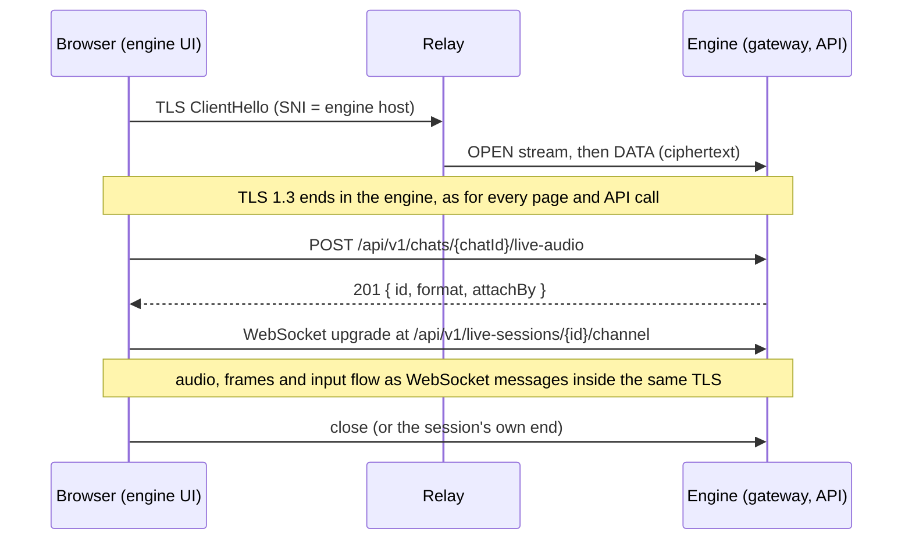

# Live sessions: voice, video and a remote browser tab

**Design only. Build nothing from this page yet.** It prepares the contract for three later features the Reborn app contract defers but asks us to design for now (`specs/app/integration.md`, "Explicitly deferred, designed for now"):

- full-duplex live audio between the owner and an agent in a chat, processed by the engine;
- video next to that audio, later;
- the owner driving one engine browser tab by hand, to sign in to a site an agent needs.

The names and routes are reserved in the contract so nothing else takes them, and they are inert: no engine advertises them, and their routes answer 404 `capability-not-supported`. Decision record: [ADR 0019](../adr/0019-live-sessions-inside-the-tunnel.md). Each section marks what is **decided** and what is **open** for the engine team.

The engine's own voice mode (`specs/cli/voice-chats.md`, `harness-voice.md`) is local and terminal-driven; it does not need any of this. What carries over is its model: a voice call belongs to an ordinary chat, the harness adapter owns the provider connection, transcripts become messages with real authors, and closing the media page ends the call.

## The boundary

**Decided.** The same zero-trust boundary as for every other request (`integration.md`, "Access, transport and zero trust"): only the authorised browser and the engine read audio, video, frames or input. Relays and the dashboard see ciphertext and metadata only.

Concretely, a live session rides the transport we already have, with no change to it:

- The browser opens the session with an ordinary API call, then attaches one WebSocket on the engine origin. That WebSocket is a normal HTTPS connection to the engine, so the relay sees one more tunnel stream of TLS records, exactly like a page load or the event stream.
- **No new tunnel frame types, stream kinds or tunnel features.** The tunnel is content-blind on purpose: a frame type for "audio" would tell the relay what a stream carries. Every stream stays an opaque TLS byte stream. The frame registry keeps codes 5–127 for a future version or a negotiated feature ([tunnel-client.md](tunnel-client.md#frames)); none is needed for this design.
- What the relay can still infer is traffic shape: a long-lived stream with steady two-way packets looks like a call, and a screencast looks like bulk downstream. That is the same class of metadata it already sees (bytes and timing per engine). Padding or constant-rate shaping is **open**; we do not plan it.

## Capabilities

**Decided (reserved).** Three capability IDs, in `RESERVED_CAPABILITIES` of `@ptbk/engine-api`, not in `KNOWN_CAPABILITIES`:

| Capability      | Means                                                            | Routes now                                                 |
| --------------- | ---------------------------------------------------------------- | ---------------------------------------------------------- |
| `live-audio@1`  | Full-duplex voice in a chat                                      | `POST /chats/{chatId}/live-audio` (`openLiveAudioSession`) |
| `live-video@1`  | Video tracks in a `live-audio@1` session, added to its open body | none; it extends `live-audio@1` additively                 |
| `browser-tab@1` | The owner drives one new engine browser tab to sign in to a site | `POST /browser-tab-sessions` (`openBrowserTabSession`)     |

Both routes are `draft`, carry their capability, and the in-memory core answers them with `capability-not-supported` even when told to advertise them. The conformance check `engine-api.live.reserved` fails an engine that advertises any of the three, and checks that their routes answer 404 `capability-not-supported`. The checks `engine-api.live-audio.session` and `engine-api.browser-tab.session` are registered and skip with `capability-not-advertised`; they get bodies when the design is agreed.

An engine advertises a capability only when it can actually do it at that moment (a voice-capable harness that is ready and permitted, a browser tool that is running). Advertising is not a promise that every call will start: runtime unavailability is a problem on the open call, not a missing capability (`harness-voice.md`: unsupported and unavailable are different results).

## Opening a session

**Decided (reserved shape, strict schemas in [`live.ts`](../../packages/engine-api/src/capabilities/live.ts)).**

- `POST /chats/{chatId}/live-audio`, permission `chats.write`, body `{ formats }`: the audio formats the browser can both capture and play, in preference order, each once. Answer 201 `LiveAudioSession { id, chatId, format, attachBy }`, the one format the engine picked; none acceptable is 415 `unsupported-media-type`. One live session per chat at a time.
- `POST /browser-tab-sessions`, permission `browser.control`, **step-up**, body `{ browser, origin }`: `browser` is a configured browser tool by name, or `null` for the engine's default; `origin` is a canonical `https` origin. Answer 201 `BrowserTabSession { id, browser, origin, attachBy, endsAt }`.
- `attachBy` is `LIVE_SESSION_ATTACH_MS` (30 s) after opening. A session whose channel has not attached by then ends unused and frees whatever it reserved (a paid provider call is not started before the channel attaches).
- Strict in, tolerant out, as everywhere: unknown fields are 400 `validation-failed`; clients strip unknown response fields.

**Open.**

1. Whether opening audio should name the speaking agent or leave it to the chat's routing (`harness-voice.md` keeps the chat's participants and routing; we lean to the latter, so no field).
2. How a browser tab session links to the Wallet request that caused it (an agent waiting for a login). A `requestId` would be an additive field once the Wallet contract has request IDs.
3. Whether `browser` names should be listed by an API (a `GET /browsers` or part of the tools inventory). Until then the UI sends `null`.

## Auth on the channel

**Decided.**

- The channel is a WebSocket upgrade at `ENGINE_API_PREFIX` + `LIVE_CHANNEL_PATH` (`/api/v1/live-sessions/{sessionId}/channel`) with subprotocol `LIVE_CHANNEL_SUBPROTOCOL` (`ptbk-live`). The subprotocol names the protocol only; the version is agreed in the first message, as in the tunnel handshake.
- It is authenticated like every API request, by the gateway session cookie. No extra token in the URL, the subprotocol or the first message: nothing that could land in a log or a referrer.
- The gateway checks `Origin` equals the engine's own origin before upgrading (cross-site WebSocket hijacking), as it checks every state-changing request.
- A session belongs to the gateway session that opened it. Another member, or the same member's other session, gets 404 for it. Revoking the gateway session or the member closes the channel within one message, as for every request.
- One attached channel per session. A second upgrade while one is attached is refused; after a drop, the same gateway session may re-attach until the session ends. Reloading or duplicating the page never starts a second paid call or a second input owner (`voice-chats.md`).
- Every open, attach, end and refusal goes to the audit log as metadata only (session ID, kind, chat or origin, outcome, duration). Never audio, frames, input, transcript text or the URL inside the tab.

**Step-up.** The browser tab needs a fresh passkey assertion to open (`stepUp: true`): driving the engine's browser means acting as the engine's accounts. Live audio does not; talking in a chat is ordinary chat use, like typing in it.

## Inside the channel

**Proposed, open for the engine team.** The route contract above is all we reserve in code; the channel's message format is drafted here and will be fixed in the contract when the first capability is built.

- Text WebSocket messages are control messages: strict JSON with a `type`, parsed like any request (unknown types or fields close the channel). First `hello` from each side with the protocol versions they speak; then, for audio, `state` (listening, speaking, muted, reconnecting), `caption` (interim text, final with a stable utterance ID), `interrupt`, `mute`, `end`; for the browser tab, `frame-ack`, `input`, `navigated`, `blocked`, `end`.
- Binary WebSocket messages are media: one byte of kind (audio in, audio out, video, tab frame), then a sequence number and a timestamp, then the payload. One message per audio packet group or per frame; never larger than 64 KiB, so a message never needs more than one tunnel `DATA` frame's worth of credit.
- `end` from either side, closing the WebSocket, the session's `endsAt`, a stopped engine, or a panic stop all end the session; ending is idempotent, and the other side always learns why with a closed set of reasons.

Transcripts are not a second message store: final utterances become the chat's ordinary messages through the chats contract, with their real authors and order, and appear in the chat's event stream like any message. The channel carries only what is live.

## Formats and codecs

**Open.** `LIVE_AUDIO_FORMATS` holds a first proposal, one format per session for both directions:

- `opus-48k-mono`: small (about 4 KB/s at 32 kbit/s), what browsers' WebCodecs `AudioEncoder` and `AudioDecoder` produce and take. Needs WebCodecs audio, which Chrome and Firefox have and Safari has only recently; without it the browser offers only PCM. A WebAssembly Opus encoder is not an option: `ENGINE_UI_CSP` has no `'wasm-unsafe-eval'`, on purpose.
- `pcm16-24k-mono`: 48 KB/s, no codec on either side, and what realtime speech providers commonly take, so the engine passes it through to the harness without transcoding.

What the engine team needs to tell us: what the voice harness (Codex with native ChatGPT login first) actually takes and returns, and whether the engine or the browser should transcode. The list only grows within `live-audio@1`.

Video (`live-video@1`): VP8 or H.264 through WebCodecs, or JPEG frames for a first version; decided only when video is planned.

Browser tab frames: JPEG or WebP screenshots from the browser's screencast (CDP `Page.startScreencast`), sized to the viewer's canvas. The spec's earlier estimate is 2–5 GB per hour at several frames per second ([zero-trust spec](../spec/zero-trust-spec.md), bandwidth and cost); keep it down with a frame-rate cap, adaptive quality and stopping when the UI tab is hidden.

## Backpressure and latency

**Decided.**

- Each live session is its own tunnel stream with its own flow-control window (`INITIAL_WINDOW_BYTES`, 256 KiB). A file download on another stream cannot stall it at the window level. Towards the engine, the relay already takes turns between a tunnel's streams in 16 KiB slices; towards the browser, the engine should interleave its streams the same way rather than write one stream's whole window first.
- The engine never queues media without a bound. When the channel's send buffer passes a small threshold, it drops, not queues: for audio, the oldest unsent packets (late audio is worthless); for the tab, it skips frames (the screencast's per-frame ack is the natural credit: no new frame until the last one was acked).
- Input events (browser tab) are never dropped; they are small and ordered, and the session ends if they cannot be delivered.
- The relay's per-engine budgets apply unchanged: `RELAY_TUNNEL_FRAMES_PER_S` (20,000 frames per second by default) and `RELAY_ENGINE_BANDWIDTH_BYTES_PER_S` (12.5 MB/s). Audio at 50 packets per second each way is far below both; send audio in 20–60 ms groups, not one packet per frame of a few bytes.

**Open.**

1. Everything runs over TCP twice (browser to relay, relay to engine over one WebSocket per tunnel), so a lost packet delays everything behind it. For voice on a reasonable network that is acceptable; we will measure mouth-to-ear latency through a relay before committing. The fix, if needed, is not in this design: a WebRTC path (below) or a datagram transport in a later tunnel version.
2. Whether the relay should prioritise small frames over bulk across one tunnel. Today it is fair per stream, not latency-aware. Changing that is a relay-only change and invisible to engines.

## The browser tab channel

**Decided** (the limits are the point of the feature):

- **Owner only.** `browser.control` is a new permission; engine policy gives it to owners only (the mock engine's `admin` lacks it). Plus step-up to open.
- **A new tab, never an existing one.** The engine opens a fresh tab in the chosen browser at `origin` for this session alone. The session never sees, lists or switches to another tab: not a task's tab, not another session's. When it ends, the engine closes that tab; the login it produced stays in the profile, as with any manual sign-in (`browser.md`).
- **Origin allowlist.** The engine accepts an `origin` only if it is on its allowlist for remote sign-in: proposed as the origins of the engine's Wallet login records and of pending Wallet requests, plus origins the owner added. The engine's own origins (its default and custom hostnames) are always refused. While the tab is on any origin outside the allowlist (an identity provider redirect, a link the page opened), frames stop and input is dropped, and the channel says so with `blocked`, until the tab returns or the owner ends the session. Which identity provider origins (`accounts.google.com` and the like) count as part of a login flow is **open**.
- **Never wallet or secret pages.** No `chrome://`, `about:`, `devtools:`, extension, `file:` or `view-source:` page, never the browser's password manager or settings, and never a page during the engine's protected Wallet entry: frames stop there exactly as screenshots, traces and agent observation do (`browser.md`, "Access and credentials"). Secrets the owner types into the site go only to the site.
- **Input is input, not code.** The browser sends pointer, wheel and key events in tab-relative coordinates and a closed set of keys; the engine replays them with the browser's input API (CDP `Input.dispatch*`). No JavaScript, no CDP commands, no navigation to arbitrary URLs from the client, no clipboard read, no file chooser, no downloads. Typed text is never logged.
- **Bounded.** One browser tab session per engine at a time. `endsAt` is at most `MAX_BROWSER_TAB_SESSION_MS` (10 minutes) after opening; 2 minutes of no input also ends it.
- **Visible.** The engine UI shows a persistent indicator while a session is live (which browser, which origin) with an end control, and the engine marks the session in its own status and terminal surfaces, so the owner always knows a remote tab is open. Every session is in the audit log.
- **Headless hosts.** On a VPS the browser is headless; the screencast works without a display, so this is exactly where the feature helps. `browser.md` defers a remote desktop or VNC login; this is the narrower replacement, one tab and one origin.

## CSP and permissions on the engine origin

**Decided.**

- `ENGINE_UI_CSP` does not change. `connect-src 'self'` covers a `wss:` WebSocket to the same host (CSP Level 3). Audio capture and playback use `getUserMedia`, Web Audio and WebCodecs, none of which `CSP` gates beyond `worker-src`/`script-src 'self'` for an `AudioWorklet` module, which ships in the signed bundle. Tab frames are drawn to a `<canvas>` with `createImageBitmap`, so `img-src` needs no `blob:`. No external origin, no STUN or TURN server, no `eval`.
- `Permissions-Policy` stays `camera=(), microphone=(), …` ([gateway.md](gateway.md#security-headers)) until the engine advertises `live-audio@1`. From then on it sends `microphone=(self)` and nothing else changes; `camera=(self)` only with `live-video@1`. The browser still asks the owner for the microphone the first time.
- Model output stays data: captions and transcripts are text, rendered as text.

**Open.** Whether `AudioWorklet.addModule` needs a Trusted Types policy in every browser we support; the engine UI's CSP test (`test:csp`) will show it when the feature is built.

## WebRTC

**Decided for now: no.** WebRTC would give lower latency over UDP, but it needs STUN and usually TURN servers (an external origin and another party that sees metadata), exposes IP addresses, and on an engine behind NAT often ends up relayed anyway. Everything above works without it.

**Open, later.** The spec already names a WebRTC direct path for the screencast, "with its DTLS fingerprint authenticated inside the TLS session, so heavy traffic skips the relay" ([zero-trust spec](../spec/zero-trust-spec.md)). If latency measurements ask for it, it becomes a new ADR: signalling over the live channel, the DTLS fingerprint pinned through it, no third-party TURN, and the same capability names.

## What the engine team should tell us

1. What the voice harness takes and returns (format, sample rate, whether it owns media tracks), so we can fix `LIVE_AUDIO_FORMATS`.
2. Whether the engine can get screencast frames and inject input for one tab of a shared browser without disturbing other engines' tabs (`browser.md`: one process per profile, several engines).
3. The allowlist rule for the browser tab, including identity provider redirects.
4. Whether an engine-side visible indicator exists in the terminal dashboard for a remote session.
5. Anything in this page that conflicts with Reborn's behaviour. The engine spec wins on behaviour; this page then changes.
