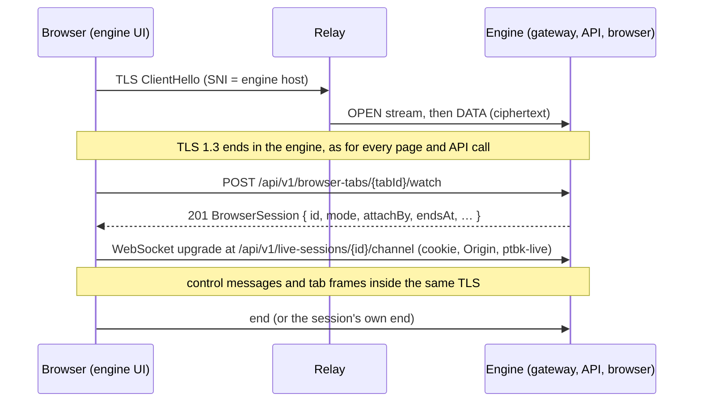

# Live sessions: the live browser, then voice and video

One design for three features the Reborn app contract defers but asks us to design for now (`specs/app/integration.md`, "Explicitly deferred, designed for now"):

- **the live browser** (`browser-tab@1`, a draft capability since 2026-11-20): members watch the tab an agent works in, the owner takes it over mid-task, signs in to a site in a fresh tab, and answers an agent's request for help;
- full-duplex live audio between the owner and an agent in a chat (`live-audio@1`, reserved, design only);
- video next to that audio, later (`live-video@1`, reserved, design only).

Decision record: [ADR 0019](../adr/0019-live-sessions-inside-the-tunnel.md) (Accepted, revised 2026-11-20). Contract: [live.ts](../../packages/engine-api/src/capabilities/live.ts) for the routes and resources, [live-channel.ts](../../packages/engine-api/src/capabilities/live-channel.ts) for the channel. Reference behaviour: the in-memory engine's [live.ts](../../packages/engine-api/src/in-memory/live.ts) with its tests. Conformance: [the browser-tab checks](../../packages/conformance/src/suites/engine-api/live.ts). The implementation brief for the engine is the [AGENT_BRIEF entry of 2026-11-20](AGENT_BRIEF.md#2026-11-20-live-browser-contract-ready).

**Not rolled out.** No real environment advertises `browser-tab@1` yet. The mock engine advertises it only with `MOCK_LIVE_BROWSER=enabled`.

The engine's own voice mode (`specs/cli/voice-chats.md`, `harness-voice.md`) is local and terminal-driven; it does not need any of this. What carries over is its model: a voice call belongs to an ordinary chat, the harness adapter owns the provider connection, transcripts become messages with real authors, and closing the media page ends the call.

## The boundary

**Decided.** The same zero-trust boundary as for every other request (`integration.md`, "Access, transport and zero trust"): only the authorised browser and the engine read frames, input, audio or video. Relays and the dashboard see ciphertext and metadata only.

- The browser opens a session with an ordinary API call, then attaches one WebSocket on the engine origin. That WebSocket is a normal HTTPS connection to the engine, so the relay sees one more tunnel stream of TLS records, like a page load or the event stream.
- **No new tunnel frame types, stream kinds or tunnel features**, and no relay change. A frame type for "screencast" would tell the relay what a stream carries.
- What the relay can still infer is traffic shape: a screencast looks like bulk downstream. That is the metadata it already sees. Padding or constant-rate shaping is not planned.

## Capabilities

| Capability      | Status                    | Means                                                                                      |
| --------------- | ------------------------- | ------------------------------------------------------------------------------------------ |
| `browser-tab@1` | Known, draft (2026-11-20) | Watch and take over agents' tabs, sign in in a fresh tab, help requests                    |
| `live-audio@1`  | Reserved                  | Full-duplex voice in a chat; `POST /chats/{chatId}/live-audio` answers 404 on every engine |
| `live-video@1`  | Reserved                  | Video tracks in a `live-audio@1` session; no routes of its own                             |

The in-memory engine leaves `browser-tab@1` out of `DEFAULT_CAPABILITIES`; a core or the mock engine opts in. An engine advertises it only when it can do it at that moment (a browser tool that runs); runtime unavailability on a call is 503 `unavailable`, not a missing capability.

## The live browser

### Two attachments

- **Sign-in** (`kind: sign-in`): `POST /browser-sessions { browser, origin }` opens a **new** tab at `origin` for this session alone, already in control. Owner only (`browser.control`), behind step-up. No agent uses the tab and no other session reaches it. Ending the session closes the tab; the login it produced stays in the browser profile, as with any manual sign-in (`browser.md`).
- **Agent tab** (`kind: agent-tab`): the tab an agent works in. Members watch it; the owner takes control of it, mid-task. While a human controls it the agent is **paused**; handing back **resumes** it.

### Routes

All `draft`, all on `browser-tab@1`, each declared in the typed route table with its permission. All are session routes, so the engine's per-member request limits apply; the opens are the ones worth limiting first.

| Route                                              | Permission        | Step-up | Does                                                                                     |
| -------------------------------------------------- | ----------------- | ------- | ---------------------------------------------------------------------------------------- |
| `POST /browser-sessions`                           | `browser.control` | yes     | Open a sign-in tab; 422 `browser-origin-refused`, 409 `browser-busy` (one at a time)     |
| `GET /browser-tabs?chatId&taskId&runId`            | `browser.watch`   |         | Agents' tabs the member may watch, newest first (sign-in tabs are never listed)          |
| `POST /browser-tabs/{tabId}/watch`                 | `browser.watch`   |         | A watching session; 409 `browser-tab-full`                                               |
| `POST /browser-tabs/{tabId}/control`               | `browser.control` | yes     | A controlling session; answers the tab's open help request; 409 `browser-tab-controlled` |
| `GET /browser-sessions/{sessionId}`                | `browser.watch`   |         | The caller's own session; 404 for any other gateway session's                            |
| `POST /browser-sessions/{sessionId}/control`       | `browser.control` | yes     | A watching session takes control; idempotent                                             |
| `POST /browser-sessions/{sessionId}/hand-back`     | `browser.control` |         | Back to watching, the agent resumes (`handed-back`); a sign-in session ends              |
| `POST /browser-sessions/{sessionId}/end`           | `browser.watch`   |         | End it, idempotent; a controller's agent resumes (`ended`)                               |
| `GET /browser-help-requests?status=open\|resolved` | `browser.watch`   |         | Help requests of work the member can see                                                 |
| `GET /browser-help-requests/{requestId}`           | `browser.watch`   |         | One, with its resolution                                                                 |
| `POST /browser-help-requests/{requestId}/dismiss`  | `browser.control` |         | Decline without taking control (`dismissed`); 409 while controlled or once resolved      |

Events on `GET /events`, IDs only: `browser-tab.changed { tabId }` (opened, moved, control or participants changed, closed) and `browser-help.changed { requestId }` (raised, in progress, resolved). The stream sends them to members holding `browser.watch`; a member who may not see the work gets 404 when reading it.

Strict in, tolerant out, as everywhere: the engine refuses unknown request fields with 400; the client strips unknown response fields and reads unknown enum values as `unknown`. The typed client groups the routes as `client.browser.*`.

### Permissions

**Decided** (likely to change later, which is why they are two closed-allowlist permissions):

- `browser.watch`: watching an agent's tab read-only, and seeing help requests. Engine policy gives it to members who can see the chat, task or run the tab belongs to, and the engine checks that per tab (the in-memory engine, which has no per-chat rules, checks `chats.read`, `tasks.read` and `runs.read` for the tab's links). The mock gives it to admin, member and viewer.
- `browser.control`: taking control, a sign-in tab, dismissing a help request. Owner only; the routes that grant control need step-up (a fresh passkey assertion): driving the engine's browser means acting as the engine's accounts.

### A session belongs to its gateway session

- A `BrowserSession` is one member's participation in one tab, bound to the gateway session that opened it. Any other gateway session, the same member's included, gets **404** for it on every route and on the channel.
- One channel per session at a time: a second upgrade while one is attached is 409 `live-channel-attached`. After a drop, the same gateway session may attach again until the session ends.
- Revoking the gateway session or the member (or the member losing the permission) ends their sessions with `revoked`, within one message or one sweep of the engine's timer.

### Control

- **Exclusive.** One controller per tab; anyone else asking gets 409 `browser-tab-controlled`. Watchers keep watching. At most `MAX_BROWSER_PARTICIPANTS` (5) open sessions per tab, the controller included.
- **The agent pauses.** Taking control sets the tab's `agentState` to `paused`, and the engine stops the agent's browser actions on that tab at its next step boundary (it does not cancel the run). Handing back, ending, expiry, idle, revocation and a protocol error all return control and resume the agent, which is told the outcome (below).
- **Where the controller may go.** While a human controls a tab, frames are shown only on the tab's origin when control started, plus the sign-in allowlist. A link that leaves them stops frames and drops input (`blocked`, `origin-not-allowed`) until the tab is back. Watching an agent shows any web origin the agent visits (the member can see that work anyway), never browser or secret pages.

### Help requests

An agent stuck on a page only a human can get past raises a `BrowserHelpRequest`:

- `id`, `tabId`, the work it came from (`agentId`, `chatId`, `taskId`, `runId`), `reason` from a closed set (`login`, `captcha`, `confirmation`, `blocked`, `other`), the tab's `origin`, the agent's short `message` (model output, at most 500 characters, **rendered as text only**), `status` (`pending`, `in-progress`, `resolved`), `resolution`, `createdAt`, `updatedAt`.
- One open request per tab; asking again while one is open is the same request.
- The tab's `agentState` is `waiting` while it is pending. The owner joins in control with one click (`POST /browser-tabs/{tabId}/control`, step-up); the request becomes `in-progress` and the session carries its `helpRequestId`.
- The agent waits until the request is resolved, then gets the **resolution** `{ outcome, origin, by, at }`. This is what the engine hands to the agent. Outcomes:
  - `handed-back`: the controller handed the tab back.
  - `ended`: the controller ended their session without handing back.
  - `expired`, `idle`: the session's time or the controller's idle limit ran out.
  - `blocked-origin`: control ended while the tab was on a page the session could not show; the agent finds the tab there.
  - `dismissed`: the owner declined without taking control.
  - `revoked`: the controller's gateway session or membership was revoked.
  - `cancelled`: the agent's work ended or closed the tab first.
- The agent never learns frames, input or typed text, only the outcome and the origin. When control of a tab ends without a help request, the agent resumes the same way, and its browser tool gets the same outcome.

### Narration

**Designed, not built.** While someone watches, the agent's current step and intent appear next to the stream from what already exists: the tab names its `runId`, `chatId`, `taskId` and `agentId`, and the UI shows that run's `run.changed` steps and the chat's live `working` steps (`chat.changed`). No new narration channel; if one is ever needed, it is an additive control message.

### Bounded and visible

- `endsAt` is at most `MAX_BROWSER_TAB_SESSION_MS` (10 minutes) after opening, for watchers and controllers alike; the UI opens a new session to keep watching.
- `attachBy` is `LIVE_SESSION_ATTACH_MS` (30 s) after opening: a session whose channel has not attached by then ends with `not-attached`.
- A controller who sends no input for `BROWSER_IDLE_MS` (2 minutes) ends their session with `idle`. Watchers are not idle-checked.
- One sign-in session per engine at a time.
- The engine UI shows a persistent indicator while a session is live (which tab, which origin, watching or controlling, "you are controlling the agent's browser") with an end control. The engine marks remote sessions in its own status and terminal surfaces.

### Never secret pages

No `chrome://`, `about:`, `devtools:`, extension, `file:` or `view-source:` page, never the browser's password manager or settings, and never a page during the engine's protected Wallet entry: frames stop there (`blocked` with `browser-page` or `secret-page`, origin withheld) exactly as screenshots, traces and agent observation do (`browser.md`, "Access and credentials"). Secrets the owner types into a site go only to the site.

### Input is input, not code

The browser sends pointer, wheel and key events in tab coordinates; the engine replays them with the browser's input API (CDP `Input.dispatchMouseEvent`, `Input.dispatchKeyEvent`). No JavaScript, no CDP commands, no navigation to a URL, no clipboard, no file chooser, no downloads from the client. Keys are a closed set of named keys or one printable character, with Shift as the only modifier, so no shortcut can reach the clipboard, print, save, devtools or a new tab. A file chooser or download the page itself opens is cancelled by the engine while a human controls the tab.

### Audit

Every open, control change, hand-back, end, attach and refusal goes to the audit log as **metadata only**: session ID, origin, outcome, end reason, duration. Never frames, input, typed text or the URL inside the tab. Actions: `browser.sign-in.open`, `browser.watch`, `browser.control.take`, `browser.control.hand-back`, `browser.session.end`, `browser.channel.attach`, `browser.help.dismiss`; targets `browser-session` and `browser-help-request`.

## The channel

**Decided** with `browser-tab@1`; audio and video will reuse it.

### Attaching

- A WebSocket upgrade at `ENGINE_API_PREFIX` + `LIVE_CHANNEL_PATH` (`/api/v1/live-sessions/{sessionId}/channel`) with subprotocol `LIVE_CHANNEL_SUBPROTOCOL` (`ptbk-live`), which names the protocol only.
- Authenticated like every API request, by the gateway session cookie. No token in the URL, the subprotocol or the first message.
- The gateway checks that `Origin` equals the engine's own origin before upgrading (cross-site WebSocket hijacking).
- Refusals before the upgrade are problem+json: 401 without a session, 403 for a wrong or missing `Origin` or a missing permission, 404 for an unknown session or another gateway session's, 409 `browser-session-ended` or `live-channel-attached`, 404 `capability-not-supported`.

### Control messages

Text messages are JSON objects with a `type`, at most `MAX_LIVE_CONTROL_MESSAGE_BYTES` (4 KiB). The engine parses what the browser sends strictly (`LiveClientMessage`, `parseLiveClientMessage`): anything unknown, malformed or too large ends the channel with `end { reason: 'protocol-error' }` and close code 1008. The browser reads what the engine sends tolerantly (`readLiveEngineMessage`): unknown types are skipped, unknown fields stripped, unknown enum values read as `unknown`.

Browser to engine:

| Message                           | Meaning                                                                                      |
| --------------------------------- | -------------------------------------------------------------------------------------------- |
| `hello { versions }`              | First message: every channel version it speaks. Anything else first is a protocol error.     |
| `view { width, height, visible }` | Its drawing size (frames no larger), and whether its page is visible (hidden pauses frames). |
| `frame-ack { seq }`               | This frame was drawn; frees one unit of credit. Unknown sequences are ignored.               |
| `input { event }`                 | A `LiveInputEvent` (below). Only the controller's reaches the tab.                           |
| `end`                             | End the session, as `POST …/end` does.                                                       |

Engine to browser:

| Message                                   | Meaning                                                                                                                                 |
| ----------------------------------------- | --------------------------------------------------------------------------------------------------------------------------------------- |
| `hello { version }`                       | The version it chose, the highest both speak; none shared is a protocol error.                                                          |
| `state { mode, agent, others, viewport }` | After `hello` and on every change: `watching` or `controlling`, the agent's state, the other participants, the tab's viewport in CSS px |
| `navigated { origin }`                    | The tab is on this origin and may be shown; frames resume. Origin only, never the URL.                                                  |
| `blocked { reason, origin }`              | Frames stop, input is dropped: `origin-not-allowed` (with the origin), `browser-page` or `secret-page` (origin withheld).               |
| `input-refused { reason }`                | `not-controlling`, `blocked` or `outside-viewport`; the channel stays open.                                                             |
| `end { reason }`                          | The last message, then close 1000 (1008 for `protocol-error`).                                                                          |

`LiveInputEvent`, in tab coordinates (CSS pixels of the viewport `state` reports, 0 to 16,384):

- `{ kind: 'pointer', action: 'move' | 'down' | 'up', x, y, button: 'none' | 'left' | 'middle' | 'right', clicks: 0–3 }`
- `{ kind: 'wheel', x, y, deltaX, deltaY }`, deltas within ±10,000
- `{ kind: 'key', action: 'down' | 'up', key, shift }`, `key` one of `LIVE_NAMED_KEYS` (Enter, Tab, Backspace, Delete, Escape, the arrows, Home, End, PageUp, PageDown) or exactly one printable character

More than `MAX_LIVE_INPUT_PER_S` (120) input events in a second ends the channel with `protocol-error`; the browser coalesces pointer moves to one per animation frame.

End reasons (`LIVE_END_REASONS`): `ended`, `expired`, `idle`, `not-attached`, `revoked`, `tab-closed`, `engine-stopped`, `protocol-error`. Ending is idempotent, and the other side always learns why.

### Media

Binary messages are media, encoded and decoded by `encodeLiveMedia` and `decodeLiveMedia`:

| Bytes | Field                                                                                                       |
| ----- | ----------------------------------------------------------------------------------------------------------- |
| 0     | kind (u8): 1 `tab-frame-jpeg`, 2 `tab-frame-png`, 3 `tab-frame-webp`; 16–31 kept for audio, 32–47 for video |
| 1–4   | sequence (u32, big-endian)                                                                                  |
| 5–12  | capture time (float64 ms since the epoch, big-endian)                                                       |
| 13–   | payload: one whole image                                                                                    |

A message never exceeds `MAX_LIVE_MEDIA_BYTES` (64 KiB) with its header, so it never needs more than one tunnel `DATA` frame's worth of credit; a frame that would be larger is re-encoded smaller or skipped. The browser sends no media in `browser-tab@1`; a binary message from it is a protocol error.

### Backpressure

- The screencast's credit: no new frame while `MAX_UNACKED_FRAMES` (2) are unacknowledged. With CDP that maps onto `Page.screencastFrameAck`, driven by the browser's `frame-ack`.
- The engine drops frames rather than queue them when the WebSocket's send buffer grows, and stops frames while the view is hidden or the tab is blocked.
- Each live session is its own tunnel stream with its own flow-control window (`INITIAL_WINDOW_BYTES`, 256 KiB), so a download on another stream cannot stall it at the window level. The relay's per-engine budgets apply unchanged (`RELAY_TUNNEL_FRAMES_PER_S`, `RELAY_ENGINE_BANDWIDTH_BYTES_PER_S`).
- The spec's estimate for a screencast is 2–5 GB per hour at several frames per second ([zero-trust spec](../spec/zero-trust-spec.md), bandwidth and cost); keep it down with a frame-rate cap, adaptive quality, sizing to `view`, and pausing while hidden.

## CSP and permissions on the engine origin

**Decided.** `ENGINE_UI_CSP` does not change: `connect-src 'self'` covers the `wss:` WebSocket to the same host, and frames are drawn to a `<canvas>` with `createImageBitmap`, so `img-src` needs no `blob:`. `Permissions-Policy` stays `camera=(), microphone=(), …` ([gateway.md](gateway.md#security-headers)); the live browser needs neither. Model output stays data: a help request's `message` is text, rendered as text.

## Voice and video (reserved, design only)

Unchanged since 2026-11-05 and not built. `POST /chats/{chatId}/live-audio` (`openLiveAudioSession`, `chats.write`, body `{ formats }`) answers 404 `capability-not-supported` on every engine, advertised or not; the conformance check `engine-api.live.reserved` fails an engine that advertises `live-audio@1` or `live-video@1`.

- A voice session belongs to a chat; transcripts become the chat's ordinary messages with their real authors. One live session per chat. No step-up: talking in a chat is ordinary chat use.
- It would use the same channel: control messages `state` (listening, speaking, muted, reconnecting), `caption` (interim and final, with a stable utterance ID), `interrupt` and `mute`; audio as media kinds 16–31, in 20–60 ms groups.
- Formats: `LIVE_AUDIO_FORMATS` proposes `opus-48k-mono` (WebCodecs) and `pcm16-24k-mono`; no WebAssembly encoder, since `ENGINE_UI_CSP` has no `'wasm-unsafe-eval'`. Video: VP8 or H.264 through WebCodecs, or JPEG frames, decided when video is planned.
- `Permissions-Policy` would send `microphone=(self)` once `live-audio@1` is advertised, `camera=(self)` only with `live-video@1`.

Open for audio: what the voice harness takes and returns (so `LIVE_AUDIO_FORMATS` can be fixed), mouth-to-ear latency through a relay over TCP, and whether `AudioWorklet.addModule` needs a Trusted Types policy.

## WebRTC

**Decided for now: no.** WebRTC would give lower latency over UDP, but it needs STUN and usually TURN (an external origin and another party that sees metadata), exposes IP addresses, and behind NAT often ends up relayed anyway. If latency measurements ask for it, it becomes a new ADR: signalling over the live channel, the DTLS fingerprint pinned through it, no third-party TURN, the same capability names.

## Still open for the engine team

1. **The sign-in allowlist rule.** Proposed: the origins of the Wallet's login records and pending Wallet requests, plus origins the owner added; never the engine's own origins. Which identity-provider origins (`accounts.google.com` and the like) count as part of a login flow, so that a redirect during sign-in or control does not block the frames.
2. **Browser names.** `browser` names a configured browser tool or `null` for the default. Whether names should be listed by an API (a `GET /browsers` or part of the tools inventory); until then the UI sends `null`.
3. **The agent's tab.** Whether the engine can screencast and inject input into one tab of a shared browser without disturbing other engines' tabs (`browser.md`: one process per profile, several engines), and how an agent's browser tool pauses at its next step and receives the outcome.
4. **Screencast settings.** Format (JPEG is the obvious first), quality and frame-rate defaults, and when to re-encode below 64 KiB.
5. **A visible indicator** in the terminal dashboard for a remote session.
6. Anything here that conflicts with Reborn's behaviour. The engine spec wins on behaviour; this page then changes.
