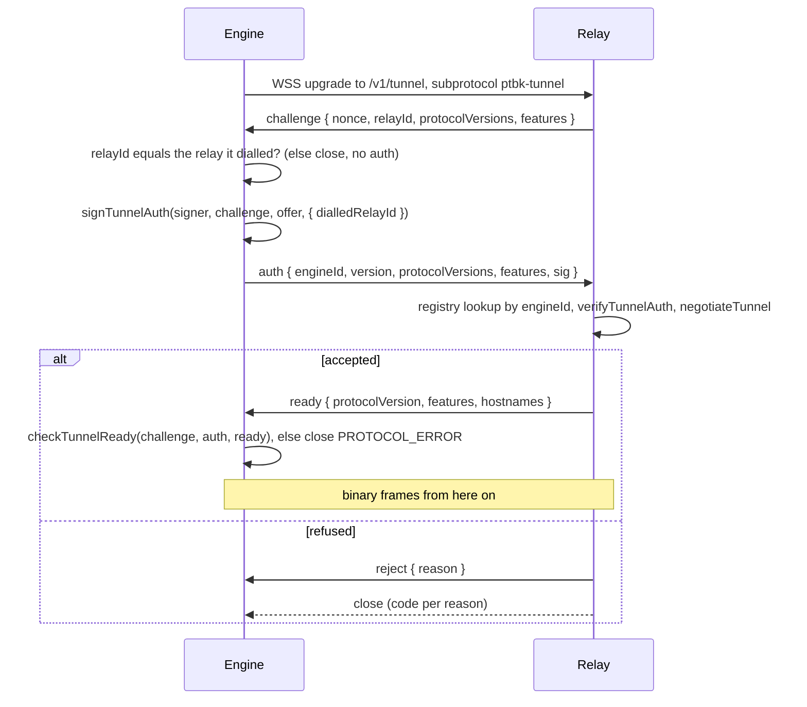

# Tunnel client

The engine dials out to every relay in its list and holds one multiplexed tunnel to each. A browser's TLS connection arrives through a tunnel as a stream of still-encrypted bytes; the engine ends TLS itself. The relay never decrypts and never holds an engine key or certificate.

Spec: [Relay and tunnel](../spec/zero-trust-spec.md#relay-and-tunnel), [Interfaces (draft)](../spec/zero-trust-spec.md#interfaces-draft) 2, 3 and 6, [Residual risks](../spec/zero-trust-spec.md#residual-risks-certificates-and-engine-updates) (1. Certificate mis-issuance). ADRs: [0010](../adr/0010-protocol-design-principles.md), [0014](../adr/0014-cryptography.md). Contract: [`src/tunnel/`](../../packages/protocol/src/tunnel/) in `@ptbk/protocol`.

The code in `@ptbk/protocol` is more precise than the spec's Interface 3, which still describes the shorter three-message handshake. Where they differ, follow the code; this page does.

## Dialling

The engine must:

- Keep one tunnel to **every** relay in its list (from registration, at most `MAX_RELAYS`; `PTBK_RELAYS`, when the operator sets it, replaces that list, see the [launch contract](identity-and-registration.md#launch-contract)). Tunnels are independent: one failing relay never delays the others, and a stream lives on exactly one tunnel. DNS returns all relays for the engine's hostname, so a browser tries the next one when one is down.
- Connect to `wss://<relay hostname>` + `TUNNEL_PATH` (`/v1/tunnel`) with the WebSocket subprotocol `TUNNEL_SUBPROTOCOL` (`ptbk-tunnel`). The subprotocol names the protocol only; the version is negotiated in the handshake.
- Verify the relay's TLS certificate for the relay's hostname with the system's trust roots, also through a proxy. A certificate for another name or from an untrusted CA fails the attempt. An operator may add a CA (for a TLS-inspecting proxy), but never replace the default roots.
- Honour `HTTPS_PROXY` and `NO_PROXY`: when a proxy applies, open the TCP connection with HTTP `CONNECT` (basic auth from the proxy URL if present), then TLS to the relay over that socket, still checking the relay's name. A non-2xx answer fails the attempt; log the status code only, never the proxy credentials.
- Send handshake messages as WebSocket text and frames as binary messages. The mock engine turns WebSocket compression off; there is nothing to gain from compressing TLS ciphertext.
- Put a timeout on the connect (TCP, proxy, TLS and upgrade) and on the handshake.

## Handshake

The messages are `TunnelChallenge`, `TunnelAuth`, `TunnelReady` and `TunnelReject`. Each is strict JSON with `v: 1` and at most `MAX_HANDSHAKE_MESSAGE_BYTES`. Handshake messages stay at `v: 1` in every protocol version, so any engine can always read a `reject`. Parse what the relay sends with `parseRelayMessage`, which never throws.

The engine must:

1. Check that the challenge's `relayId` equals the hostname of the relay it dialled, taken from its own relay list, never from the challenge. On a mismatch, close without answering. `signTunnelAuth` enforces this: pass `{ dialledRelayId }` and it returns `wrong-relay` without calling the signer, so a signature can never be replayed to another relay.
2. Sign `auth` with `signTunnelAuth`. It signs `signingInput('ptbk-tunnel-v1', relayId, nonce, engineId, version, relayVersions, relayFeatures, engineVersions, engineFeatures)` ([cryptography.md](cryptography.md)): the nonce as its raw 32 bytes, `version` as the engine's software version (`EngineVersion`), and the relay's lists taken from the challenge. Every field of `auth` except `sig` is signed, so nothing in it can be changed in the path.
3. Encode each list exactly as `tunnelAuthInput` does, because it is part of the wire format: `protocolVersions` sorted numerically ascending, in decimal without leading zeros; `features` sorted ascending by byte (ASCII order, not locale order); each list comma-joined into one UTF-8 part; an empty list is an empty part. For example `[2, 10, 1]` is `"1,2,10"`, and `"a-b"` sorts before `"ab"`.
4. Offer 1 to 8 unique versions in 1..`MAX_PROTOCOL_VERSION` (65,535, a u16) and 0 to 32 unique features matching `TunnelFeature`. v1 has `TUNNEL_PROTOCOL_VERSIONS = [1]` and `TUNNEL_FEATURES = []`.
5. On `ready`, run `checkTunnelReady(challenge, auth, ready)` and close with `TUNNEL_CLOSE_CODE.PROTOCOL_ERROR` unless it returns `ok`. `ready.protocolVersion` must be the highest version both lists share and `ready.features` exactly their intersection, sorted by byte (`negotiateTunnel`), so nobody can downgrade the session.
6. Record the hostnames the relay accepted in `ready` (1 to 32). Warn if the engine's default hostname is missing.
7. After `ready`, speak the chosen version and send optional fields or ignorable frames only for features both sides advertised. A text message after `ready` is a protocol error.

The relay waits `AUTH_TIMEOUT_MS` (10 s) for `auth` after sending `challenge`. The engine's own handshake timeout is its choice; the mock engine allows 15 s from the WebSocket opening to `ready` and then closes with `AUTH_FAILED`.

## Reject reasons and close codes

The relay sends a `reject` before closing for every refusal during the handshake, then closes:

| `reject.reason`       | Close code                                | Relay's meaning                                                     |
| --------------------- | ----------------------------------------- | ------------------------------------------------------------------- |
| `auth-failed`         | `TUNNEL_CLOSE_CODE.AUTH_FAILED` (4001)    | Unknown engine, bad signature, key mismatch or registry unavailable |
| `suspended`           | `TUNNEL_CLOSE_CODE.SUSPENDED` (4004)      | The engine is suspended or revoked                                  |
| `unsupported-version` | `TUNNEL_CLOSE_CODE.PROTOCOL_ERROR` (4002) | No common protocol version                                          |
| `timeout`             | `TUNNEL_CLOSE_CODE.AUTH_FAILED` (4001)    | `auth` did not arrive in time                                       |
| `rate-limited`        | 1013 (Try Again Later)                    | Too many attempts; the one close code outside 4000–4999, on purpose |

Malformed input (an invalid message, a binary message during the handshake, a message of the wrong type) gets no `reject`: the relay closes with `PROTOCOL_ERROR` at once. The reasons are coarse on purpose, so a failed attempt learns nothing finer. Use the names in `TUNNEL_CLOSE_CODE`, never numeric literals; 1013 is not part of that object.

After `ready`, a relay may close a tunnel with:

- `REPLACED` (4000): a newer tunnel with the same engine key took this relay slot. The engine **must not** reconnect in a loop, or two holders of one key would replace each other forever. It should stop that relay's link and alert the owner, because another process holds its key.
- `SHUTTING_DOWN` (4003): the relay is draining. Reconnect soon, with a short jitter.
- `SUSPENDED` (4004) or `AUTH_FAILED` (4001): the relay's periodic registry check refused the engine.
- `PROTOCOL_ERROR` (4002): the engine sent something invalid.
- `FRAME_BUDGET` (4005): the engine sent more frames per second than the relay allows a tunnel. Reconnect with backoff, and send fewer, larger frames.

The engine should reconnect with exponential backoff and full jitter after every other close, after every `reject`, and after every close before `ready`. Fast retries before `ready` could loop against a relay that accepts and closes every connection. The mock engine uses a 500 ms base, factor 2, a 10 s cap and resets after 60 s of a healthy tunnel; those numbers are not part of the contract. After a relay restart, the tunnel should be back within 10 s (spike acceptance criterion). An engine that keeps getting `suspended` or `auth-failed` should show it in the security panel.

## Frames

After `ready`, every binary WebSocket message is one frame: `[u8 type][u32 streamId, big-endian][payload]` (`FRAME_HEADER_BYTES` = 5). The WebSocket message length is the frame length. Use `encodeFrame` and `decodeFrame`; `decodeFrame` never throws and returns `frame`, `ignored` or `invalid` with a `FrameInvalidReason`.

| `FrameType` | Code | Payload                                                                                | Direction       |
| ----------- | ---- | -------------------------------------------------------------------------------------- | --------------- |
| `OPEN`      | 1    | `[u8 family 4 or 6][4 or 16 address bytes][u16 client port]`: the browser's address    | Relay to engine |
| `DATA`      | 2    | 1..`MAX_FRAME_PAYLOAD_BYTES` (65,536) raw bytes                                        | Both            |
| `CLOSE`     | 3    | `[u8 code]` from `CLOSE_CODE`: `NORMAL`, `RESET`, `REFUSED`, `TIMEOUT`, `FLOW_CONTROL` | Both            |
| `WINDOW`    | 4    | `[u32 credit increment]`, 1..`MAX_WINDOW_INCREMENT` (2^31 − 1)                         | Both            |

The type byte is a flag bit and a code. Bit 7 is `FRAME_IGNORABLE_FLAG` (`0x80`); bits 0–6 are the code.

- Code 0 is always invalid, with or without the flag.
- Codes 1–4 are v1 and are always sent with the flag clear; a v1 code with the flag set is invalid (`bad-flags`).
- Codes 5–127 are reserved for a new protocol version or a negotiated feature. There is no private or experimental range. An unknown code with the flag set is `ignored`: drop the frame. Without the flag it is a protocol error. In type bytes: 0x85–0xFF are ignorable, 0x80 and 0x81–0x84 are invalid.

The engine must:

- Accept streams only from the relay. Stream IDs are non-zero u32 values (`StreamId`) that increase per tunnel and are never reused. A duplicate `OPEN`, a reused ID or a frame for a stream that was never opened is a protocol error. A late frame for a stream that already closed is dropped, never a protocol error: the relay may have had it in flight when the stream closed.
- Treat an `invalid` frame as a protocol error and close the tunnel with `PROTOCOL_ERROR`. Capping the WebSocket message size at `FRAME_HEADER_BYTES + MAX_FRAME_PAYLOAD_BYTES` is fine too: the WebSocket layer then closes an oversized frame with 1009.
- Use the `OPEN` address as the client IP for rate limits and the audit log (the engine API's `client.ip`).
- Close a stream with `CLOSE` when it ends; destroying either side closes the other. `CLOSE` closes the stream fully; there is no half-close, and TLS `close_notify` covers orderly shutdown.
- Refuse a stream it cannot serve with `CLOSE` `REFUSED`.

## Flow control

- Each direction of each stream starts with `INITIAL_WINDOW_BYTES` (262,144) of credit, counted in `DATA` payload bytes.
- The engine must not send more `DATA` than its credit; it waits for the relay's `WINDOW`. It grants credit back with `WINDOW` only after it has delivered bytes downstream (for example, as the TLS server reads them), so a slow consumer slows the sender instead of filling memory.
- `DATA` beyond the credit the engine granted, or a grant that would take the window past `MAX_WINDOW_BYTES`, is a flow-control violation: close the stream with `CLOSE` `FLOW_CONTROL`. The mock engine also closes the tunnel with `PROTOCOL_ERROR`.
- Every frame the engine sends counts against a per-tunnel frame budget on the relay, ignorable frames and `CLOSE` for old streams included. Grant credit in increments of at least 1 KiB where the stream allows it: the relay collects smaller grants before it sends `DATA`, unless a grant reopens a fully closed window, and many tiny grants spend the budget.
- Time out TLS handshakes the engine does not complete: the relay resets a stream that gets no `DATA` from the engine within about 10 s of `OPEN`, and refused connections never send a byte.
- `createSendWindow` and `createReceiveWindow` do the accounting and return `violation` instead of wrapping around.
- Respect backpressure everywhere: never buffer without a bound.

## Liveness

- Send a WebSocket ping every `PING_INTERVAL_MS` (25 s), one at a time. The mock engine terminates the connection if no pong arrives within 10 s and reconnects.

## Ending the browser's TLS

- The engine terminates TLS for each stream itself, with TLS 1.3 only, choosing the certificate by SNI. A ClientHello for an unknown or missing SNI fails the handshake; there is no default certificate.
- Certificates come from ACME (below). A renewal applies to new connections without a restart.
- Behind TLS sits the [gateway](gateway.md), never the app server directly.

## Custom hostnames

Enterprise custom hostnames are set up by hand with each customer (not self-service). The engine must:

- Accept the hostname from `PTBK_CUSTOM_DOMAIN`, parsed with the `Hostname` rules (ASCII only, IDNs as A-labels, lowercase, at least two labels). Apex domains are not supported in v0: the setup UI and docs must say so, because an apex cannot carry a CNAME.
- Produce the claim with `signHostnameClaim(signer, hostname, engineId)`, which signs `signingInput('ptbk-hostname-v1', hostname, engineId)`, and show the hostname and the base64url signature so the owner can hand them to us. The dashboard stores the claim and serves it in the registry entry (`RegistryEntry.claims`, `HostnameClaim`).
- Tell the customer to create exactly one DNS record: a CNAME from the custom hostname to `expectedCnameTarget(engineId, engineDomain)`, which is the engine's default hostname `<engineId>.<engine domain>`, **not** a relay hostname.
- Obtain its own certificate for the custom hostname once the relay routes it, exactly as for the default hostname.

What the relay does, so the engine can explain failures to the owner:

- It looks the engine up by engine ID at tunnel auth (`registryPath`, Interface 2), never by hostname, and refreshes the entry every 5 minutes.
- It routes a custom hostname only if the claim verifies (`resolveRoutableHostnames`) **and** the hostname's CNAME resolves to exactly that engine's default hostname. So neither a compromised dashboard nor an attacker can attach a customer's domain to another engine.
- If two connected engines claim the same hostname, it routes it for neither.
- The hostnames it routes are the ones in `ready.hostnames`.

## ACME TLS-ALPN-01 through the relay

The engine obtains its own certificates. TLS-ALPN-01 (RFC 8737) works through the passthrough relay, so normal operation needs no DNS action from us.

- The CA's validation server connects to the engine's hostname on 443 with that SNI and ALPN `acme-tls/1` only. The relay routes it like any browser connection; it never looks at ALPN.
- The engine must recognise that connection from the ClientHello (`parseClientHello` in `@ptbk/protocol` reads SNI and ALPN) and answer it with the challenge certificate, then serve normal connections as usual. Answer `acme-tls/1` only while a challenge for that hostname is pending, and only when it is the sole protocol offered (RFC 8737); close any other `acme-tls/1` connection without a byte.
- The ACME account key must be separate from the engine key, stored in `PTBK_DATA_DIR` with mode 0600.
- Renew before expiry. The spec also asks for an hourly Certificate Transparency check that alerts the owner about certificates with a key that is not the engine's ([ENG-119](checklist.md#tunnel-interfaces-2-and-3); the dashboard's trust page promises it), and a CAA record with `accounturi`.
- The production ACME client is the engine team's choice (see the [open points](README.md#open-points)).

## Contract exports

| Need                       | Export                                                                                                                                                                                                                                             | Source                                                                                                                                                                                           |
| -------------------------- | -------------------------------------------------------------------------------------------------------------------------------------------------------------------------------------------------------------------------------------------------- | ------------------------------------------------------------------------------------------------------------------------------------------------------------------------------------------------ |
| Constants                  | `TUNNEL_PATH`, `TUNNEL_SUBPROTOCOL`, `TUNNEL_PROTOCOL_VERSIONS`, `TUNNEL_FEATURES`, `PING_INTERVAL_MS`, `AUTH_TIMEOUT_MS`, `INITIAL_WINDOW_BYTES`, `MAX_FRAME_PAYLOAD_BYTES`, `MAX_HANDSHAKE_MESSAGE_BYTES`, `MAX_PROTOCOL_VERSION`, `NONCE_BYTES` | [constants.ts](../../packages/protocol/src/tunnel/constants.ts)                                                                                                                                  |
| Handshake                  | `TunnelChallenge`, `TunnelAuth`, `TunnelReady`, `TunnelReject`, `TunnelRejectReason`, `TunnelFeature`, `parseRelayMessage`, `negotiateTunnel`, `checkTunnelReady`                                                                                  | [handshake.ts](../../packages/protocol/src/tunnel/handshake.ts)                                                                                                                                  |
| Signing                    | `signTunnelAuth`, `tunnelAuthInput`, `verifyTunnelAuth`, `DialledRelay`                                                                                                                                                                            | [auth.ts](../../packages/protocol/src/tunnel/auth.ts)                                                                                                                                            |
| Close codes                | `TUNNEL_CLOSE_CODE`                                                                                                                                                                                                                                | [close.ts](../../packages/protocol/src/tunnel/close.ts)                                                                                                                                          |
| Frames                     | `FrameType`, `FRAME_IGNORABLE_FLAG`, `FRAME_HEADER_BYTES`, `CLOSE_CODE`, `StreamId`, `MAX_WINDOW_INCREMENT`, `encodeFrame`, `decodeFrame`                                                                                                          | [frame.ts](../../packages/protocol/src/tunnel/frame.ts)                                                                                                                                          |
| Flow control               | `createSendWindow`, `createReceiveWindow`, `MAX_WINDOW_BYTES`                                                                                                                                                                                      | [window.ts](../../packages/protocol/src/tunnel/window.ts)                                                                                                                                        |
| Hostname claims, CNAME     | `signHostnameClaim`, `expectedCnameTarget`, `HostnameClaim`, `RegistryEntry`, `resolveRoutableHostnames`                                                                                                                                           | [hostname-claim.ts](../../packages/protocol/src/hostname-claim.ts), [custom-hostname.ts](../../packages/protocol/src/custom-hostname.ts), [registry.ts](../../packages/protocol/src/registry.ts) |
| ClientHello (SNI and ALPN) | `parseClientHello`                                                                                                                                                                                                                                 | [client-hello.ts](../../packages/protocol/src/tls/client-hello.ts)                                                                                                                               |

Golden vectors: [`tunnel/vectors.json`](../../packages/protocol/src/tunnel/vectors.json) has a signed handshake with multi-element, unsorted version and feature lists (and each signed part), `auth` messages that must not verify, `ready` messages that must fail `checkTunnelReady`, and valid, ignored and invalid frames in hex.

## Conformance

The `tunnel` suite of [`@ptbk/conformance`](../../packages/conformance/README.md) (C-09) acts as the relays your engine dials. It starts your engine through the platform harness ([conformance.md](conformance.md#an-engine-the-harness-starts)), registers it with a fake dashboard and gives it `PTBK_RELAYS` with three relay hostnames under `localhost`, all served by one fake relay on loopback. Each check gets a fresh engine. Run it with `--engine-cmd … --suite tunnel`; every check ID is in [checklist.md](checklist.md) (ENG-20 to ENG-30).

What your engine must support to be tested, all of it production behaviour:

- **`PTBK_RELAYS`** as an override of the registration's relays, with a port in each URL.
- **The relay CA from `NODE_EXTRA_CA_CERTS`**, added to the default roots. A relay certificate for another name, from another CA or expired must still fail.
- **`HTTPS_PROXY` and `NO_PROXY`** read at start, for `tunnel.proxy.connect`.
- **A restart with the same data directory** (SIGTERM, then a new start), which some checks use to reset backoff.
- **The certificate you would serve anyway** for `<engineId>.<engine domain>`, inside each stream. The suite checks TLS 1.3, the name and the dates. It checks the chain too when your conformance target factory names the CA your certificates chain to (`certificateAuthority(engine)`; the mock's is its dev CA). Your engine never accepts a CA from the suite for anything it verifies. For a run, a development or test CA mode that issues your own leaf is enough. Production keeps ACME.

What the suite measures, and its tolerances:

- Timeouts are the contract's plus a margin: `auth` within `AUTH_TIMEOUT_MS`, back within 5 s of `SHUTTING_DOWN`, within 30 s of any other close, within 15 s of a relay restart, and a ping within `PING_INTERVAL_MS` + 10 s of `ready` (only the first interval is measured, to keep the run short).
- Backoff: one reconnect may come at once under full jitter, so five consecutive failed attempts are judged together: the engine's own delays, from each closed connection to its next TCP connection, must add up to at least 1 s. The relay's handshake work is not counted, so a busy machine only makes a correct engine look slower. After `REPLACED`, at most one reconnect in 10 s.
- Flow control is tested with HTTP/1.1 requests sent one after another on one connection, as a browser sends them, never pipelined.
- A missing-feature downgrade is tried only when the engine offers features; v1 has none.

## Reference implementation

Merged (M-01, M-02), in [`apps/mock-engine`](../../apps/mock-engine/README.md):

- Relay list and composition: [config.ts](../../apps/mock-engine/src/app/config.ts), [start-mock-engine.ts](../../apps/mock-engine/src/app/start-mock-engine.ts).
- Handshake state machine (`idle`, `connecting`, `handshaking`, `ready`, `backoff`): [relay-link.ts](../../apps/mock-engine/src/domain/tunnel/relay-link.ts).
- Backoff and the close-code policy: [backoff.ts](../../apps/mock-engine/src/domain/tunnel/backoff.ts).
- WebSocket dialling, relay certificate check and ping: [ws-relay-dialer.ts](../../apps/mock-engine/src/adapters/ws-relay-dialer.ts), extra CA in [extra-ca.ts](../../apps/mock-engine/src/adapters/extra-ca.ts).
- `CONNECT` proxy and `NO_PROXY`: [http-connect-proxy.ts](../../apps/mock-engine/src/adapters/http-connect-proxy.ts).
- Streams, frames and `WINDOW`: [stream-mux.ts](../../apps/mock-engine/src/domain/tunnel/stream-mux.ts), [tunnel-duplex.ts](../../apps/mock-engine/src/adapters/tunnel-duplex.ts).
- TLS inside the tunnel, certificate per SNI: [tls-stream-server.ts](../../apps/mock-engine/src/adapters/tls-stream-server.ts), [certificate-source.ts](../../apps/mock-engine/src/domain/tls/certificate-source.ts), dev CA in [dev-ca.ts](../../apps/mock-engine/src/adapters/dev-ca.ts).

Where the mock engine is simpler than this page: it treats every `reject` reason alike (it backs off), and it does not sign hostname claims.

- **Custom hostname claims: no reference implementation yet.**
- ACME TLS-ALPN-01 (M-03): the ClientHello router in front of the TLS servers, [client-hello-router.ts](../../apps/mock-engine/src/adapters/client-hello-router.ts) with the decision in [alpn-dispatch.ts](../../apps/mock-engine/src/domain/tls/alpn-dispatch.ts); the challenge responder, [tls-alpn-responder.ts](../../apps/mock-engine/src/adapters/tls-alpn-responder.ts); issuance, storage and renewal, [acme-certificate-source.ts](../../apps/mock-engine/src/adapters/acme-certificate-source.ts) and [renewal-policy.ts](../../apps/mock-engine/src/domain/tls/renewal-policy.ts); the account key, [acme-account-key.ts](../../apps/mock-engine/src/adapters/acme-account-key.ts). The ACME client itself ([acme-client-issuer.ts](../../apps/mock-engine/src/adapters/acme-client-issuer.ts), `acme-client`) is for the Pebble spike only. Result and the Let's Encrypt staging runbook: [docs/spike/acme-tls-alpn-01.md](../spike/acme-tls-alpn-01.md).
