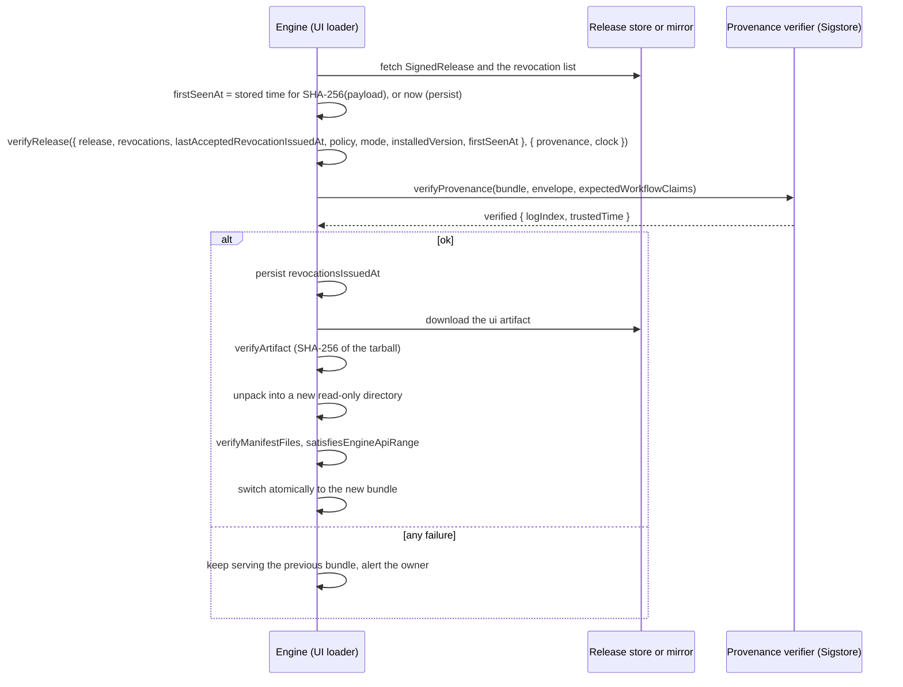

# UI loader

The app UI is our closed, static bundle. The engine never loads it from us at page-load time: it downloads a release, verifies it against the release log, unpacks it and serves it from its own origin under its own CSP. A bundle that fails any check is never served, and the engine keeps the previous one.

Spec: [Interfaces (draft)](../spec/zero-trust-spec.md#interfaces-draft) 5, [Residual risks](../spec/zero-trust-spec.md#residual-risks-certificates-and-engine-updates) (2. Engine updates), [Security hardening](../spec/zero-trust-spec.md#security-hardening) 9 and 10. ADRs: [0003](../adr/0003-ui-as-signed-bundle.md), [0014](../adr/0014-cryptography.md). Contract: [`src/release/`](../../packages/protocol/src/release/) in `@ptbk/protocol`.

Two points that shape the loader are still open: which release and signing identity carry the UI, and who signs the production revocation list and how often (staging's is decided: [development.md](../development.md#revocation-list)). Where releases are fetched from is proposed as the [release mirror layout v1](#release-mirror-layout-v1), pending your review before the E-02 freeze. Read the release log items in the [open points](README.md#open-points) before building the fetcher.

## Flow

## What the engine must do

**Fetch**

- Download the release record (`SignedRelease`: a DSSE envelope over the `ReleaseEntry` bytes plus the Sigstore bundle in `provenance`) and the current revocation list (a DSSE envelope over a `RevocationList`) from the release store or a configured mirror (`PTBK_UI_RELEASE_URL`), in the [release mirror layout v1](#release-mirror-layout-v1). Enterprise and offline installs mirror both. Every request has a timeout and a size cap.
- Check for an update at startup, then periodically. The conformance suite triggers checks by restarting the engine.
- Pass the raw JSON to `verifyRelease`; it parses strictly itself, and only after a trusted signature over the PAE verifies.

**Verify with `verifyRelease`**

`verifyRelease(input, { provenance, clock })` is pure and returns the first failure, in this order: `invalid-entry`, `signature-threshold-not-met`, `not-in-log`, `revocations-unverifiable` (reason `missing`, `invalid`, `expired` or `rolled-back`), `revoked`, `not-newer`, `delay-not-elapsed`; otherwise `ok` with `eligibleAt`.

The engine must:

- Pass its `TrustPolicy`: release keys, exactly three distinct maintainer keys, `SECURITY_THRESHOLD` (2), the `WorkflowIdentity` of the release workflow, the `revocationRule` and `RELEASE_DELAYS` (72 h regular, 24 h security). The schema refuses a key that is both a release and a maintainer key. A policy with `"profile": "staging"` may set both delays from 1 minute up to those values (`StagingTrustPolicy`); accept it only outside production, and in a production build refuse to start with it (`isStagingPolicy`), as the mock engine does under `NODE_ENV=production`. The conformance trust file always carries a production policy.
- Persist `firstSeenAt` per payload SHA-256 the first time it sees a release, and pass the stored value every time after. The delay counts from the latest of `publishedAt`, the verified trusted time and `firstSeenAt`, so a release withheld and shown late still waits the full delay, and a backdated `publishedAt` cannot shorten it.
- Persist the `issuedAt` of every revocation list it accepts (`revocationsIssuedAt` in the result) and pass the latest as `lastAcceptedRevocationIssuedAt`. A list older than that is `rolled-back`.
- Write that state durably (temporary file, `fsync`, rename) and parse it strictly when loading. If the state is lost, the delay restarts rather than shortening; log it as an error, because it also resets rollback protection.
- Keep the current version, and alert the owner, when the revocation list is missing, invalid, expired or rolled back. It never installs without a fresh list. A list whose `issuedAt` is more than `REVOCATION_MAX_FUTURE_SKEW_MS` (5 minutes) in the future, or that is valid for longer than `REVOCATION_MAX_VALIDITY_MS` (30 days), is invalid.
- Pass `installedVersion`, so an older or equal version is `not-newer` (no downgrades).
- Pass `mode: 'manual'` only when the owner approved this release by hand; it skips the delay and nothing else.

What `verifyRelease` enforces on the way (you get it by calling it, not by reimplementing it):

- A regular release needs **both** a valid release-key signature over the PAE and valid provenance from the release workflow. A security release also needs 2 of the 3 maintainer keys. Unknown key IDs are ignored, a key that signs twice counts once.
- A payload with a duplicate JSON key at any depth is `invalid-entry`, even when validly signed.
- At most one `ui` artifact per release.

**Provenance (Sigstore)**

The engine supplies the `ProvenanceVerifier` port. Its adapter must:

- Be built on `@sigstore/verify@4.1.2` directly (with `@sigstore/bundle@5.0.0` and `@sigstore/protobuf-specs@0.5.2`, all pinned exactly), never `sigstore.verify()`, whose identity match is an unanchored regular expression and whose OID comparison uses raw DER.
- Verify against a pinned `trusted_root.json` that ships with the engine's release, with no live TUF fetch: `toTrustMaterial(TrustedRoot.fromJSON(pinnedRoot))`, then `new Verifier(trustMaterial, { tlogThreshold: 1, ctlogThreshold: 1 })`.
- Check that the bundle's DSSE payload and payload type equal the envelope's byte for byte.
- Compare the certificate's subject alternative name to `expectedWorkflowClaims(identity, entry).subjectAlternativeName` exactly, and decode each required Fulcio extension's DER UTF8String and compare the string exactly (`FULCIO_OID`): commit, `refs/tags/<gitTag>`, repository ID, `GITHUB_HOSTED_RUNNER` and `RELEASE_BUILD_TRIGGER` (`push`). No caller-supplied patterns. `checkCertificateClaims` does the comparison.
- Return as `trustedTime` the **latest** verified timestamp in the bundle (RFC 3161 TSA or Rekor integrated time), with `logIndex`; `null` when there is none, which `verifyRelease` treats as `not-in-log`.

**Download, unpack, serve**

- Download the artifact whose `kind` is `ui` and check its SHA-256 with `verifyArtifact` before unpacking. The artifact is a `tar.zst`.
- Unpack into a new directory and make it read-only. Refuse absolute paths, `..`, symbolic and hard links, devices and duplicate paths, and cap the number of files and the unpacked size.
- Parse the bundle's `UiBundleManifest` strictly, require its `version` and `commit` to match the release entry, and check `satisfiesEngineApiRange(manifest.engineApi, ENGINE_API_VERSION)` against the engine API the engine serves.
- Run `verifyManifestFiles(manifest, files)` over everything unpacked: an unlisted file, a missing file or a size or hash mismatch refuses the bundle, so an unpacker bug can never serve a file the release did not contain.
- Serve only files listed in the manifest, with `index.html` (`UI_BUNDLE_ENTRY`) as the entry and SPA fallback, behind the gateway session. The fallback must never shadow `ENGINE_RESERVED_PATHS` (`/api/`, `/auth/`, `/setup`, `/.well-known/`).
- Send `ENGINE_UI_CSP` from `@ptbk/engine-api` as the Content-Security-Policy, byte for byte. Never read the manifest's `csp`, which is informational: the engine's headers are engine code. See [gateway.md](gateway.md#security-headers) for the full header set.
- Switch to the new bundle atomically, keep the previous one, and on any failure keep serving the previous bundle. If no bundle has ever installed, serve a plain engine page.
- **A revoked active bundle stops being served immediately** (decided 2026-10-26). When an accepted, fresh revocation list names the active bundle's version, fall back to the previously accepted bundle if that one is not revoked, and otherwise serve the plain engine page saying the UI is unavailable. Persist the switch, so a restart does not bring the revoked bundle back, and report it in `lastUpdateCheck` as `refused` with reason `revoked` and the revoked version, unless the same check installs a newer release. Never keep a revoked bundle as the previous one.
- Show the UI version, its bundle SHA-256 and its release log index in the security panel (`GET /security` → `ui`), and the last update check in `ui.lastUpdateCheck`: when it ran, its outcome, the version checked, the refusal and revocation reasons, and, since API 1.10.0, `eligibleAt` when the reason is `delay-not-elapsed`.

## Contract exports

| Need                 | Export                                                                                                                                                                                                                                              | Source                                                                                                                 |
| -------------------- | --------------------------------------------------------------------------------------------------------------------------------------------------------------------------------------------------------------------------------------------------- | ---------------------------------------------------------------------------------------------------------------------- |
| Verification         | `verifyRelease`, `VerifyReleaseInput`, `VerifyReleaseDeps`, `ReleaseVerification`, `RevocationsUnverifiableReason`, `verifyArtifact`, `verifyManifestFiles`                                                                                         | [verify.ts](../../packages/protocol/src/release/verify.ts)                                                             |
| Release entry        | `SignedRelease`, `ReleaseEntry`, `Artifact`, `ReleaseKind`, `parseReleaseEntry`, `compareEngineVersions`                                                                                                                                            | [entry.ts](../../packages/protocol/src/release/entry.ts), [version.ts](../../packages/protocol/src/release/version.ts) |
| Revocations          | `RevocationList`, `parseRevocationList`, `REVOCATION_MAX_FUTURE_SKEW_MS`, `REVOCATION_MAX_VALIDITY_MS`                                                                                                                                              | [revocation.ts](../../packages/protocol/src/release/revocation.ts)                                                     |
| Trust policy         | `TrustPolicy`, `ProductionTrustPolicy`, `StagingTrustPolicy`, `isStagingPolicy`, `KeyRef`, `WorkflowIdentity`, `RevocationRule`, `DEFAULT_REVOCATION_RULE`, `RELEASE_DELAYS`, `STAGING_MIN_DELAY_MS`, `SECURITY_THRESHOLD`, `GITHUB_ACTIONS_ISSUER` | [trust.ts](../../packages/protocol/src/release/trust.ts)                                                               |
| Provenance           | `ProvenanceVerifier`, `ProvenanceVerification`, `expectedWorkflowClaims`, `checkCertificateClaims`, `FULCIO_OID`, `GITHUB_HOSTED_RUNNER`, `RELEASE_BUILD_TRIGGER`                                                                                   | [provenance.ts](../../packages/protocol/src/release/provenance.ts)                                                     |
| Manifest             | `UiBundleManifest`, `UiBundleFile`, `BundlePath`, `UI_BUNDLE_ENTRY`, `satisfiesEngineApiRange`                                                                                                                                                      | [manifest.ts](../../packages/protocol/src/release/manifest.ts)                                                         |
| DSSE                 | `DsseEnvelope`, `RELEASE_PAYLOAD_TYPE`, `REVOCATION_PAYLOAD_TYPE` ([cryptography.md](cryptography.md))                                                                                                                                              | [dsse.ts](../../packages/protocol/src/release/dsse.ts)                                                                 |
| Headers, API version | `ENGINE_UI_CSP`, `ENGINE_RESERVED_PATHS`, `ENGINE_API_VERSION` (in `@ptbk/engine-api`)                                                                                                                                                              | [constants.ts](../../packages/engine-api/src/constants.ts)                                                             |

`createFakeProvenanceVerifier` applies the same exact matching to test claims and is for tests only.

Golden vectors: [`release/vectors.json`](../../packages/protocol/src/release/vectors.json) has fixed release, maintainer and outsider keys with their key IDs, a regular and a security release, a revocation list, payloads with duplicate keys that must be `invalid-entry`, and a signature over the raw payload that must not verify.

## Release mirror layout v1

Adopted as proposed (2026-10-26), pending the engine team's review before the E-02 freeze. It is what the UI release workflow publishes (X-03), what the mock engine reads and what the conformance suite's fake store serves, below `PTBK_UI_RELEASE_URL` (an `https://` URL whose path ends in `/`):

| Path                            | Content                                                                                                                           |
| ------------------------------- | --------------------------------------------------------------------------------------------------------------------------------- |
| `ui/latest.json`                | `{ "version": "<semver>" }`, the version `auto` and `manual` check. Unsigned: only a hint, whatever it names still has to verify. |
| `release-log/ui-<version>.json` | The `SignedRelease` of that version.                                                                                              |
| `release-log/revocations.json`  | The current revocation list's DSSE envelope; a 404 means no list (`missing`).                                                     |
| `ui/<version>/<artifact name>`  | An artifact the entry names, URL-encoded. Find the UI one by `kind: 'ui'`, never by name.                                         |

The UI archive is a ustar `tar.zst` (any conforming zstd frame, including stored blocks) whose first entry is the `UiBundleManifest` as `manifest.json`. The suite exports the layout as `MIRROR_LAYOUT_V1`.

## Testing the loader: conformance build

The conformance suite tests the loader black-box, with releases it signs on the fly: test release and maintainer keys, and Sigstore bundles minted under an ephemeral trusted root (Fulcio-style certificate with the exact claims, embedded SCT, Rekor entry with signed entry timestamp and inclusion proof, RFC 3161 timestamps). A production engine must never take a trust policy or a trusted root from its environment, because whoever controls the environment or a mirror would then choose the code on the engine's origin. So the test trust comes in through a separate build (decided 2026-10-26):

1. **Conformance build.** Build the engine with a compile-time constant (for example `PTBK_CONFORMANCE_BUILD`, replaced at bundle time) that release builds set to `false`, so the code path is not in them at all. Only that build reads `PTBK_CONFORMANCE_TRUST_FILE`: JSON `{ "v": 1, "trustPolicy": <TrustPolicy>, "trustedRoot": <Sigstore trusted_root.json> }`, parsed strictly with `ConformanceTrustFile` from `@ptbk/protocol`. It replaces the pinned trust policy and the pinned trusted root, and nothing else: your real `@sigstore/verify` adapter, fetcher, state, unpacker and server run unchanged, which is what the suite tests.
2. **Production builds refuse it.** A production build that sees `PTBK_CONFORMANCE_TRUST_FILE` set refuses to start, with an error naming the variable. It never ignores it silently.
3. **Never released.** Your release workflow asserts that the constant is off in everything it publishes. The conformance build announces itself in its startup log (and in `GET /engine` once the contract has a field for it).
4. **What the suite sets per start:** `PTBK_UI_RELEASE_URL` (its fake store, HTTPS on a `*.localhost` name under the harness's test CA), `PTBK_UPDATE_POLICY`, `PTBK_PINNED_VERSION` and `PTBK_CONFORMANCE_TRUST_FILE`; the harness sets `PTBK_DATA_DIR` and keeps it across restarts. It reads `GET /security` with an owner session and fetches the served bundle on the engine's origin.

The mock engine accepts the same file, refused under `NODE_ENV=production` like its other development switches.

## Conformance

The `ui-loader` suite (C-10) runs every check through the conformance harness, which starts your conformance build; [`packages/conformance/README.md`](../../packages/conformance/README.md#ui-loader-suite) describes each one. In short: a valid release installs and is shown in the panel; release-key signatures get exactly the strict Ed25519 verdict for every case class of `ed25519-vectors.json`; the signature threshold, DSSE PAE and strict payload; exact provenance identity and a log entry; the delay from trusted time, persisted across restarts; archive hash, manifest file list, unsafe archive entries and the `engineApi` range; no downgrade; revocation freshness, rollback across restarts, revoked candidates and a revoked active bundle; store failures keep the current bundle; the update policy; only listed files served, with `ENGINE_UI_CSP` and the full header set. Every check ID is in the [checklist](checklist.md#ui-loader-interface-5).

## Open points (decided 2026-10-26)

- **The build in `GET /engine`.** The next additive engine API version adds `build: "conformance"` to `GET /engine`, so a client can see that it talks to a conformance build. Until then the startup log is the only sign.
- **Mirror layout.** [Release mirror layout v1](#release-mirror-layout-v1) is adopted as proposed, pending the engine team's review.
- **Slow engines.** Each `ui-loader` check has its own timeout. An engine that needs longer per check (a slow unpack, a slow first start) raises it with `--timeout-ms`.
- **Revoked active bundle.** The engine withdraws a revoked active bundle only once it accepts a revocation list naming it, and it accepts a list only while checking a candidate release that verifies. So with no verifiable candidate in the store, a revoked bundle keeps being served until one appears. This is accepted for v1. The alternative, verifying the revocation list on its own at every check, is not part of v1.

## Reference implementation

Merged (M-05), in `apps/mock-engine` and the shared [`@ptbk/release-tools`](../../packages/release-tools/README.md):

- **The check**: [ui-update.ts](../../apps/mock-engine/src/domain/ui/ui-update.ts), the part to port. It fetches the record, the revocation list and (under `auto`) the store's latest version, stores `firstSeenAt` under SHA-256 of the envelope payload, calls `verifyRelease` with `lastAcceptedRevocationIssuedAt`, persists the accepted list's `issuedAt` whatever the verdict, then downloads the artifact found by `kind: 'ui'`, checks its SHA-256, unpacks, checks the manifest against the entry (`version`, `commit`), the `engineApi` range and every file, and activates. Every refusal leaves the active bundle alone and is logged as `ui.refused` with the reason and version; an unverifiable revocation list is also logged as `ui.revocations-unverifiable` at error level. `PTBK_UPDATE_POLICY`: `auto` installs after the delay, `pinned` installs exactly `PTBK_PINNED_VERSION`, and under `manual` nothing installs until the owner asks; the last two pass `mode: 'manual'`, which skips the delay and nothing else.
- **Ports and state**: [release-source.ts](../../apps/mock-engine/src/domain/ui/release-source.ts), [bundle-store.ts](../../apps/mock-engine/src/domain/ui/bundle-store.ts), [update-state-store.ts](../../apps/mock-engine/src/domain/ui/update-state-store.ts); the schedule (startup, every `MOCK_UI_CHECK_INTERVAL_S`, one check at a time) in [ui-updater.ts](../../apps/mock-engine/src/domain/ui/ui-updater.ts) and [ui-loader.ts](../../apps/mock-engine/src/domain/ui/ui-loader.ts).
- **Persisted state**: [fs-update-state-store.ts](../../apps/mock-engine/src/adapters/ui/fs-update-state-store.ts) writes `PTBK_DATA_DIR/ui/update-state.json` (0600, temporary file, `fsync`, rename) and parses it strictly; a lost or unreadable file starts empty, which restarts delays and is logged as `ui.update-state-lost` at error level because it also resets rollback protection.
- **Unpack and switch**: [bundle-unpacker.ts](../../apps/mock-engine/src/adapters/ui/bundle-unpacker.ts) on the ustar reader in [`@ptbk/release-tools`](../../packages/release-tools/src/tar.ts) (no links, devices, absolute paths, `..` or duplicates; at most 10,000 entries and 200 MB); [fs-bundle-store.ts](../../apps/mock-engine/src/adapters/ui/fs-bundle-store.ts) unpacks into `ui/staging-<random>/`, reads the files back for the checks, renames to `ui/<version>-<sha256 prefix>/`, makes it read-only and replaces `ui/active.json` atomically. It keeps one previous bundle, deletes the rest and re-checks every file against its manifest at startup.
- **Release store**: [http-release-source.ts](../../apps/mock-engine/src/adapters/ui/http-release-source.ts), with a timeout and a size cap on every request, through the same proxy-aware HTTPS client as registration. It reads the [release mirror layout v1](#release-mirror-layout-v1).
- **Provenance**: the Sigstore verifier in [`@ptbk/release-tools`](../../packages/release-tools/src/sigstore-provenance-verifier.ts), shared with the UI release scripts, against the pinned `trusted_root.json` in the same package; [ui-loader-deps.ts](../../apps/mock-engine/src/app/ui-loader-deps.ts) wires it. `MOCK_UI_FAKE_PROVENANCE=enabled` swaps in C-06's fake verifier over test attestations ([test-provenance.ts](../../apps/mock-engine/src/adapters/ui/test-provenance.ts)) for tests and the e2e stack, and is refused under `NODE_ENV=production`. `PTBK_CONFORMANCE_TRUST_FILE` keeps the real verifier and swaps only the trust policy and the trusted root, as a [conformance build](#testing-the-loader-conformance-build) does.
- **Serving**: [static-route.ts](../../apps/mock-engine/src/domain/ui/static-route.ts) maps a request to a listed file or the SPA fallback (only `GET` or `HEAD` with `Accept: text/html`, never under `/assets/`). The engine's own paths (`ENGINE_RESERVED_PATHS`, the API prefix, and the mock's `/__spike/` and `/__mock/`) are refused before the manifest is consulted, so a bundle never occupies them; a manifest that lists a file there is refused at install as a manifest mismatch, because C-06's path grammar alone allows `api/…`, `auth/…`, `setup` and `__mock/…`. content-hashed assets are `Cache-Control: public, max-age=31536000, immutable`, everything else `no-cache`. [ui-routes.ts](../../apps/mock-engine/src/adapters/http/ui-routes.ts) serves the active bundle behind the gateway session and a plain 503 engine page before the first install. The headers come from [security-headers.ts](../../apps/mock-engine/src/domain/http/security-headers.ts) on every response ([gateway.md](gateway.md#security-headers)).
- **Security panel**: the active bundle's version, archive SHA-256 and Rekor log index appear as `GET /security` → `ui`.
