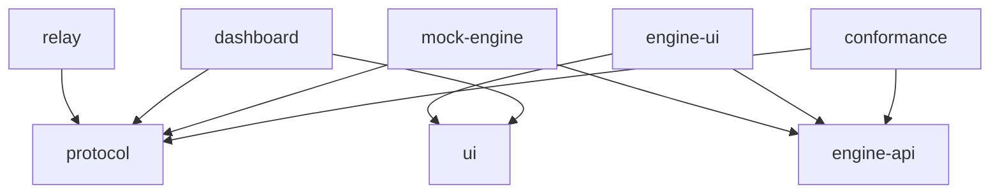

# Engineering guide

How code in this repo is structured. The goal: every module can be replaced by another implementation of the same interface without touching the rest. The mock engine and the real engine are the first case of that, not the last.

## Modules

A module is a workspace package under `apps/` or `packages/`.

- **It owns a contract.** Packages expose exactly one code entry (`"exports": { ".": "./src/index.ts" }`); deep imports are impossible. The one exception is `@ptbk/ui`, which may also export its stylesheet (`"./styles.css"`). Apps expose nothing in code; their contract is the network interface they serve.
- **It declares what it uses.** The isolated linker makes undeclared transitive dependencies fail to resolve. Root dev tools stay visible to every package by directory lookup, so declare what you import anyway. Workspace dependencies use `"workspace:*"`; shared third-party versions come from the root `catalog`.
- **Apps never import from apps.** They talk over the documented HTTP and tunnel interfaces only.
- **Contracts live in packages.** `protocol` (engine, relay, dashboard wire formats) and `engine-api` (engine HTTP API for the UI) are portable: no `node:*`, `cloudflare:*` or `bun:*` imports, Web APIs only (ESLint enforces it).



## Contracts

Wire formats follow [ADR 0010](adr/0010-protocol-design-principles.md): versioned messages, negotiation in the handshake, change by addition, domain-separated signatures, canonical encodings, explicit limits. Formats freeze when the contracts are published (task E-02), after review by the engine team and Pavol.

## Inside an app: ports and adapters

```
src/
  domain/     Pure logic, types and ports (interfaces). No I/O, no node:, no cloudflare:.
  adapters/   Implementations of ports: node:net, D1, Stripe, fetch, in-memory fakes.
  app/        Composition root: parse config, build adapters, inject them, start.
  main.ts     (or worker.ts) Entry point; calls app/.
```

- `domain/` may not import `adapters/`, `app/` or platform modules (ESLint enforces it). It defines what it needs as an interface:

  ```ts
  export interface EngineRegistry {
    lookup(engineId: EngineId, signal: AbortSignal): Promise<RegistryLookup>;
  }
  ```

- Adapters implement ports. Every port gets an in-memory adapter too, used by unit tests and local development.
- Dependencies are passed in explicitly, as a `deps` object to a factory function or constructor. No DI container, no module-level singletons, no hidden global state.
- Configuration is parsed once in `app/` with zod into a typed, frozen object. Nothing else reads `process.env` or Workers bindings.
- Time, randomness and crypto are ports (`Clock`, `Random`, `Signer`) so tests are deterministic.

engine-ui follows the same idea in React terms: components depend on hooks, hooks depend on an `EngineApiClient` interface from `engine-api`, and the composition root decides whether that client talks HTTP or an in-memory fake.

## TypeScript rules

- **Strict everything** (see `tsconfig.base.json`), including `noUncheckedIndexedAccess` and `exactOptionalPropertyTypes`.
- **Erasable syntax only:** no `enum`, `namespace` or parameter properties. Use `as const` objects and string-literal unions.
- **Interfaces for object shapes and ports** (`consistent-type-definitions`); type aliases for unions and mapped types. No `I` prefix.
- **Branded types for identifiers and validated values:** `EngineId`, `Hostname`, `RelayId`, `StreamId`. They are created only by a zod schema or a parsing function: parse, don't validate.
- **`unknown` at boundaries, never `any`.** Every byte from the network, disk, env or another module goes through a zod schema first. Schemas are strict: unknown fields are rejected.
- **Discriminated unions** for states and outcomes, handled with exhaustive `switch` (`switch-exhaustiveness-check`).
- **`readonly` by default** for data passed between layers.
- **Named exports only.** Default exports are allowed only where a framework requires them (config files, Workers entry, route files).

## Errors

- Expected outcomes are values: return a discriminated union specific to the operation (`{ kind: 'routed', engineId } | { kind: 'unknown-host' }`). Callers must handle every case.
- Exceptions are for bugs and broken infrastructure. Catch them at the edge (request handler, connection handler), log without content, and fail closed.
- No generic `Result` library: a union named for the operation reads better.

## Authorization

- One policy port per app, `Authorizer.can(actor, action, resource)`, deny by default ([ADR 0006](adr/0006-organizations-and-roles.md)).
- Code checks permissions, never role names. Adding a role must not touch handlers or components.
- Every data access in the dashboard is scoped by `orgId`; a query without it is a bug.

## Async and I/O

- Every I/O call has a timeout and accepts an `AbortSignal`.
- Long-lived connections (tunnels, streams) have explicit backpressure: respect `write()` returning `false`, use `WINDOW` credit in the tunnel protocol.
- Prefer Web Streams and `fetch` in portable code; Node streams only in Node adapters.

## Testing

| Level         | What                                                      | Where                    |
| ------------- | --------------------------------------------------------- | ------------------------ |
| Unit          | Domain logic with in-memory adapters (fakes, not mocks)   | `src/**/*.test.ts`       |
| Property/fuzz | Parsers and codecs: SNI parser, frame codec, schemas      | next to the code         |
| Adapter       | One shared test suite per port, run against every adapter | `src/adapters/*.test.ts` |
| Conformance   | The engine contract, run against mock or real engine      | `packages/conformance`   |
| End to end    | Browser through relay to engine, failover, proxies        | `e2e/` (Playwright)      |

- Tests are deterministic: inject `Clock` and `Random`, seed fake data, no sleeps (use fake timers or events).
- A bug fix starts with a failing test.

## Logging and metadata

- Structured logs through a `Logger` port. Never log content, tokens, keys, cookies or full headers.
- The relay logs only what the spec's "Metadata we still see" lists, and keeps it short-lived.

## Naming

- Files and directories: `kebab-case.ts`. Types and interfaces: `PascalCase`. Functions and variables: `camelCase`. Constants that are configuration: `SCREAMING_SNAKE_CASE`.
- One concept per file; name the file after it.
- No barrel files inside apps. A package has one `src/index.ts` that is its public API.
