# Implementation plan

How we get from an empty repo to the private half of the zero-trust interface: relay, dashboard and engine-ui, all working end to end against a mock engine, with the real engine plugged in last.

The [spec](../spec/zero-trust-spec.md) says what and why. The [ADRs](../adr/) record decisions taken since. This plan says in which order, in tasks small enough for one PR each.

## Principles

1. **Contracts first.** `protocol` and `engine-api` land before the code that uses them, so modules can be built in parallel against the same interfaces.
2. **Mock first, real engine last** ([ADR 0004](../adr/0004-mock-engine-and-conformance.md)). Everything is proven end to end against the mock engine. The conformance suite is how the real engine proves it can replace it.
3. **Riskiest first.** Milestone 1 is the spec's spike: TLS through the relay, including ACME TLS-ALPN-01, NAT, proxies and failover.
4. **One task, one PR, one module** where possible. A task that has to touch two modules says so.
5. **Every task leaves `main` green**: `bun run check` passes, and from X-01 on, the e2e suite passes too.

## Milestones

| Milestone          | Goal                                                         | Done when                                                                                                                                                                 |
| ------------------ | ------------------------------------------------------------ | ------------------------------------------------------------------------------------------------------------------------------------------------------------------------- |
| **M0 Foundation**  | Repo, tooling, docs, plan                                    | Done (this commit)                                                                                                                                                        |
| **M1 Spike**       | Relay end to end with the mock engine                        | Every spike criterion in the spec (Build plan, "Spike acceptance criteria") passes as an automated e2e test                                                               |
| **M2 Engine UI**   | The private UI, running on the mock engine through the relay | The owner flows (agents, create agent, chat, security panel, secrets, audit) pass in e2e under the engine's strict CSP, loaded through the UI loader from a signed bundle |
| **M3 Dashboard**   | app.ptbk.io                                                  | Sign up with a passkey, link the mock engine, see it online, open it through the relay; the relay reads its registry from the dashboard                                   |
| **M4 Production**  | Our side runs in staging, then production                    | Two relays and the dashboard live in staging, deploys are signed and approved, monitoring without content, abuse controls, internal security review passed                |
| **M5 Real engine** | Swap the mock for the engine team's engine                   | Contracts are public, the real engine passes the conformance suite and the full e2e suite                                                                                 |

M2 and M3 can run in parallel once M1's contracts exist. E-01 (the engine integration guide) is pulled forward into M2 because the engine team needs lead time.

## Lanes

| Lane               | Module(s)                                                          | Prefix |
| ------------------ | ------------------------------------------------------------------ | ------ |
| Contracts          | `packages/protocol`, `packages/engine-api`, `packages/conformance` | C      |
| Relay              | `apps/relay`                                                       | R      |
| Mock engine        | `apps/mock-engine`                                                 | M      |
| Engine UI          | `apps/engine-ui`                                                   | U      |
| Dashboard          | `apps/dashboard`                                                   | D      |
| Cross-cutting      | `e2e/`, release tooling                                            | X      |
| Infra              | `infra/`, deploy workflows                                         | I      |
| Engine integration | docs, contract publishing                                          | E      |

## Tasks

Each brief in [tasks/](tasks/) carries its own **Depends on** and **Status** (`todo`, `in progress (<branch>)`, `done (#<PR>)`), so parallel PRs never edit the same line. For the live table:

```sh
bun run plan          # all tasks with dependencies and status
bun run plan --next   # tasks that are todo and fully unblocked
bun run plan --check  # validates statuses and dependencies (part of bun run check)
```

| ID                                                       | Task                                                                             | Lane | Milestone |
| -------------------------------------------------------- | -------------------------------------------------------------------------------- | ---- | --------- |
| [C-01](tasks/C-01-protocol-primitives.md)                | Protocol primitives: branded IDs, base64url, Ed25519, engine ID, hostname claims | C    | M1        |
| [C-02](tasks/C-02-tunnel-protocol.md)                    | Tunnel handshake schemas and binary frame codec                                  | C    | M1        |
| [C-03](tasks/C-03-registration-registry-heartbeat.md)    | Registration, registry lookup and heartbeat contracts                            | C    | M1        |
| [R-01](tasks/R-01-sni-parser.md)                         | SNI parser for the TLS ClientHello                                               | R    | M1        |
| [R-02](tasks/R-02-relay-skeleton.md)                     | Relay skeleton: config, ports, static registry adapter                           | R    | M1        |
| [R-03](tasks/R-03-tunnel-endpoint.md)                    | Tunnel endpoint: WSS, challenge-response, sessions                               | R    | M1        |
| [R-04](tasks/R-04-browser-listener.md)                   | Browser listener: SNI routing, stream piping, flow control, limits               | R    | M1        |
| [M-01](tasks/M-01-mock-engine-tunnel-client.md)          | Mock engine skeleton and tunnel client (N relays, proxy, reconnect)              | M    | M1        |
| [M-02](tasks/M-02-mock-engine-tls-server.md)             | TLS and HTTP server inside the tunnel, dev CA, spike endpoints                   | M    | M1        |
| [X-01](tasks/X-01-e2e-harness.md)                        | E2E harness: compose stack, Playwright, first browser test                       | X    | M1        |
| [M-03](tasks/M-03-acme-tls-alpn.md)                      | ACME TLS-ALPN-01 through the relay against Pebble                                | M    | M1        |
| [X-02](tasks/X-02-spike-network-tests.md)                | Spike network tests: NAT, 443-only, proxies, failover, packet capture            | X    | M1        |
| [R-05](tasks/R-05-relay-load-test.md)                    | Relay load and throughput test                                                   | R    | M1        |
| [C-04](tasks/C-04-engine-api-contract.md)                | Engine API contract v1 and typed client                                          | C    | M2        |
| [C-06](tasks/C-06-release-log.md)                        | Release log entry and verification (engine and UI artifacts)                     | C    | M2        |
| [M-04](tasks/M-04-mock-engine-api.md)                    | Mock engine API: seeded data, scenarios, fault injection, streaming              | M    | M2        |
| [C-05](tasks/C-05-conformance-suite.md)                  | Conformance suite v1, run against the mock engine                                | C    | M2        |
| [U-01](tasks/U-01-engine-ui-scaffold.md)                 | Engine UI scaffold under the engine's CSP                                        | U    | M2        |
| [U-02](tasks/U-02-design-system-shell.md)                | Design system, app shell, i18n                                                   | U    | M2        |
| [U-03](tasks/U-03-agents.md)                             | Agents: list, detail, control                                                    | U    | M2        |
| [U-04](tasks/U-04-create-edit-agent.md)                  | Create and edit agent: wizard and book editor                                    | U    | M2        |
| [U-05](tasks/U-05-chat.md)                               | Chat with streaming                                                              | U    | M2        |
| [U-06](tasks/U-06-security-settings.md)                  | Security panel, settings, members, secrets                                       | U    | M2        |
| [U-07](tasks/U-07-audit-log.md)                          | Audit log view                                                                   | U    | M2        |
| [X-03](tasks/X-03-ui-bundle-release.md)                  | UI bundle build, manifest, signing and publishing                                | X    | M2        |
| [M-05](tasks/M-05-ui-loader.md)                          | UI loader in the mock engine (reference implementation)                          | M    | M2        |
| [X-04](tasks/X-04-e2e-ui-flows.md)                       | E2E UI flows through relay and loader, CSP violations fail                       | X    | M2        |
| [E-01](tasks/E-01-engine-integration-guide.md)           | Engine integration guide for the engine team                                     | E    | M2        |
| [D-01](tasks/D-01-dashboard-scaffold.md)                 | Dashboard scaffold: TanStack Start on Workers, D1, environments                  | D    | M3        |
| [D-02](tasks/D-02-accounts-passkeys.md)                  | Accounts, passkeys, sessions                                                     | D    | M3        |
| [D-03](tasks/D-03-engine-registration.md)                | Link codes and engine registration API                                           | D    | M3        |
| [D-04](tasks/D-04-registry-api.md)                       | Registry API for relays and the relay's HTTP registry adapter                    | D    | M3        |
| [D-05](tasks/D-05-heartbeat-status.md)                   | Heartbeat ingest, Durable Object per engine, offline alerts                      | D    | M3        |
| [D-06](tasks/D-06-engine-list-ui.md)                     | Engine list and status UI                                                        | D    | M3        |
| [D-07](tasks/D-07-billing.md)                            | Billing with Stripe                                                              | D    | M3        |
| [D-08](tasks/D-08-custom-domains.md)                     | Enterprise custom domains (manual admin flow)                                    | D    | M3        |
| [M-06](tasks/M-06-mock-engine-registration-heartbeat.md) | Mock engine registration and heartbeat client                                    | M    | M3        |
| [X-05](tasks/X-05-e2e-dashboard-flow.md)                 | E2E: sign up, link engine, see it online, open it                                | X    | M3        |
| [I-01](tasks/I-01-relay-hosts.md)                        | Relay hosts: provisioning and hardening                                          | I    | M4        |
| [I-02](tasks/I-02-dns-cloudflare.md)                     | DNS and Cloudflare environments                                                  | I    | M4        |
| [I-03](tasks/I-03-deploy-pipelines.md)                   | Deploy and release pipelines                                                     | I    | M4        |
| [I-04](tasks/I-04-observability.md)                      | Monitoring without content                                                       | I    | M4        |
| [I-05](tasks/I-05-abuse-controls.md)                     | Abuse controls and monitoring jobs                                               | I    | M4        |
| [I-06](tasks/I-06-security-review.md)                    | Internal security review gate                                                    | I    | M4        |
| [E-02](tasks/E-02-publish-contracts.md)                  | Move the contracts public and consume published versions                         | E    | M5        |
| [E-03](tasks/E-03-real-engine-swap.md)                   | Run conformance and e2e against the real engine                                  | E    | M5        |

## Parallel waves

What can run at the same time, assuming each wave's dependencies have merged:

```mermaid
flowchart LR
    subgraph W1[Wave 1]
        C01[C-01] & R01[R-01] & D01[D-01]
    end
    subgraph W2[Wave 2]
        C02[C-02] & C03[C-03] & C04[C-04] & C06[C-06] & R02[R-02] & D02[D-02]
    end
    subgraph W3[Wave 3]
        R03[R-03] & M01[M-01] & U01[U-01] & D03[D-03] & D07[D-07]
    end
    subgraph W4[Wave 4]
        R04[R-04] & M02[M-02] & U02[U-02] & D05[D-05] & M06[M-06] & E01[E-01]
    end
    subgraph W5[Wave 5]
        X01[X-01] & M04[M-04] & U03[U-03] & U05[U-05] & U06[U-06] & U07[U-07] & X03[X-03] & D04[D-04] & D06[D-06]
    end
    W1 --> W2 --> W3 --> W4 --> W5
```



After wave 5: M-03, X-02, R-05, C-05, U-04, M-05, D-08, X-05, then X-04 and M4. Up to six agents can work at once without touching the same module.

## Decisions

**Taken** (2026-10-19):

- Porting code from the predecessor UI (ManGo wizard, book editor, chat components in `promptbook/apps/agents-server` and the `agents-server` prototype) is **allowed**. Ported code must still meet the CSP, the engineering rules and our stack.
- Dashboard account recovery: email link that only allows registering a new passkey, under the conditions in D-02.
- Email: `EmailSender` port; Cloudflare Email Service is the current adapter.
- Languages: English and Czech, with i18n from day one in engine-ui and the dashboard.
- Organizations, members and roles are modelled from day one ([ADR 0006](../adr/0006-organizations-and-roles.md)).

**Still needed** (each blocks specific tasks, not the start):

| Decision                                            | Blocks                                    | Owner       |
| --------------------------------------------------- | ----------------------------------------- | ----------- |
| Engine domain name (separate from ptbk.io)          | I-02 (local and staging use placeholders) | Team        |
| Cloudflare accounts and relay VPS provider accounts | I-01, I-02                                | Team        |
| Release key holders (2 of 3)                        | X-03 for production signing, I-03         | Team        |
| Who builds the engine side, and when                | E-03                                      | Engine team |

## How to work a task

See [AGENTS.md](../../AGENTS.md#working-on-a-task) for the full procedure. In short: pick a task from `bun run plan --next`, work in your own worktree and branch, follow the brief's acceptance criteria, update the brief's status line, open a PR, merge when CI is green and the self-review passes.
