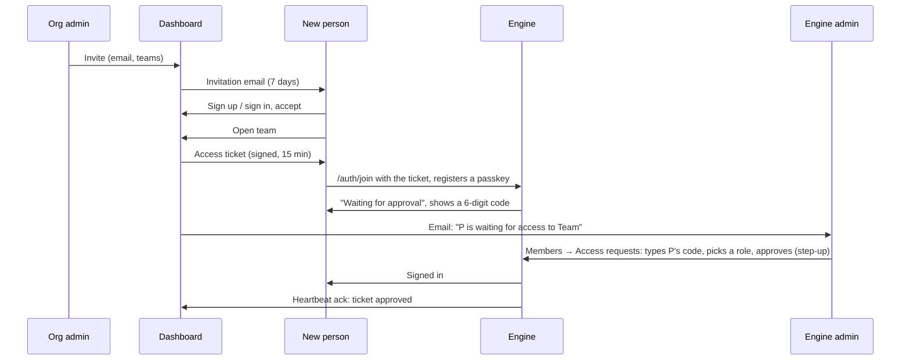

# Teams

- **Status:** draft for review
- **Date:** 2026-10-30
- **Decisions:** [ADR 0018](../adr/0018-teams-and-member-access.md)
- **Sources:** the architecture meeting of 2026-10-23 and Seb's answers of 2026-10-30
- **Builds on:**
  - [ADR 0006](../adr/0006-organizations-and-roles.md);
  - the [zero-trust spec](zero-trust-spec.md), sections "Pairing and identity" and "What our platform can and cannot do".

Teams let an agency, or any company, give several people access to an engine, and run several engines under one bill. Each team is a group of people sharing its own engine; teams are separated from each other completely.

## Model

```
Organization ── billing, org roles
 ├── Team ── name; at most one engine in v1
 │    ├── Engine ── the engine is the authority on who can use it
 │    └── Team members ── users of the organization
 └── Team …
```

**Organization**

- An organization holds the billing and the org roles. Sign-up still creates a personal organization, and a user can create more.
- An agency that wants each client billed separately creates an organization per client. An agency that pays for its clients itself creates a team per client.

**Team**

- A team belongs to one organization. Teams are flat: no teams inside teams.
- Teams share nothing: no agents, files or people pass between them.

**Membership**

- A user can be in several teams, across organizations. Team membership is `(teamId, userId)`.
- Being in a team lets you ask for access to its engine. Only the engine grants that access (see [Adding a person](#adding-a-person)).

**Engine**

- A team has at most one engine in v1, enforced by a unique `engines.teamId`.
- Members, invites, access requests and the name hang off the team, not the engine. Allowing several engines per team later means:
  - dropping the unique constraint;
  - changing the screens that show "the" engine.
- Nothing else changes, because approval and revocation already work per engine.

**Moving a team to another organization**

- This changes `teams.orgId`, and `engines.orgId` of its engine, in one transaction.
- v1 does it by hand, following a runbook, not in the UI. The engine and its members are untouched.

**Migration of existing data**

- Every existing engine gets a team named after its label (or hostname), with the organization's owner as its only member.
- `organizations.kind` value `team` is renamed `shared`, so "team" means one thing; no row uses it yet.

## Roles

**Organization roles**, enforced by the dashboard:

| Action                                                  | owner | admin | member          |
| ------------------------------------------------------- | ----- | ----- | --------------- |
| See the team list                                       | all   | all   | their teams     |
| Open a team's engine (ask for access the first time)    | ✓     | ✓     | their teams     |
| Create, rename or delete a team; link or unlink engines | ✓     | ✓     |                 |
| Invite people; add them to teams; remove them           | ✓     | ✓     |                 |
| Change org roles                                        | ✓     |       |                 |
| Billing, delete the organization                        | ✓     |       |                 |
| Leave a team or the organization                        | ✓\*   | ✓     | ✓               |

\* Except the last owner.

Two things from the meeting are deliberately not supported:

- an admin of a single team ("that is a separate organization");
- an org admin who sees inside every engine without having been given access there.

**Engine roles** stay engine policy, as the contract has them: owner, admin, member and viewer.

- The dashboard proposes a role with each access request: org owners and admins get `admin`, members get `member`. The person approving can change it.
- Members can't manage people, so "a team member uses the engine but does not add people" holds on the engine too.
- The meeting's "every user has the same rights on the engine" is replaced by these contract roles.

## Adding a person

The dashboard must never be able to grant access to an engine; otherwise we could add ourselves. So the dashboard invites, the person asks the engine, and someone already on the engine approves, the way a new device is approved.



1. **Invite.** An org owner or admin enters one or more email addresses, the org role (default member) and the teams.
   - The dashboard stores the invite with the token hashed, valid for 7 days and single use, and emails a link to `app.ptbk.io/invites/{token}`.
   - Inviting someone who is already in the organization only adds the teams.
2. **Accept.** The person signs in, or signs up with a dashboard passkey, and accepts.
   - They become an org member and a team member, with the state "waiting for access" on each team.
3. **Ticket.** The first time they open a team, the dashboard issues an access ticket and sends the browser to `https://<engine>/auth/join#<ticket>`. The ticket:
   - is signed with the dashboard's member key and valid for 15 minutes;
   - is bound to this user and this engine, with a single-use `ticketId`;
   - goes in the fragment so it never reaches logs or a `Referer`.
4. **Request.** The engine's join page, a gateway page, verifies the ticket:
   - the signature against the pinned dashboard key;
   - the engine ID, the expiry, and that the ticket is unused.
   - The person then registers a passkey on the engine's hostname, and the engine stores an access request (see [Contracts](#contracts)).
   - The page shows "Waiting for approval" and a 6-digit code. It checks for approval, and signs the person in once approved.
5. **Notify.**
   - The engine counts pending requests in its heartbeat.
   - The dashboard emails the inviter, and the org owners and admins who are in that team: "{name} is waiting for access to {team}. Approve them in the engine: Members → Access requests."
   - The engine UI shows a badge on Members.
6. **Approve.** Someone with `members.manage` opens the request.
   - They see the name and email as reported by the dashboard (labelled as such) and the proposed role.
   - They ask the person for the code on their screen and type it in.
   - On a match and a fresh passkey assertion, the engine adds the member with the `dashboardUserId` from the ticket, and their passkey.
   - The code proves the request is the person in front of them; the name from the dashboard is only a hint. Declining deletes the request.
7. **Confirm.**
   - The next heartbeat acks the ticket as `approved` (or `declined`), and the dashboard updates the person's state on the team to "Has access".
   - It can then email them "You now have access to {team}".

**Limits**

- A request expires after 7 days.
- An engine keeps at most 20 pending requests; the 21st ticket is refused with "too many pending requests".
- A ticket for a `dashboardUserId` that is already an active member just signs them in, or asks them to sign in.

**Engines without a dashboard, or older engines.** The engine's own invite link (`POST /invites`) stays as the way to add people. Those members have no `dashboardUserId`, and the dashboard can neither see nor remove them.

## Removing a person

An org owner or admin can take someone out of a team, or out of the organization (and so out of all its teams), without being on the engine. The dashboard may take access away, never grant it.

**Revoking**

1. The dashboard deletes the team membership and queues a signed member revocation for that engine, `{ engineId, revocationId, dashboardUserId }`. The person's state shows "Removing…".
2. The engine picks up pending revocations from the reply to its next heartbeat (within about 60 s). For each one, it:
   - disables the member with that `dashboardUserId`;
   - deletes their passkeys and ends their sessions;
   - deletes a pending access request from them;
   - writes an audit entry: "removed by the organization (dashboard)".
3. The next heartbeat acks the revocation, and the person disappears from the team.

**What an engine refuses**

| Revocation                   | Ack                | Dashboard shows                                    |
| ---------------------------- | ------------------ | -------------------------------------------------- |
| Targets the last engine owner | `refused-owner`    | Transfer ownership on the engine first             |
| Owner switched it off        | `refused-disabled` | This engine doesn't accept removals from here; remove them on the engine |
| No such member               | `not-found`        | The person is simply gone                          |

The owner switches dashboard removals off in Settings → Security ("Let the organization remove members from the dashboard"). It is on by default, and changing it needs step-up. This keeps the stricter model available to anyone who wants it, for example a client who wants sole control while the agency still pays.

**Changes the dashboard learns about**

- When an engine admin removes someone who joined by ticket, the engine acks that ticket as `removed`, and the dashboard drops the team membership.
- Role changes on the engine stay on the engine.

## Contracts

Contracts change in a new version alongside the old one ([rule 5](../../AGENTS.md#rules-that-must-never-break)). An engine on the old heartbeat simply gets the old behaviour: invite links only, no removals from the dashboard.

**Protocol (`packages/protocol`)**

- **Dashboard member key.**
  - An Ed25519 key, separate from every other key, used only for access tickets and revocations.
  - The registration response gains `memberKey` (its public key), and the engine pins it.
  - Key rotation comes later: a signed rollover to a list of keys.
- **`AccessTicket`**, signed over `signingInput('ptbk-access-ticket-v1', sha256(body))`.
  - Fields: `{ v: 1, engineId, ticketId, dashboardUserId, displayName (≤128), email (≤254), proposedRole: 'admin' | 'member', issuedAt, expiresAt }`.
  - At most 15 minutes of life, and a size cap.
- **`MemberRevocation`**, signed over `signingInput('ptbk-member-revocation-v1', sha256(body))`.
  - Fields: `{ v: 1, engineId, revocationId, dashboardUserId, issuedAt }`.
- **Heartbeat v2.**
  - It adds `accessRequests` (an integer) and `acks`, at most 32 entries of the form `[{ id, outcome }]`. The outcome is one of `approved | declined | removed | revoked | refused-owner | refused-disabled | not-found`.
  - IDs are random values the dashboard issued, so the heartbeat still carries no names or free text.
  - The reply carries `{ revocations: MemberRevocation[] }` (at most 32). The dashboard resends a revocation until it is acked.

**Engine API (`packages/engine-api`)**

- **Gateway: `/auth/join`.** The join page plus its WebAuthn registration endpoints, under the reserved `/auth/` prefix. They are documented in `gateway.md`, like the setup page.
- **Access requests.**
  - `GET /access-requests` needs `members.read`.
  - `POST /access-requests/{id}/approve` takes `{ code, role }` and needs `members.manage` and step-up.
  - `DELETE /access-requests/{id}` needs `members.manage`.
  - A request is `{ id, displayName, email, proposedRole, createdAt, expiresAt }`. The code is never returned.
- **`Member.dashboardUserId`:** a string or null.
- **Settings:** `dashboardRemovals: boolean`, which needs `settings.manage` and step-up.
- **Member drafts made final:** `PATCH` and `DELETE /members/{id}` and the invite routes, as they are today.
- **Conformance:**
  - ticket checks: forged, expired, replayed, wrong engine, over the pending cap;
  - the approve code: wrong code, missing step-up;
  - revocations: forged, replayed, last owner, switched off;
  - heartbeat v2 acks.

## Dashboard UI

- **Teams** replaces Engines in the navigation. Each row shows the team name, its engine's status dot, the number of people, and Open.
  - Org owners and admins see every team, plus "New team". Members see their own teams.
- **Creating a team:** a name, then the existing link flow (install command), which now binds the new engine to the team. The creator is the first member and becomes engine owner through the setup secret, as today.
- **Team page:**
  - a header with the name, the engine status and Open;
  - a People section. Each person shows their state (Invited / Waiting for approval / Has access / Removing…) and has a ⋯ menu with "Remove from team";
  - an "Invite people" button;
  - the engine details as they are today.
- **Organization → People:**
  - lists each member with their org role and teams;
  - lists pending invites, which can be resent or revoked;
  - change role, and "Remove from organization".
- **Invite dialog:** email addresses (several allowed), the org role (default member) and the teams as checkboxes.
- **Accept invitation page:** the organization and team names, then sign in or sign up, then Accept.
- **Emails:**
  - the invitation;
  - a waiting-for-approval notice to the inviter and to the team's org admins;
  - "You now have access".
  - Each is in the recipient's language, like the existing status emails.

## Engine UI

- **Members → Access requests**, above the members list, with a badge in the navigation while any are pending.
  - Each request shows the name and email ("as reported by your organization"), the proposed role and how long ago it was made.
  - Approve opens a dialog: "Ask {name} for the 6-digit code on their screen", a code field and a role picker, then step-up. A wrong code gives "That code doesn't match. Check it with {name}."
  - Decline removes the request.
- **Members:** members who came from the dashboard show "via organization". Removing them on the engine works as today.
- **Settings → Security:** the dashboard removals switch.
- **Join page:** a gateway page, with the reference implementation in the mock engine.
  - It names the engine, then asks "Create a passkey for {engine}".
  - It then shows "Waiting for approval", the code in large digits, and "Tell this code to the person approving you".

## Abuse and failure cases

- **A compromised dashboard can:**
  - create access requests, which still need an engine admin and the code;
  - remove members, which is a lockout, no worse than cutting transport today; it cannot touch the last owner, and the owner can switch removals off.
- **It cannot** add anyone, read anything, or change roles.
- **Anonymous request spam** isn't possible: requests need a valid ticket for this engine, and pending requests are capped.
- **The approve code** stops an admin approving the wrong request, or one an attacker raced in with a stolen ticket.
- **An admin reachable only by email:** the engine never emails. The dashboard emails a hint with no secret in it, and approving happens on the engine.
- **A person removed while their request is pending:** the revocation deletes the request.
- **An org member in no team** sees an empty Teams page that says "Ask an admin to add you to a team".

## Out of scope for v1

- admins of a single team, nested teams, and sharing between teams;
- moving a team in the UI, and several engines per team (the model allows it);
- SSO and SCIM, seat-based pricing, and per-agent sharing inside an engine;
- dashboard key rotation;
- syncing role changes from the engine to the dashboard.

## Open points

- The trial: per organization or per team (see `docs/plan/apply.md`, step 2). The proposal is per organization: one trial, then billing covers every team.
- Whether the engine's role-to-permission mapping becomes normative, now that people other than the owner use it. This is an engine team decision ([checklist](../engine-integration/checklist.md) ENG-63).
