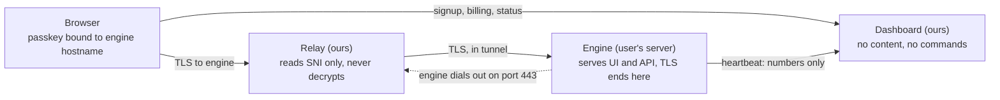
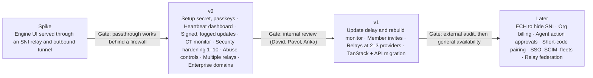

<!--
Snapshot of the spec, rev 105 (2026-10-19). The living version is the Claude Doc:
https://claude.ai/code/artifact/cd422fa3-3ccb-4d1a-b7fe-79a10c32802b
Decisions taken after this snapshot are recorded as ADRs in docs/adr.
-->

# Promptbook Zero-Trust Interface: Spec (draft)

Draft · 16 Oct 2026 · Seb

## Goal and scope

Promptbook hosts a web interface where a user creates and controls agents that run on their own server (the engine). Promptbook operators must be cryptographically unable to read that content or act on the engine. Trusting our good behaviour is not enough.

- **In scope:** the web interface, the channel between the browser and the engine, pairing, key management, the control API the interface may call, and how users can verify the security claims.
- **Out of scope:** the agent runtime itself (it already exists), billing implementation, orgs and teams (designed for, not built in v0).
- **Decided 2026-10-16:** the engine serves its own UI, and our relay passes TLS through to it without decrypting. Our platform provides transport, signup and billing only.

## Security goals and threat model

"Mathematically we can't access it" means one thing: every key that can read content or authorise a command exists only on the engine and on the user's devices. Our servers only ever hold ciphertext and public keys. The claim fails in exactly one way: code we deliver, or a certificate we obtain, could impersonate the engine. The residual risks section covers how both stay publicly detectable.

**Security goals**

1. **Confidentiality:** the relay and our database see no agent definitions, prompts, outputs, credentials or browser sessions.
2. **Authority:** the engine acts only for sessions that signed in with a passkey registered on the engine. We cannot create agents, change them, or start tasks.
3. **No silent pairing:** we cannot attach our own device or a new user to an engine without the user seeing it on the engine or on an existing device.
4. **Verifiability:** a third party can check every claim against open source, reproducible builds and a public log, without trusting us.
5. **Availability is not a goal against us.** We can always cut the service off; we must never be able to read or control anything.

**Attackers and what each one gets**

| Attacker | Gets today without E2E | Must get with this design |
| --- | --- | --- |
| Promptbook operator or insider | Everything on the server | Metadata only |
| Compromised relay, hosting or CDN | Traffic and stored data | Metadata only |
| Legal order to Promptbook | Whatever we hold | Metadata only; we have nothing else to hand over |
| Malicious engine update, or a certificate mis-issued for an engine hostname (us, or a hijacked deploy) | n/a | **Detected**: see residual risks |
| Network attacker | Blocked by TLS | Blocked by TLS and E2E |
| Stolen user device | Full access | That device's access, until it is revoked |
| Rogue agent or prompt injection on the engine | Engine access | Engine access: out of scope for the channel; needs sandboxing on the engine |

**Trust assumptions we accept:** the user's own device and browser, the engine host, TLS 1.3, WebAuthn passkeys, the public CA and Certificate Transparency system, and the open-source code users can audit.

## Prior art

Our closest model is Home Assistant's Nabu Casa Remote UI: the cloud routes TLS by hostname without decrypting it, and the home instance serves its own UI. The other products below each contribute one pattern, or one mistake to avoid.

| Product | How it works | What we copy | What we avoid |
| --- | --- | --- | --- |
| [Nabu Casa Remote UI](https://github.com/NabuCasa/snitun) | Instance opens an outbound tunnel to SniTun; browser TLS ends on the instance; certificate via DNS-01 | SNI passthrough; certificate and UI on the user's box | Vendor owns the DNS zone, so it could mis-issue a certificate (detectable only via CT) |
| [Tailscale Funnel and Tailnet Lock](https://tailscale.com/kb/1226/tailnet-lock) | TLS ends on the node for vendor-owned `*.ts.net` names; Tailnet Lock makes new nodes need signatures from user devices | User devices, not the vendor, authorise new members | Recovery secrets users lose |
| [Happy](https://github.com/slopus/happy) (Claude Code remote) | E2E app plus a relay; QR pairing with an ephemeral key; the server stores encrypted blobs | Same product shape; open-source, self-hostable relay | Pairing not authenticated against the relay; RPC calls replayable; one shared secret; vendor-served web app |
| [Claude Code Remote Control](https://code.claude.com/docs/en/remote-control) | Outbound HTTPS; transcript on the vendor's servers | Per-device trusted devices with biometric step-up | Not E2E |
| [Chrome Remote Desktop](https://chromium.googlesource.com/chromium/src/+/098ef3d2d/remoting/protocol/spake2_authenticator.cc), [Magic Wormhole](https://magic-wormhole.readthedocs.io/) | Short code fed into SPAKE2; the relay sees only ciphertext | Short-code pairing as an option later | — |
| [Signal](https://signal.org/blog/a-synchronized-start-for-linked-devices/), [Keybase](https://keybase.io/docs/server_security) | Per-device keys; new devices linked from existing ones | Per-device credentials that can be revoked one by one | Keybase kept crypto out of its served web UI, as we do |
| [Syncthing](https://docs.syncthing.net/users/relaying.html), [StartOS](https://docs.start9.com/0.3.4.x/support/concepts/networks) | Device ID is a hash of its key; relays forward TLS; StartOS uses Tor onion addresses | Engine ID derived from the engine key | — |
| [1Password](https://1password.com/files/1password-white-paper.pdf), Bitwarden, Proton | Zero-knowledge web vaults, but the vendor serves the web client | Their honesty about the limit | Claiming zero trust while serving mutable JS |
| Cloudflare Tunnel, ngrok, Omnara | The vendor terminates TLS or stores the content | — | The anti-pattern for us |

## Architecture

**Content flows only between browser and engine; we route ciphertext**



The browser's TLS session runs straight through our relay and ends on the engine. Our dashboard only ever talks to the browser about the account, and to the engine through the numbers-only heartbeat.

- **Engine (user's server, open source):** bound to localhost behind the pre-auth gateway. It holds every key, serves the API and our UI bundle, verifies passkeys and stores all data.
- **Tunnel client:** part of the engine. It dials out to the relay and obtains and monitors the engine's certificate.
- **Engine UI (ours, closed):** the full app. We build it and publish it as a signed bundle; the engine downloads, verifies and serves it (see UI delivery below).
- **Relay (ours):** routes by SNI and never terminates TLS for engine hostnames.
- **Dashboard (ours):** signup, billing, the engine list and status from heartbeats. It links to engine hostnames and nothing more.

**UI delivery: our bundle, served by the engine.** The engine is open source and contains only what runs on the server. The full app UI is ours and closed: we build it and publish it as a signed bundle on R2. On update, the engine downloads the bundle, checks it like an engine release (signatures, Rekor entry, delay, no revocation) and serves it from its own origin. The open engine holds only a small loader, about 100 lines, that fetches, verifies and serves.

**Why the engine serves it, not us:** whoever serves the JavaScript on each page load can send one customer a modified version for a few minutes and read everything, unseen. With the engine serving the bundle, that attack needs a signed, publicly logged release that waits out the delay and is identical for every customer. We never serve UI to browsers live.

**Security stays in the open part:** the pre-auth gateway, the sign-in, setup and WebAuthn pages, the CSP and Trusted Types headers, API authorisation and the audit log are all engine code. Anonymous visitors get only open code. The UI loads after sign-in and can do nothing the signed-in user could not do through the API. Enterprise and offline installs can mirror the bundle.

**Limits:** CSP cannot block every way out (a top-level navigation, WebRTC), so against a deliberately malicious UI the protection is the release process, not CSP. Customers cannot rebuild the UI from source; we, or an auditor under NDA, check that the published bundle matches the source. Code secrecy is the same in every variant, because browsers always receive the minified JavaScript: closed means the source and the licence. Public wording: "the security layer is open and verifiable; the UI is closed but sandboxed, signed, logged and identical for everyone."

**Rejected: the browser loads the bundle from our CDN, pinned by hash (SRI) in an engine page.** The UI would depend on our CDN, we would see metadata for every page load, and integrity checks for dynamically loaded chunks are new in browsers.

## One address for users

Users see one product on one domain. `app.<our domain>` is the only entry point, and each engine lives at `<engineId>.<engine domain>` with the same UI. It works like Slack workspaces or Home Assistant's `*.ui.nabu.casa` addresses, and the zero-trust claim still holds.

- **Entry point (ours, on Cloudflare):** account sign-in, the engine list, billing and status. Opening an engine goes to its hostname.
- **Engine UI (served by the engine):** the same design system as the entry point, with an engine switcher and a link back in the header. Only the hostname changes.
- **Same address in every mode:** `<engineId>.<engine domain>` points at the relays, or straight at the engine in direct mode.

**Why not one origin** (such as `app.<our domain>/engine/abc`): the path travels inside the encrypted request, so routing by path means decrypting it. One shared origin also means we serve the JavaScript that sees content, and we could ship altered code to a single user without trace. Signed web code (WAICT, WEBCAT) is not ready to close that gap.

**If one origin becomes a hard requirement:** a hosted frontend with end-to-end encryption to the engine key pinned at pairing, reproducible builds, and every bundle hash in a public log. The claim then drops from "impossible" to "verifiable", the level 1Password, Bitwarden and Proton offer. The engine-served UI would stay as a strict mode for companies. This needs explicit sign-off from leadership and Pavol. Later, a signed desktop or mobile app (for example Tauri) can give one frontend without that loss.

## Residual risks: certificates and engine updates

A malicious Promptbook could still get in by one of two paths: a certificate for an engine's hostname, or a poisoned engine update. On our own domain we can make both publicly detectable. With a custom domain and manual updates, both close entirely.

The honest public claim is: "Promptbook cannot read or control your engine without leaving permanent public evidence. With your own domain and manual updates, it cannot at all."

**1. Certificate mis-issuance**

We control DNS for `<engine>.<domain>`, so we could get a valid certificate, intercept the browser and serve our own JS.

- The engine obtains its own certificate with TLS-ALPN-01 through the passthrough relay, so normal operation needs no DNS action from us.
- Every publicly trusted certificate must appear in Certificate Transparency logs. The engine checks those logs for its hostname every hour and alerts the owner (UI, email, push) when it finds a certificate whose key is not its own.
- A CAA record with `accounturi` ([RFC 8657](https://www.rfc-editor.org/rfc/rfc8657)) pins issuance to the engine's ACME account. This blocks third parties, not us, because we could change the record.
- **Custom domain (strict mode):** the user points their own subdomain at the relay. We never control the DNS, so we cannot get a certificate. This is the recommended setup for companies.
- Put the engine domain on the Public Suffix List. That isolates cookies and passkeys between engines and lifts Let's Encrypt's per-domain rate limits.

**2. Engine updates**

The engine updates itself (the existing blue/green self-update), so code we publish runs on the user's server. This is the same problem as serving web JS, moved to the server.

- Builds are reproducible. A regular release carries two signatures: a keyless Sigstore signature from the release workflow identity (this repo, this workflow, this commit), and a signature from the release key, held by a person on a hardware key. Both are logged in [Sigstore Rekor](https://blog.sigstore.dev/rekor-v2-ga/). The engine requires both and refuses releases that are not in the log, so a compromised CI alone cannot ship.
- Auto-update is the default. A regular release installs only after it has been public for 72 h, and a security fix after 24 h. Nothing ever installs automatically in under 24 h. The delay gives independent monitors time to rebuild the release from source and compare.
- A security fix needs signatures from 2 of 3 maintainers, held on separate hardware keys, plus a published advisory. So one stolen key, or one insider, cannot use the "security" label to shorten the delay.
- After the delay, engines install at a random moment within the next 24 h (staged rollout). Before installing, an engine checks the log for a revocation entry, so a release flagged by a monitor stops spreading.
- The owner picks the update policy in the engine UI: automatic after the public delay (the default, so small teams stay patched), manual approval of each release, or a pinned version. The policy lives on the engine, changing it needs a fresh passkey assertion and is logged, and we cannot change it. Every mode installs only signed, logged releases; manual approval may install a release before the delay ends. Fleets later set the policy through a signed fleet policy.
- The install command pins the release hash, so a tampered installer fails.

**Release keys and dependencies:** updates are the main remaining path to customer data, so both ends need an owner before v0.

- A named holder of the release key and three named key holders for the 2-of-3 security signatures, each on a hardware key, with a written key ceremony and a procedure for replacing a holder.
- A signed release is only as good as what went into it: lockfile-pinned npm dependencies, an SBOM published with each release, and review of every dependency change. Dependency updates go through the same delay as our own code.

**3. Our dashboard**

The dashboard never touches content; it only links to the engine's hostname. A malicious dashboard could link to a lookalike host, but passkeys are bound to the exact engine hostname, so a lookalike cannot sign in. The engine hostname is derived from the engine key and shown at setup.

## Pairing and identity

The engine alone decides who may use it. People sign in to the engine with passkeys registered on the engine's own hostname. Our account system only links an engine to a paying customer and grants nothing inside the engine.

**Identities**

| Identity | Created on | Held by | What it allows |
| --- | --- | --- | --- |
| Engine key (Ed25519) | Engine, at first start | Engine only | Authenticates the tunnel to the relay; signs heartbeats |
| TLS key and certificate | Engine; certificate from Let's Encrypt | Engine only | Ends the browser's TLS on the engine |
| Owner and member passkeys | User's device, registered with the engine | Device or passkey manager; engine keeps the public key | Signing in to the engine UI |
| Owner setup secret (128-bit) | Engine | Shown once in the engine's terminal, single use, 30 min | Registering the first passkey |
| Promptbook account | Our dashboard | Us | Billing, engine list, status. No access to the engine |

**First setup (v0)**

1. The user signs up on our dashboard, which shows one install command with a one-time link code. The code only ties the engine to the account for routing and billing.
2. The engine installs from a signed, pinned release, then generates its keys and registers its public key with us. It gets its hostname, obtains a certificate itself, and opens the tunnel.
3. The engine's terminal prints a setup link and QR code: `https://<engine>.<domain>/setup#<secret>`. The secret is in the URL fragment, which the browser never sends over the network; only the engine's own page reads it, over TLS that ends on the engine.
4. The user opens the link and registers a passkey as owner. The engine marks setup complete and rejects the secret from then on.

We never see the setup secret, so we cannot claim the owner seat. Only someone who can read the engine's terminal can.

**Devices, members and recovery**

- **More devices:** synced passkeys (iCloud Keychain, Google Password Manager, 1Password) work on new devices automatically. For a non-synced device, the owner shows a one-time link QR from the engine UI.
- **Revoke:** remove a passkey in the engine UI or with the engine CLI. All of its sessions end.
- **Lose every device:** run `engine owner --reset` on the server. It revokes all passkeys and prints a fresh setup link. Nothing is lost, because the data never left the engine.
- **Members later:** the owner creates an invite link in the engine UI. The invitee registers their own passkey on the engine. Roles live on the engine. Our dashboard learns only a member count, if billing needs it.

**Devices without a built-in passkey**

A passkey needs no fingerprint reader. Almost every computer can use one through one of the first four routes below. The fifth covers the rare device with none of them, and we deliberately offer no password fallback, because passwords can be phished.

| Route | Works on | Notes |
| --- | --- | --- |
| Windows Hello with a PIN | Most Windows 10 and 11 PCs, no camera or fingerprint needed | The default prompt on Windows |
| Passkey stored in a browser or password manager | Any OS with Chrome (Google Password Manager), 1Password, Bitwarden, Proton Pass or Dashlane, including Linux | Synced, so it also covers the user's other devices |
| Phone as the authenticator | Any computer with Bluetooth and a modern browser; phone on iOS 16+ or Android 9+ | The browser shows a QR code and the phone confirms over Bluetooth proximity, which resists phishing |
| Hardware security key (e.g. YubiKey) | Any computer with USB or NFC | Recommended for owners and company accounts; register two |
| Device approved by a signed-in device | Anything with a modern browser | The new browser creates a non-extractable key in WebCrypto, and the owner approves it from a signed-in device, as in Bitwarden's login with device. It is weaker than a passkey because it is not hardware-backed, so it gets a shorter session lifetime |

Companies can later restrict which kinds are allowed (for example, hardware keys only) through WebAuthn attestation policies, or hand sign-in to their identity provider through SSO.

## Relay and tunnel

The engine dials out to our relay on port 443 and holds a multiplexed tunnel open. For each incoming browser connection, the relay reads only the hostname from the TLS ClientHello (SNI) and pipes the still-encrypted bytes into that engine's tunnel. TLS 1.3 ends on the engine. E2E is plain TLS, with no custom crypto.

**Why a relay is needed:** we want one address, nothing opened on the engine host, and no code served by us. For an engine without a public address, something it dialled out to must forward the traffic. Every alternative breaks one of those three:

| Alternative | What it breaks |
| --- | --- |
| Direct connection to the engine | Needs a public IP, an open port and certificate handling on the customer's side |
| WebRTC peer-to-peer | We would serve the frontend; corporate networks still need a TURN relay |
| Cloudflare Tunnel, ngrok | They decrypt the traffic |
| Tailscale or another VPN | Every user device needs a client; Tailscale itself falls back to its DERP relays |

The relay never decrypts, so it is not a trust point. It must not be a single point of failure either (see below).

1. The engine connects to `wss://relay-<region>.<domain>/v1/tunnel` (Interface 3). This passes company firewalls, and the engine honours `HTTPS_PROXY` (CONNECT).
2. The engine proves its identity by signing a relay challenge with its engine key. The relay maps the engine's hostnames, taken from the registry, to the tunnel.
3. The browser resolves `<engine>.<domain>` to the relay and opens TLS. The relay reads the SNI and opens a stream in the tunnel without terminating TLS.
4. Liveness: a heartbeat every 25 s, reconnect with exponential backoff and jitter. Browsers simply reconnect.

**Implementation options**

| Option | Notes | Use |
| --- | --- | --- |
| [SniTun](https://github.com/NabuCasa/snitun) (Nabu Casa, Python) | Built for exactly this and proven at Home Assistant's scale | Study the design; licence check before reuse |
| frp (Go), `https` vhost | Popular reverse proxy that routes by SNI; passthrough behaviour to verify | 1–2 day spike |
| Own relay (TypeScript on Node) | SNI peek plus stream multiplexing (yamux or HTTP/2). Small enough to audit fully | Recommended for production |

**Hosting:** the relay needs raw TCP on 443, which Cloudflare Workers cannot accept; Cloudflare Spectrum can, but only on Enterprise plans. Relays therefore run on plain VPSs. Because a relay only sees ciphertext, the provider affects availability and metadata, not confidentiality.

**No single point of failure:** a relay holds no secrets and almost no state, so anyone can run one without being trusted.

| Stage | Who runs relays | Failover |
| --- | --- | --- |
| v0 | Us. The engine takes a list of N relays from day one; we start on one VPS and add a second before the paid launch (recommended) | Each engine holds a tunnel to every relay in its list; DNS returns all of them and the browser tries the next one |
| v1 | Us, 2–3 providers in different countries (e.g. Hetzner, OVH, Fly.io) | Each engine tunnels to relays at 2 providers, so one provider's outage goes unnoticed |
| Later | Federation: partners and companies run relays from a signed relay list | A company can use its own relay with ours as backup; DNS lists the relays each engine is connected to |

Engines relaying traffic for each other is rejected: customer servers would carry strangers' traffic, which brings legal, abuse and reliability problems. A Tor onion address can be an optional extra for enthusiasts, as StartOS offers.

**Fairness and DoS on a shared relay:** per-engine limits on concurrent connections, new connections per second and bandwidth, so one customer, or an attack on one customer, cannot slow the others. Relays sit behind the VPS provider's network DDoS protection, and the relay drops connections whose SNI matches no registered engine before reading anything else.

**Escape hatches:** a user can run a relay on their own VPS (ours under licence, or their own implementation of the open tunnel protocol) and take us out of the traffic path. Direct mode (public IP, open port, the engine's own certificates, as the current `install.sh` sets up) stays for advanced self-hosters only and is not offered in onboarding. Encrypted Client Hello (ECH) can later hide the SNI from network observers; the relay itself still sees it.

**Enterprise custom domains (supported from v0, set up by hand):** the relay registry maps several hostnames to one engine, and the engine obtains its own certificate for each. A custom domain is therefore one DNS record on the customer's side plus one registry entry on ours. It is agreed individually with Enterprise customers and is not part of the standard plan or self-service settings; everyone else gets the default engine domain automatically. The relay routes a custom hostname only with a claim signed by the engine key, so neither we nor an attacker in the dashboard can point it at another engine.

## What our platform can and cannot do

Our platform has no command channel into the engine. The limited API from the original brief shrinks to a one-way heartbeat from the engine with a fixed, published schema. Agent creation and control happen in the engine's own UI, over TLS that ends on the engine.

**Heartbeat (engine to platform, every 60 s, signed by the engine key)**

| Field | Type | Why we need it |
| --- | --- | --- |
| Engine ID, engine version | ID, semver | Engine list, update status |
| Online, uptime | bool, seconds | Status page, offline alerts |
| Disk, RAM, CPU load | percent, bucketed | Health alerts |
| Update available or pending | enum | Status page |
| Agent count, member count | integer | Billing by agent count |

The heartbeat carries no names, prompts, free text or error messages. The engine enforces the schema in open-source code, and the engine UI shows the owner the exact last payload sent. The schema is public and versioned, and any new field ships in the release notes. Agent count and availability are decided; further aggregated statistics stay open and are added only for a real product need.

**The platform cannot:** create, read or change agents; start tasks; read logs or outputs; open a shell; add users or passkeys; or push config. It can only cut transport and stop billing.

**Engine-side rules from the original brief**, now enforced by the engine for its own UI:

- Credentials, cookies and API keys are write-only in the UI. A stolen session can replace a secret but never read it.
- Browser profiles and session keys have no export endpoint.
- Remote login to third-party services reuses the existing page-preview screencast. Through the engine UI it is E2E automatically. The session is limited to one agent profile and expires.
- Risky actions (adding a member, a shell feature if one ever exists) require a fresh passkey assertion.
- **Full access mode** is no longer a platform question. The owner is already on their own engine; any extra power is an engine feature behind step-up authentication, and it never involves us.

## Metadata we still see

We see who pays, which engines exist, whether they are healthy, and how much traffic flows. We do not see what flows. Every item below should be in the public privacy policy, with its retention period.

| Data | Source | Needed for | Proposed retention |
| --- | --- | --- | --- |
| Account email, billing details | Signup, Stripe | Account, invoices | While the account exists, plus legal minimum |
| Engine ID, hostname, engine public key | Registration | Routing | While the engine exists |
| Heartbeat values | Engine | Status, alerts, billing | 30 days |
| Engine IP, tunnel connect and disconnect times | Relay | Operations, abuse | 7 days |
| Browser IPs, connection times and byte counts per engine | Relay | Abuse handling only | 24 h, not linked to accounts |
| SNI hostname | Relay (and the network until ECH) | Routing | Not stored |

**Minimisation:** the relay keeps no access logs by default. Byte counts are aggregated per day. The hostname uses a key-derived ID, not the user's or company's name. TLS record sizes and timing stay visible; padding is out of scope for v0.

## Transparency and verifiability

Every claim in this spec must be checkable by a user or a third party without trusting us. That takes five pieces.

1. **Open source:** the engine (already public), the tunnel client, the UI loader, the protocol and engine API contracts, and the heartbeat schema. The relay, the dashboard and the engine UI are ours and closed: the relay only sees ciphertext, the dashboard holds no content, and the UI runs inside the open engine's sandbox (see Architecture).
2. **Reproducible, logged releases:** anyone can rebuild an engine release from a git tag and get the same hash, and that hash appears in Sigstore Rekor. We run a public rebuild monitor; anyone can run their own. The UI bundle is signed and logged the same way and every engine gets the same hash; its rebuild check is done by us or an auditor under NDA.
3. **Self-checks in the engine UI:** a security panel shows the engine version and its log entry, the UI bundle hash and its log entry, the certificate fingerprint (to compare with the browser's padlock), the result of the last CT check, the list of passkeys, and the last heartbeat payload.
4. **A public security document:** this threat model, the honest limits and the metadata table, written for customers.
5. **External audit before general availability**, covering the relay, setup and passkey flow, the update chain and the UI bundle. After that, a yearly transparency report listing the legal requests we received and the metadata we handed over.

## Engine security baseline

Once the engine serves its own UI, the engine's security is the product's security. One XSS bug or one vulnerable dependency gets around every guarantee above. Target: [OWASP ASVS](https://owasp.org/www-project-application-security-verification-standard/) level 2 across the engine, level 3 for authentication, sessions and key handling, and the [OWASP Top 10 for LLM applications](https://genai.owasp.org/llm-top-10/) for agent behaviour.

**Frontend framework: move the engine to a Vite + TanStack Router SPA with a separate typed API, incrementally.**

Today the engine is Next.js 15.5 (App Router): 81 pages, 170 API routes, 37 server-action files, access control in middleware, and a feature that injects custom inline JavaScript. Three reasons to move:

- **Smaller attack surface.** Server actions and React Server Components add an implicit RPC layer. In 2025 that layer carried two critical CVEs: a middleware authorisation bypass (CVE-2025-29927) and remote code execution in React Server Components (CVE-2025-55182). A static SPA plus an explicit API has neither.
- **Verifiable builds.** A Vite build is close to deterministic and yields a hashed static bundle. That makes reproducible releases, a strict CSP without nonces and a future WAICT manifest easy. Next.js builds are much harder to reproduce.
- **API-first for enterprise.** The UI, a CLI, an SDK and a mobile app can all use one documented API.

The engine is about 285k lines of TypeScript, so this is a strangler migration, not a rewrite. New security-critical screens (setup, passkeys, security panel) are built in the target stack first. Existing route handlers move to the typed API one module at a time, and both apps run side by side under the engine origin until Next.js is gone. Until then: keep Next.js patched, enforce authorisation in every route handler (never only in middleware), and remove custom inline JS in zero-trust mode.

**Baseline rules**

| Area | Rule |
| --- | --- |
| API | Every input validated by a schema (zod or valibot); deny-by-default authorisation checked per route against one policy module |
| Sessions | Passkeys only; `__Host-` cookies, `Secure`, `HttpOnly`, `SameSite=Strict`; short TTL; fresh passkey assertion for sensitive actions; Origin check on every state-changing request |
| Browser headers | CSP `script-src 'self'` with no `unsafe-inline` or `unsafe-eval`, Trusted Types, `frame-ancestors 'none'`, HSTS, COOP, `Referrer-Policy: no-referrer` |
| Secrets | Encrypted at rest with envelope encryption; key in a 0600 file or the OS keyring; write-only in the UI |
| Process separation | Engine key and TLS key readable only by the tunnel/TLS process; agents run as separate Unix users with no access to the engine database or keys |
| Agent sandbox | Each agent in a rootless container (later gVisor or Firecracker); network only through the engine's egress proxy (see Security hardening) |
| Supply chain | pnpm with a locked lockfile, a minimum release age for new versions, and install scripts disabled except an allowlist; SBOM (CycloneDX) per release; Renovate; OpenSSF Scorecard |
| Verification | CodeQL or Semgrep in CI, schema fuzzing of the API, a pentest before general availability, then a bug bounty |
| Audit | Append-only, hash-chained audit log of every authenticated action, visible in the security panel |

## Security hardening

Ten structural measures carry the engine's security. Each closes a whole class of bugs rather than one bug, and each has a check that runs in CI. All ten classes were present in the predecessor (`apps/agents-server`); the details are in a separate private report.

**None of this limits the owner.** The measures are aimed at agents, anonymous visitors and Promptbook. A signed-in owner sees and controls everything in the engine UI: every agent, its name, tasks, runs, logs, output, source code and files, and can create, edit, start, stop and delete agents. Isolation is one-way: the engine starts, stops and watches every agent and reads its workspace, while nothing in an agent can reach the engine. The only things nobody reads back are stored secrets (item 7).

**1. Pre-auth gateway: nothing reaches the app without a passkey session.** Every engine hostname is public in Certificate Transparency logs, so scanners will find each engine within minutes. Today every anonymous request reaches Next.js, and safety depends on 170 route handlers each checking access correctly.

- A small separate process in the engine terminates TLS and is the only thing listening. Next.js binds to 127.0.0.1 and never sees an unauthenticated request.
- Anonymous visitors get only the sign-in page, the WebAuthn endpoints and the setup-secret page. Everything else needs a valid session cookie (`__Host-`, short-lived, bound to the device); otherwise the gateway answers with the sign-in page and the request goes no further.
- The gateway is a few hundred lines of TypeScript (Node `http2`, SimpleWebAuthn), small enough to audit fully. It works like Cloudflare Access or oauth2-proxy, but runs on the engine, not at us.
- It is the natural home for rate limits, device sessions, step-up for sensitive actions and the audit log, and it stays unchanged while Next.js is replaced behind it.
- Exceptions are explicit: public agents (an existing feature: public profile, chat and embeddable chat) pass only for agents the owner marked public, with rate limits. Incoming webhooks for integrations pass only on allowlisted paths with their own signature check.

This turns "minimal public face" from a policy into a property of the architecture, and makes bugs like CVE-2025-29927 unreachable without a session. Done when: an anonymous scan of an engine reaches only the sign-in and setup pages and the agents marked public.

**2. Agents never run as root and never sit next to engine secrets.** Agents are Claude Code, Codex and similar CLIs with a shell, so whatever they can reach, a prompt injection can reach. They run in a separate runner container, each agent as its own unprivileged user with its own workspace. The runner has no engine environment, database, keys or other agents' files. Coding CLIs reach their LLM through an engine-run gateway with a per-agent, revocable, budget-limited token, so real provider keys never enter the runner. Public agents run with no credentials and no logged-in browser profiles. *Done when:* inside an agent, `env`, the filesystem and the process list show no engine secret and no other agent's data.

**3. One way out: the egress proxy.** The runner's only network route is the engine's egress proxy, and every server-side fetch in the engine uses the same guard. It resolves each name, connects only to the address it checked, re-checks every redirect, and blocks private, loopback, link-local, CGNAT and IPv6 ULA ranges, including cloud metadata (`169.254.169.254`, `fd00:ec2::254`). The public internet stays open by default; per-agent allowlists are an option, not a requirement. *Done when:* requests from an agent to the metadata address, the LAN and the engine's own ports fail, including through a redirect.

**4. Nothing leaves the engine unless it is on the list.** The engine itself may contact only the relays, the heartbeat endpoint, the release log, the LLM providers the owner configured, and services the owner adds. No telemetry or error-reporting DSN ships by default, SDK tracing is off (for example OpenAI Agents tracing), and every UI asset, font and map tile is served by the engine. The security panel lists every outbound destination. *Done when:* a packet capture of a fresh engine through a full chat session shows only listed destinations.

**5. Agent output is untrusted in the browser.** The UI sends a strict CSP: `default-src 'self'`, `img-src 'self' data:`, `connect-src 'self'`, no `unsafe-inline` or `unsafe-eval`, Trusted Types, `frame-ancestors 'none'`. Markdown from agents is sanitised after the stream ends, external images are shown as links rather than loaded, and agent output can never become an executable button or script. *Done when:* an agent reply containing `` causes no network request.

**6. Tool calls never become code.** No `eval`, `new Function` or `vm` anywhere in the engine, enforced by a lint rule. Tool names are resolved through a server-side allowlist, and arguments are validated against a strict JSON schema; invalid calls are rejected, not repaired. *Done when:* the lint rule is a required CI check.

**7. Deny by default, owner-scoped data.** Every API resource is authorised in one policy module against its owner, never in scattered checks. Secrets, API tokens, OAuth tokens and browser profiles are encrypted at rest per owner and agent and never returned by any endpoint. The owner sees each secret's name, scope and last use, and can replace, revoke or delete it, but cannot read the value back, so a stolen session cannot steal credentials. *Done when:* an automated test signs in as user B and gets 403 on every one of user A's resources.

**8. Server-side sessions and cross-site protection.** Sessions live on the engine: 128-bit IDs, `__Host-` cookies with `Secure`, `HttpOnly` and `SameSite=Strict`, idle and absolute timeouts, a new ID on sign-in, and revocation of one or all sessions. The gateway rejects cross-site requests using Fetch Metadata (`Sec-Fetch-Site`) before any other code runs. API tokens are stored hashed, scoped and expiring. *Done when:* a revoked session fails within one request, and a cross-site POST gets 403 at the gateway.

**9. The engine cannot change its own code.** The engine container runs as non-root with a read-only root filesystem, all capabilities dropped, `no-new-privileges` and no Docker socket. Updates are applied by a small separate updater, the only component allowed to restart containers, which accepts only logged releases signed both by our release workflow identity and by the release key; the update source cannot be changed from the UI or an API. *Done when:* the engine process cannot write its own code directory, and the updater refuses an unsigned image and a downgrade.

**10. A release pipeline that one stolen token cannot poison.** Release jobs run on GitHub-hosted runners with SHA-pinned actions, read-only default tokens, no `pull_request_target` workflows and no restored caches. Publishing uses npm trusted publishing with a human approval step, and images are signed keylessly with cosign. Engines also require the release key's signature, made by a person on a hardware key, so a compromised pipeline alone cannot ship. Dependencies are locked, install scripts are allowlisted, and new versions wait at least 24 hours. This is the path used in the TanStack npm compromise of May 2026. *Done when:* a release cannot be published without a second maintainer's approval.

**CI security gates:** the checks above run on every release as one suite: an anonymous scan of a test engine, the egress tests from inside an agent, the packet capture, the CSP exfiltration test, the cross-user authorisation test, the no-`eval` lint and the updater signature test. A failing check blocks the release.

**Deliberately not in v0:** microVMs per agent (no KVM on home PCs, Macs or most NAS boxes), taint tracking or CaMeL-style prompt-injection defences, per-agent domain allowlists by default, Device Bound Session Credentials (Chrome-only today), and HSTS preload. Each can be added later without changing the architecture. Human confirmation of sensitive agent actions is still to be specified.

## Enterprise-ready engine architecture

Enterprise features must fit later without breaking the zero-trust model. The rule that keeps this true: every enterprise feature runs on the engine or between the customer's own systems, and our platform at most relays signed blobs it cannot forge.

| Capability | Build now (v0) | Add later |
| --- | --- | --- |
| Data model | Org, team, project and agent entities; every row carries an org ID, even for a single owner | Multiple orgs per engine if ever needed |
| Identity | Auth as a pluggable module; passkeys | OIDC and SAML SSO with the customer's IdP talking directly to the engine; SCIM provisioning |
| Authorisation | Roles (owner, admin, member, viewer) checked in one policy module | Attribute-based policies with a policy engine such as [Cedar](https://www.cedarpolicy.com/) |
| Audit | Hash-chained local audit log | Export to the customer's SIEM (syslog, OpenTelemetry, webhook) |
| API | Versioned `/v1` API with an OpenAPI contract | Public SDK, CLI, mobile app |
| Fleets | Engine ID and org ID in the heartbeat | Fleet policies (allowed models, egress rules, update ring) signed by an org admin key; we distribute them but cannot forge them |
| Updates | Signed, logged releases; version pinning | Update rings (canary, stable) per fleet |
| Extensions | Capability manifest for agents | Plugins under the same manifest and sandbox |
| Backups | Encrypted backups to the customer's own storage (v0, see Operations) | Scheduled restore tests, retention policies, backup status in the security panel |

Data residency comes for free: the data never leaves the customer's server. For our own platform (relay, dashboard, billing), plan for SOC 2 or ISO 27001 once enterprise sales start.

## Abuse on our domains

Anyone can modify the open-source engine and serve any content at `<id>.<engine domain>`, and by design we cannot inspect it. A single phishing page could get the whole domain blocked by browsers. Ngrok, Tailscale Funnel and GitHub Pages all face this; the mitigations below are layered so that no single one has to be perfect.

1. **Separate domain.** Engines live on a domain used for nothing else, never the brand or mail domain. A block then cannot take down the dashboard or our email.
2. **Public Suffix List entry** for the engine domain. Browsers and reputation systems then treat each engine as its own site, which reduces the risk of one engine's abuse spreading to the whole domain.
3. **No chosen names.** Hostnames are derived from the engine key, so no one gets `paypal-login.<engine domain>`.
4. **Paid, verified accounts.** Engines require a card on file, with rate limits on engine creation per account.
5. **Minimal public face.** An unmodified engine serves only its sign-in and setup pages to anonymous visitors; everything else needs a session. The pre-auth gateway enforces this (see Security hardening), and agents the owner marks public are the only exception.
6. **Public-face check.** We visit each engine hostname anonymously, like any internet user, and compare the public page with the known engine sign-in page. It reads no private traffic, but it must be disclosed in the privacy policy. Its limit: a modified engine can show our checker a clean page and others a phishing page.
7. **Monitoring.** Google Search Console and Safe Browsing alerts for the domain, phishing feeds such as Netcraft and PhishTank, and our own CT watch for unexpected certificates.
8. **Fast takedown.** A public abuse address. On a confirmed report we cut that engine's tunnel and revoke its hostname and engine key. Target: within hours.
9. **Custom domains** move the reputation risk to the customer's own domain, which is another reason to push companies towards them.

The terms of service limit engine hostnames to the engine UI and forbid public web hosting.

**Before the Public Suffix List entry lands** (it does not block launch): engine cookies are host-only with the `__Host-` prefix and never set on the parent domain; passkeys use the full engine hostname as their relying-party ID; nothing is served on the bare engine domain; and the engine domain is a separate registrable domain from `ptbk.io`.

## Hosting and stack

The whole stack can be TypeScript, and everything runs on Cloudflare except the relay. The relay needs raw TCP passthrough on 443, which Workers cannot accept and Spectrum offers only on Enterprise plans.

**Hosting**

| Part | Where | Why |
| --- | --- | --- |
| Relay | One VPS to start (e.g. Hetzner, EU), a second before the paid launch, then other providers (e.g. OVH, Fly.io) and independent operators | Needs raw TCP on 443 and long-lived connections, so not Workers. EU suits GDPR. |
| Engine DNS | Cloudflare DNS, DNS-only (not proxied, so TLS stays end to end) | A wildcard record pointing at all relays; per-engine records once relays are federated. A second DNS provider from v1 |
| Dashboard | Cloudflare Workers, D1, a Durable Object per engine for status and offline alarms, Stripe | No content, so not security-critical |
| Releases | GitHub Actions with Sigstore signing | Same mechanism as npm provenance |
| Monitoring jobs | Cloudflare Workers Cron Triggers | Rebuild monitor, public-face check, abuse feeds, CT watch for the engine domain |
| Release artifacts | Cloudflare R2, mirrored on GitHub Releases | Engines verify the signature and the log entry, so the storage location is not trusted |
| Engine UI bundle | Built by us in GitHub Actions, stored on Cloudflare R2 with the release artifacts | Engines download, verify and serve it; we never serve it to browsers |

**TypeScript stack**

| Layer | Choice |
| --- | --- |
| Engine UI | Vite + React + TanStack Router and Query, static hashed bundle; built by us (closed) against the engine API contract, served by the engine |
| Engine API | Hono or Fastify on Node, zod schemas, OpenAPI contract |
| Passkeys | `@simplewebauthn/server` and `@simplewebauthn/browser` |
| Certificates | `acme-client`, plus a small TLS-ALPN-01 responder on `node:tls` and `@peculiar/x509`; or Caddy in front of the engine as a ready-made alternative |
| Tunnel client | `node:tls` with HTTP/2 or yamux multiplexing |
| Relay | Node, about 1,000 lines: parse the SNI from the ClientHello, then pipe bytes. Small enough to rewrite in Go if memory per connection ever matters |
| Release verification | `sigstore` npm package |
| CT monitor | crt.sh and Cert Spotter APIs, two sources |
| Dashboard | TanStack Start on Cloudflare Workers (the `webgptorg/agents-server` prototype already uses it) |

**Known hard problems**

- **TLS-ALPN-01 through the relay** is the riskiest assumption; the spike settles it. The fallback is DNS-01 through our DNS API, as Nabu Casa does it.
- **Reproducible builds:** much easier after the move to Vite. Until then, the engine could build itself from a signed git tag using lockfile hashes.
- **Let's Encrypt rate limits:** per registered domain per week until the PSL entry is live. Request the PSL entry and a rate-limit increase early.
- **One sign-in per engine:** each engine is its own origin. Synced passkeys soften this; Anka should review the UX.
- **LLM providers still see prompts.** The zero-trust promise covers Promptbook, not the model provider the customer picks. Small companies accept that; local models will close the gap later. Public wording must state it.

## Operations

If our infrastructure fails, the user loses remote access, but agents keep running and no data is at risk. Every failure mode below has a defined fallback.

**Availability and failure modes**

| Failure | Effect | Fallback |
| --- | --- | --- |
| One relay region down | None for most users | Each engine holds tunnels to every relay in its list, and DNS returns all of them, so browsers retry the next IP. While there is only one relay, see the next row |
| All relays down | No remote access; agents keep running | Break-glass local login (below) |
| Dashboard or Cloudflare down | No signup, billing or status pages | The relay caches the engine registry, so routing keeps working. From v1, a second DNS provider covers a Cloudflare DNS outage |
| Engine offline | The UI is unreachable | The dashboard shows offline; a Durable Object alarm emails the owner after 3 missed heartbeats |

**Break-glass local login:** `engine login --local` on the server prints a one-time link for `http://localhost:4440`, reached through `ssh -L`. Passkeys are bound to the engine hostname and do not work on localhost, so this needs shell access, the same trust level as an owner reset. Proposed target: 99.9 % relay availability from v1, with a public status page.

**Bandwidth and cost**

All browser-to-engine traffic passes through the relay. Normal UI and API use is small. The live browser screencast for logging in to third-party services is the heavy case: JPEG frames at several per second, roughly 2–5 GB per hour of active streaming (an estimate the spike must measure).

- Hetzner includes about 20 TB of traffic per server per month, then charges about €1 per TB; Fly.io charges per GB. That makes Hetzner the cost default for the relay.
- Keep screencast traffic down: stream only on demand, cap the frame rate, adapt quality, and stop when the tab is hidden.
- Later: a WebRTC direct path for the screencast, with its DTLS fingerprint authenticated inside the TLS session, so heavy traffic skips the relay.

**Notifications without us**

The engine sends Web Push notifications directly to the owner's browsers and installed PWAs, using its own VAPID keys. Payloads are encrypted for the receiving device ([RFC 8291](https://www.rfc-editor.org/rfc/rfc8291)), so Google, Apple and Mozilla's push services see only metadata. Our platform sends only metadata alerts: engine offline, disk nearly full, update pending. On iOS, Web Push needs the engine UI installed as a PWA (iOS 16.4 or later).

**Backups (v0):** data lives only on the engine, so a failed disk on a home PC loses everything. The engine backs up its database, files and keys, encrypted with a backup key the owner keeps, to storage the customer chooses (S3, R2, a NAS, a local disk). We never hold the backup or the key. Restoring onto a new machine needs the backup and that key; the passkeys are re-registered through the setup secret.

## Migrating existing engines

Today's engines run on a public IP with nginx and Let's Encrypt. That stays supported. Tunnel mode is added beside it, and one command moves an engine across without losing data.

| Mode | Reachable via | For |
| --- | --- | --- |
| `tunnel` (new default) | Our relay, `<id>.<engine domain>` or a custom domain | Everyone without a public IP, and everyone who wants the dashboard |
| `direct` (today) | Its own public IP and domain | Advanced self-hosters only (public IP, open port, own certificates); not offered in onboarding |
| `local` | 127.0.0.1 only | Development, air-gapped use |

- **Switching:** `engine migrate --to tunnel --link <code>` generates the keys, registers the engine, gets the certificate, binds to localhost and turns nginx off. The database and files stay as they are. A domain the engine already uses can stay as its custom domain (CNAME to the relay).
- **Users:** after migration, each existing password user must register a passkey at their next sign-in. Password sign-in switches off after a grace period (proposal: 14 days), or immediately in strict mode.
- **API tokens:** existing `ptbk_` tokens keep working, but they are stored hashed, scoped to explicit permissions, and given an expiry.
- **Secrets:** the upgrade encrypts the plaintext `UserWallet` entries once, in place.

## Legal and GDPR

We never process the content, only transmit it, so the customer stays the controller of everything on the engine. Our data processing agreement then covers only account and metadata. This needs a lawyer's review before launch, but it is a strong sales argument.

- **Promptbook:** controller for account and billing data; controller for our own operational metadata (relay IPs, heartbeats), kept to the retention table above.
- **Customer:** controller for all engine content. The LLM providers they choose are their processors, not ours.
- **Our sub-processors:** Cloudflare, Hetzner, Stripe, all with EU hosting where offered.
- **Data subject requests** about engine content go to the customer; we have nothing to search.

## Interfaces (draft)

These are draft contracts to start building against. The spike confirms or changes them, and every one is versioned (`v1`) from day one. All schemas are strict: unknown fields are rejected.

**1. Engine registration** (engine to dashboard API, HTTPS)

```json
POST /v1/engines/register
{ "linkCode": "<one-time, 30 min>", "enginePublicKey": "<Ed25519, base64url>", "engineVersion": "1.8.2", "mode": "tunnel",
  "sig": "<base64url Ed25519 over \"ptbk-register-v1\" | linkCode | enginePublicKey | engineVersion>" }

200 { "engineId": "<26 chars base32 of SHA-256(enginePublicKey)>",
      "hostname": "<engineId>.<engine domain>",
      "relays": ["relay-fsn.<domain>", "relay-hel.<domain>"] }
```

The dashboard verifies `sig` against `enginePublicKey` before it accepts the request. Without this proof of key possession, anyone holding a stolen or guessed link code could register a public key they do not control and claim that engine's ID and hostname. The dashboard stores only a hash of the link code. Because the engine ID is derived from the key, anyone can check that a hostname belongs to a key.

**2. Relay registry lookup** (relay to dashboard, internal, authenticated with a relay key)

```json
GET /internal/v1/engines/{engineId}
200 { "enginePublicKey": "...",
      "hostnames": ["<engineId>.<engine domain>", "agents.customer.com"],
      "claims": [{ "hostname": "agents.customer.com", "sig": "<base64url>" }],
      "status": "active" | "suspended" }
```

The relay calls this when an engine authenticates its tunnel, using the engine ID the engine presents. It keeps a hostname → engine map only for engines connected to it, refreshes each entry every 5 minutes, and keeps stale entries if the dashboard is unreachable. A relay never has to route a hostname whose engine has no tunnel to it, so no lookup by hostname is needed. `suspended` (abuse or unpaid) refuses the tunnel; an engine suspended while connected is cut off at the next refresh.

Each custom hostname has an entry in `claims`: an Ed25519 signature by the engine key over `"ptbk-hostname-v1" | hostname | engineId`. The relay drops any hostname whose claim does not verify. Default hostnames need no claim, because they are derived from the key.

**3. Tunnel protocol** (engine to relay)

- The engine connects to `wss://relay-<region>.<domain>/v1/tunnel`. The relay terminates TLS only for its own name. WebSocket passes HTTP proxies and TLS-inspecting company proxies, and even an inspecting proxy sees only the browser's TLS bytes inside, which stay encrypted end to end.
- Handshake:
  1. Relay sends `{type: "challenge", nonce: <32 bytes>, relayId}`. `relayId` is the relay's own hostname (e.g. `relay-fsn.<domain>`), so the signature binds to the relay the engine meant to dial.
  2. Engine replies `{type: "auth", engineId, version, sig}`, where sig = Ed25519 over `"ptbk-tunnel-v1" | relayId | nonce`.
  3. Relay looks the engine up in the registry (Interface 2), checks the signature and answers `{type: "ready", hostnames}`.
- Framing: binary WebSocket messages `[u8 type][u32 streamId][payload]`. Types: `OPEN` (carries the client IP, so the engine can rate-limit and audit), `DATA`, `CLOSE`, and `WINDOW` (flow-control credit in bytes). WebSocket ping every 25 s. The spike may swap this for yamux over WebSocket.
- Browser side: the relay listens on 443 and reads the SNI from the ClientHello. Its own name is handled locally. A registered engine hostname gets a new `OPEN` stream and raw bytes are piped. A missing or unknown SNI is closed.

**4. Heartbeat** (engine to dashboard API, every 60 s)

```json
POST /v1/engines/{engineId}/heartbeat
Ptbk-Signature: ed25519=<base64url over the raw body>
{ "v": 1, "engineId": "...", "seq": 1042, "ts": "2026-10-16T12:00:00Z",
  "version": "1.8.2", "uptimeS": 86400,
  "diskPct": 40, "ramPct": 60, "cpuLoad": "low" | "medium" | "high",
  "update": "none" | "available" | "pending" | "installing",
  "agents": 7, "members": 3 }
```

Percentages are rounded to tens. `seq` must increase and `ts` must be within 2 minutes, which stops replays.

**5. Release log entry** (published to Sigstore Rekor and on R2)

```json
{ "v": 1, "version": "1.8.2", "gitTag": "v1.8.2", "commit": "<sha>",
  "artifacts": [{ "name": "engine-linux-x64.tar.zst", "sha256": "...", "kind": "engine" },
                { "name": "engine-ui.tar.zst", "sha256": "...", "kind": "ui" }],
  "kind": "regular" | "security", "advisory": "<url>" | null,
  "publishedAt": "...",
  "provenance": "<Sigstore bundle: keyless signature of the release workflow identity>",
  "signatures": [{ "keyId": "<release key or maintainer key>", "sig": "..." }] }

{ "v": 1, "revokes": "1.8.2", "reason": "...", "signatures": [...] }
```

Before installing, the engine checks four things: the signatures meet the threshold (for regular releases, both the release workflow's Sigstore signature and the release key; for `security`, 2 of 3 maintainers); Rekor holds an inclusion proof; the delay has passed; and no revocation entry exists. The delay counts from the later of `publishedAt` and the Rekor log timestamp, so a backdated `publishedAt` cannot shorten it.

The UI bundle is an artifact of the same release (`"kind": "ui"`), so engine and UI versions always match and pass the same four checks. The engine's loader downloads it from R2 or a mirror, compares the SHA-256, unpacks it into a read-only directory and serves only those files. A bundle that fails a check is never served; the engine keeps the previous one.

**6. Engine configuration**

| Variable | Values |
| --- | --- |
| `PTBK_MODE` | `tunnel`, `direct`, `local` |
| `PTBK_UPDATE_POLICY` | `auto` (default), `manual`, `pinned` (with `PTBK_PINNED_VERSION`) |
| `PTBK_CUSTOM_DOMAIN` | Optional hostname, verified by a CNAME to the relay |
| `HTTPS_PROXY`, `NO_PROXY` | Standard proxy settings for the tunnel and updates |
| `PTBK_DATA_DIR` | Keys, certificates, database and audit log; mode 0700 |

## Build plan

The work splits between two repos that share one contracts package. The engine side stays open source in webgptorg/promptbook and is built by the engine team against this spec. Our side is private in webgptorg/app: relay, dashboard, engine UI and a mock engine. The spike comes first; v0 is done when every epic below meets its done criterion and the internal review passes.

**Components and where they live (proposal)**

| Component | Location | Runs on |
| --- | --- | --- |
| Contracts: zod schemas for registration, registry, tunnel, heartbeat, release log, and the engine API (OpenAPI) | `webgptorg/app`, `packages/protocol` for now (MIT, no private code); moves to `promptbook` or npm before the engine depends on it | Shared by all |
| Engine: API, pre-auth gateway, sign-in, UI loader | `promptbook` (public) | Customer's server |
| Engine tunnel: tunnel client, ACME, CT monitor, updater | `promptbook`, `packages/engine-tunnel` | Customer's server |
| Engine UI: the full app, closed | `webgptorg/app` | Built by us; served by the engine |
| Mock engine and conformance suite | `webgptorg/app` | CI and local development |
| Relay | `webgptorg/app` | One VPS to start (e.g. Hetzner, EU), then more |
| Dashboard | `webgptorg/app` | Cloudflare Workers |
| Release tooling and rebuild monitor | `promptbook`, `packages/release`; the UI bundle is built in `webgptorg/app` and joins the same signed release | GitHub Actions, Workers Cron |

**One source for contracts:** the protocol and engine API contracts exist once and are never copied. The engine and our apps pin the same published version, and contract tests run on both sides.

**Mock engine first, real engine last:** the mock engine speaks the real protocol. It registers, dials the relays, serves TLS, serves the engine API with seeded fake data, and serves the UI bundle through the loader logic. Relay, dashboard and engine UI work end to end without the real engine. A conformance suite runs against any engine; the real engine swaps in once it passes.

**Distribution:** the main channel is an official Docker image, signed and logged like every release, so the same engine runs on a VPS, a company server, a home PC or a NAS. The install script verifies the signature and the pinned hash before it runs anything, instead of a bare `curl | sh`. It is the first thing a customer runs from us, so it gets the same care as the update path.

**Spike acceptance criteria**

- [ ] The engine UI loads at `https://<id>.<test domain>` through the relay, with a Let's Encrypt staging certificate issued by TLS-ALPN-01 through the relay.
- [ ] It works with the engine behind NAT with no public IP, behind a firewall that allows only 443, through an HTTP CONNECT proxy, and through a TLS-inspecting proxy (e.g. mitmproxy). In the last case, the browser must still see the engine's own certificate.
- [ ] After a relay restart, the tunnel is back within 10 s. With one of two relays killed, browsers still connect.
- [ ] WebSockets and server-sent events (agent streaming) work through the passthrough.
- [ ] The screencast runs through the relay at 5 fps or better, with bandwidth per hour measured.
- [ ] A packet capture on the relay shows only TLS records for engine traffic, and the relay holds no engine key.

**v0 epics**

| Epic | Done when |
| --- | --- |
| Protocol package | All six interfaces and the engine API contract as strict schemas, with contract tests used by the engine, relay, dashboard and engine UI |
| Relay | Spike criteria pass; one relay serves many engines, and a load test sustains 1,000 idle tunnels on one small VPS (target to confirm); an engine with N relays in its list keeps working when one is stopped |
| Engine tunnel mode | One install command reaches a running engine; certificates renew; the CT monitor alerts on a test certificate; a test custom domain works with one DNS record and one registry entry |
| Engine sign-in | Owner setup with the setup secret, passkeys, owner reset, break-glass login, step-up for sensitive actions, passwords off in strict mode |
| Engine hardening | Every check in Security hardening passes as a CI gate; custom JS off in zero-trust mode; security panel |
| Pre-auth gateway | Next.js listens on 127.0.0.1 only; an anonymous scan of an engine reaches nothing but the sign-in and setup pages and the agents marked public |
| Backups | Encrypted backup to customer storage on a schedule; a restore onto a fresh machine succeeds in a test |
| Distribution | Signed Docker image and an installer that refuses a tampered image or script |
| Updates | Signed releases in Rekor; delay, threshold and revocation enforced; update policy setting; rebuild monitor live |
| Dashboard | Passkey signup, Stripe, engine list, heartbeat status in a Durable Object, offline alert emails, links to engines |
| Engine UI | The full app runs on the mock engine through the relay; the bundle is signed and joins a release; the loader refuses a tampered or revoked bundle |
| Mock engine and conformance | Relay, dashboard and engine UI pass end to end against the mock engine in CI; the conformance suite runs against any engine URL |
| Abuse controls | Separate engine domain, PSL request submitted, public-face check, abuse address and takedown runbook |
| Public documents | Security document, privacy policy with the metadata table, a guide to verifying the claims |

**Gate to v0 release:** David tries to break it, Pavol reviews the cryptography and key handling, and Anka reviews onboarding.

## Decisions, open questions and roadmap

**Decided in the 2026-10-16 interviews**

| Topic | Decision |
| --- | --- |
| Architecture | Engine serves the UI (our signed bundle) from its own origin; our relay passes TLS through by SNI |
| Entry point | app.ptbk.io for the account, engine list and billing; the full app with all private data is served by each engine at \<engineId>.\<engine domain>, with the same look (not one origin) |
| UI delivery | Engine UI is ours and closed. The engine downloads our signed bundle, verifies it like a release and serves it from its own origin; we never serve UI live (see Architecture) |
| Repos | Engine open in webgptorg/promptbook; relay, dashboard, engine UI and mock engine private in webgptorg/app. Contracts start in webgptorg/app and move public before the engine depends on them |
| Relay | Required for engines without a public address and never decrypts. One shared relay serves many engines; the engine supports N relays from v0. One VPS to start, then more providers and legally independent operators. Own relay or direct connection for advanced users |
| Custom domains | Enterprise only, set up individually (DNS, certificates); supported by the architecture from v0, not in the standard plan or self-service |
| Billing | No technical enforcement against a modified engine; the terms of service cover it. Revisit only if abuse becomes a real economic problem |
| Public Suffix List | Apply early; does not block launch, with the interim measures in Abuse on our domains |
| Data home | Engine only; we store no content, not even encrypted. Engine storage is local (SQLite, or the customer's own Postgres); no hosted database service |
| Keys and recovery | Passkeys registered on the engine; recovery by reset on the engine; no recovery phrase |
| Multi-user | Single owner in v0; the engine stores roles from day one so members can be added later |
| Client trust | Solved by the architecture: we never serve code to browsers; the engine serves only a UI bundle from a signed, logged, delayed release |
| LLM providers | Trusted by the customer; zero trust covers Promptbook. Local models later |
| Abuse | Must be mitigated on our engine domain (see Abuse on our domains) |
| Engine security | Maximal, best practice, ready for enterprise extension |
| Stack | TypeScript throughout; engine moves to TanStack Router + typed API (proposed) |
| Updates | Automatic by default (72 h delay; security fixes 24 h with 2-of-3 maintainer signatures); owner may switch to manual approval or a pinned version |

**Open questions**

- [ ] Engine domain name: not chosen yet. It must be a separate registrable domain from ptbk.io; apply for the Public Suffix List entry as soon as it is chosen.
- [x] One full app: decided. The browser connects to the engine and the engine serves the whole app; app.ptbk.io is the entry point and engine list only. No frontend on app.ptbk.io loads engine data (see One address for users).
- [x] Update delays: decided. 72 h for regular releases, 24 h for security fixes signed by 2 of 3 maintainers, never under 24 h automatically.
- [x] Custom domains: decided. Enterprise only, set up individually; not in the standard plan or self-service.
- [ ] Exact heartbeat scope beyond agent count and availability: open, decided by real product needs. Agent names and content never go in.
- [x] Storage: decided. All engine data stays on the engine host (SQLite by default, or the customer's own Postgres); no hosted database service.
- [x] Relay: decided. We write our own in TypeScript; SniTun is a design reference only.
- [ ] Agent sandboxing: the baseline is decided (Security hardening 2 and 3). Human confirmation of sensitive agent actions is still to be specified.
- [ ] Public agents on the default engine domain: allowed for everyone, or only with a custom domain? Public chatbots on our domain are an abuse risk (see Abuse on our domains).
- [ ] Name the release key holder and the three maintainer key holders, and schedule the key ceremony before v0.
- [x] UI delivery: decided. Our closed UI bundle, verified and served by the engine; the engine stays open and holds only the loader (see Architecture).
- [ ] Contracts package: moves to the public repo (or is published to npm) before the real engine depends on it. Pick the moment and the package name with the engine team.
- [ ] Revocation threshold: who may sign a revocation entry? Proposal: the release key or any one maintainer, so a bad release can be stopped fast.
- [x] **Billing: decided.** no technical enforcement against a modified engine; the terms of service cover it. Revisit only if abuse becomes a real economic problem.

**Engine changes this needs** (from reading `apps/agents-server`)

- Tunnel mode: bind to 127.0.0.1 with no nginx and no public port.
- Passkey sign-in, the setup-secret flow and `engine owner --reset`, replacing passwords as the primary login.
- ACME with TLS-ALPN-01, plus the CT monitor.
- Heartbeat client and the security panel.
- Verify signed, logged releases in the existing self-update, with the delay.
- Encrypt `UserWallet` secrets at rest; they are plaintext today.

**Roadmap**

**Three gates stand between the spike and general availability**



The spike is the cheapest way to prove the design. Once the engine UI loads through the relay with TLS ending on the engine, everything after it is engineering, not research.
