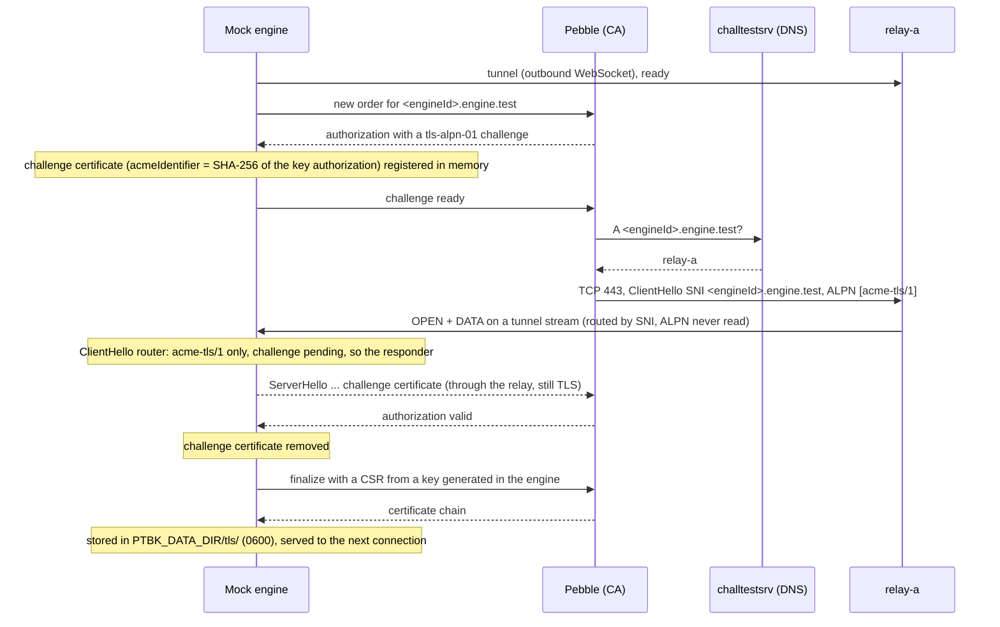

# Spike: ACME TLS-ALPN-01 through the passthrough relay

Task [M-03](../plan/tasks/M-03-acme-tls-alpn.md). It tests the spec's riskiest assumption (Residual risks 1): an engine reachable only through our SNI passthrough relay can obtain its own certificate with ACME TLS-ALPN-01, and nobody touches DNS for it.

## Result

**Works against Pebble** (`ghcr.io/letsencrypt/pebble:2.10.1`), automated in the e2e `acme` scenario. The relay was not changed. The DNS-01 fallback below is not needed for the flow itself.

**Still open: a real Let's Encrypt staging certificate.** It needs a public relay and public DNS (after I-01 and I-02). The [runbook](#runbook-lets-encrypt-staging-manual) below says how to run it. The spike criterion stays open until that run passes and its result is recorded here.

| Check (e2e `acme` scenario)                                                                                                                                                                                                            | Spec                                   |
| -------------------------------------------------------------------------------------------------------------------------------------------------------------------------------------------------------------------------------------- | -------------------------------------- |
| A fresh engine with `MOCK_CERT_SOURCE=acme` gets a Pebble certificate, and a browser that trusts only Pebble's root loads `/__spike/whoami` with it; a browser trusting only the dev CA is refused                                     | `tests/acme/issuance.spec.ts`          |
| An `acme-tls/1` connection with no challenge pending is closed before a byte comes back; browsers are still served                                                                                                                     | `tests/acme/issuance.spec.ts`          |
| With 90-second certificates the engine renews while an SSE stream is open: the stream carries on without a reconnect or a gap, and a new connection gets the new certificate                                                           | `tests/acme/renewal.spec.ts`           |
| A capture of relay-a's port 443 during a renewal shows Pebble's validation as TLS records in both directions, starting with a hello for the engine hostname offering only `acme-tls/1`; relay-a logs nothing about the engine hostname | `tests/acme/relay-routes-only.spec.ts` |

## The flow observed



- **Relay:** routed the validation connection by SNI like any browser. It parsed the ClientHello for routing only and never read ALPN (R-04). It never terminated TLS for the engine hostname and logged nothing about it: the relay logs no per-connection records by design, so relay-a's log shows no event naming the engine hostname during the window. The capture of relay-a's port 443 shows Pebble's connection as well-formed TLS records in both directions. Only the engine could have completed that handshake, because the challenge certificate and its key exist nowhere but in the engine's memory, and Pebble accepted it.
- **Engine:** the ClientHello router (`apps/mock-engine/src/adapters/client-hello-router.ts`) reads each stream's ClientHello with `@ptbk/protocol`'s parser. The parser needed no change. The router puts the bytes back and hands a hello offering exactly `acme-tls/1` for a hostname with a pending challenge to the responder. Any other `acme-tls/1` hello is closed, and everything else goes to the normal TLS server.
- **No DNS action from us:** the only DNS involved is the CA resolving the engine hostname, which in production is the engine domain's normal record pointing at the relays.

## Timing

Measured in the e2e `acme` scenario (local Docker, 2026-10-21, `PEBBLE_VA_NOSLEEP=1`), from the engine's own events:

| Step                                                      | Time  |
| --------------------------------------------------------- | ----- |
| First tunnel ready → order created                        | 14 ms |
| Order created → challenge valid (validation via relay-a)  | 42 ms |
| Challenge valid → certificate issued (finalize, download) | 20 ms |
| Failed attempts before the first certificate              | 0     |

The relay adds no measurable time: the validation is one more routed stream. Against Let's Encrypt, validation from several vantage points and its queueing dominate (seconds), and the 120 s issuance timeout leaves room for that. The renewal test (90-second certificates, renewal at 60 s) passed with the SSE stream unbroken across the renewal.

## Findings

- **Renewal under traffic:** certificates are chosen per handshake (`SNICallback`), so a renewal reaches the next connection, while open connections (SSE, WebSockets) carry on with the certificate they were opened with.
- **Authorization reuse:** Pebble ran with `PEBBLE_AUTHZREUSE=0`, so every renewal validated through the relay again. Let's Encrypt reuses valid authorizations for up to 30 days, so most real renewals skip validation. That is no reason to rely on it: a renewal after a reuse window must still work through the relay.
- **Which relay the CA reaches:** challtestsrv sends Pebble to relay-a only. Let's Encrypt validates from several vantage points, which may resolve the engine hostname to different relays. The engine must hold tunnels to every relay DNS returns at the time of validation, and relay per-IP limits must not throttle validators.
- **When to order:** the engine orders only once a relay reports the tunnel ready, because the CA validates through it. At startup, a validation that reaches a relay whose tunnel is not up yet fails and is retried with backoff (5 s doubling to an hour), while any stored certificate keeps being served.
- **CSR without a common name:** an engine hostname can exceed the common name's 64 characters, so the CSR carries SANs only.
- **acme-client:** it worked for the flow, but it is unmaintained (ADR 0014). Its types do not even list `tls-alpn-01` challenges, and it pulls in axios, node-forge and an older `@peculiar/x509`. It sits behind the `CertificateIssuer` port, so the engine team's production client replaces one file.

## Runbook: Let's Encrypt staging (manual)

Prerequisites: I-01 (relays on public addresses on port 443) and I-02 (the engine domain's public DNS pointing at them) are live. You also need a mock engine registered with them (or in the M1 mode with `PTBK_RELAYS` and a relay static registry entry for its key).

1. Pick a fresh data directory. Check that the engine hostname resolves publicly to the relays only: `dig +short <engineId>.<engine domain> A` from two networks, and `AAAA` too.
2. Start the engine against staging:
   ```sh
   PTBK_DATA_DIR=/var/lib/ptbk-acme-staging \
   PTBK_RELAYS=wss://<relay 1>,wss://<relay 2> \
   PTBK_ENGINE_DOMAIN=<engine domain> \
   MOCK_CERT_SOURCE=acme \
   PTBK_ACME_DIRECTORY_URL=https://acme-staging-v02.api.letsencrypt.org/directory \
   PTBK_ACME_EMAIL=<ops address> \
   node apps/mock-engine/dist/main.mjs
   ```
   Do not set `NODE_EXTRA_CA_CERTS`: staging's API has a publicly trusted certificate.
3. Watch for `tunnel.ready` for every relay, then `acme.order-created`, `acme.challenge-served` (one per validation connection; expect several, from different vantage points), `acme.challenge-valid` and `acme.certificate-issued`. On `acme.issue-failed`, note the `stage`. The engine never logs CA response text; the reason is in the failed authorization at the CA, readable with any ACME client that uses the same account key (`PTBK_DATA_DIR/acme/account-key.pem`).
4. Check the served certificate through each relay, by address:
   ```sh
   for ip in $(dig +short <engineId>.<engine domain> A); do
     openssl s_client -connect "$ip:443" -servername <engineId>.<engine domain> </dev/null 2>/dev/null \
       | openssl x509 -noout -issuer -subject -enddate
   done
   ```
   The issuer must be a staging intermediate (`(STAGING) ...`), the same certificate through every relay.
5. Check that the relays logged nothing about the hostname and hold no engine key (as X-02's key scan does), and that `PTBK_DATA_DIR/tls/` and `PTBK_DATA_DIR/acme/` are 0700 with 0600 files.
6. Record here: date, relay and engine versions, the timeline from step 3, the number of validation connections and which relays they reached (from the engine's `acme.challenge-served` count and the relays' traffic counters), and the issuer. Then tick the spike criterion in the plan.

Do not run it against Let's Encrypt production, and stay within staging's rate limits (one run takes one order).

## DNS-01 fallback (not needed so far)

If TLS-ALPN-01 fails through the relays in the real run, the fallback is DNS-01 through our DNS API, as Nabu Casa does it:

- The engine asks the dashboard, with an engine-signed request (`signingInput('ptbk-acme-dns01-v1', hostname, value, expiry)`), to set `_acme-challenge.<hostname>` TXT to the key authorization digest. The dashboard accepts only the engine's own hostnames: its default hostname, and custom hostnames with a verified claim.
- The dashboard sets the record through the DNS provider's API with a short TTL and removes it when the engine reports the authorization settled, or after a timeout.
- The engine keeps its key and certificate; only the TXT record passes through us.
- The cost: every issuance then needs DNS action by us. That weakens the "no DNS action from us" property in Residual risks, and a compromised dashboard could obtain certificates for engine hostnames (it still could not decrypt traffic, since it has no engine key, but it could impersonate the engine to a browser that reaches it some other way). CAA with `accounturi` limited to the engine's own account would close that hole, at the cost of customers managing CAA.
